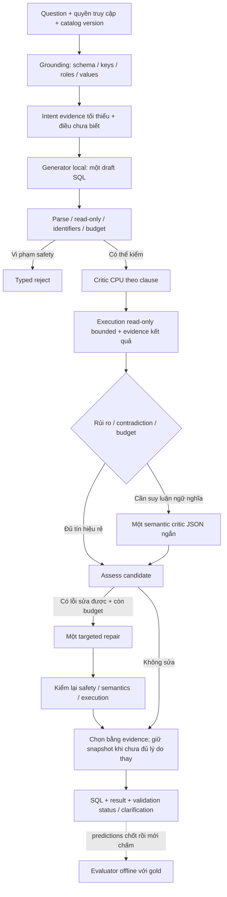

# Hướng nghiên cứu và kiến trúc phù hợp cho Agentic Text-to-SQL local

**Ngày cập nhật:** 2026-10-01, Asia/Bangkok.

**Cơ sở:** trao đổi mentor trong `small_chát.md`, các báo cáo so sánh, ledger, code/artifacts hiện có và paper gốc được kiểm tra lại.

**Trạng thái:** đề xuất nghiên cứu và thiết kế để review; chưa triển khai pipeline mới, chưa có benchmark mới. [`realistic_project_creation_codex.md`](realistic_project_creation_codex.md) vẫn là đặc tả và completion ledger canonical.

## 1. Quyết định phù hợp nhất lúc này

**Bạn đúng khi yêu cầu xem lại kiến trúc dành cho model nhỏ/vừa. Bản khuyến nghị trước đặt quá nhiều trọng tâm vào bổ sung correction cho P6 và đẩy việc thử model chuyên SQL quá muộn. Tôi sửa hướng nghiên cứu thành: giữ P6 làm đối chứng; nghiên cứu đồng thời về mặt thiết kế hai trục “kiến trúc phù hợp local” và “model chuyên Text-to-SQL”; triển khai và chạy từng thí nghiệm theo gate, không đổi tất cả cùng lúc.**

Kiến trúc đáng thử đầu tiên là:

> **Grounding có evidence → một lượt sinh SQL bản nháp → kiểm tra deterministic theo clause → execution read-only có giới hạn → critic ngữ nghĩa có điều kiện → tối đa một repair có mục tiêu → chọn candidate dựa trên evidence hoặc trả trạng thái chưa xác minh.**

“Có critic nhỏ lẻ” nên hiểu trước hết là **kiểm tra từng trách nhiệm nhỏ**, không phải mỗi clause có một agent/model riêng. SELECT, population, grain, JOIN, predicate, duplicate và ranking có thể được kiểm bởi các hàm CPU cùng một lượt AST; phần cần LLM gom vào một response ngắn. Đây là cách khai thác ý tưởng của SQLCritic mà vẫn kiểm soát chi phí.

Nghiên cứu model không nên chỉ là đổi Qwen 14B sang model lớn hơn. Một checkpoint 7B chuyên SQL có weights công khai, trước hết xem xét Arctic-Text2SQL-R1-7B hoặc OmniSQL-7B, đáng được đánh giá sớm với cùng cơ chế grounding/validation. Đó là một giả thuyết có cơ sở để thử, chưa phải kết luận model nào tốt nhất trên máy bạn.

Ý mentor và ý bạn có thể kết hợp: **audit toàn bộ cấu trúc để xác định bottleneck, sau đó thử một thiết kế khác được lựa chọn từ bằng chứng về small models**. Giữ baseline là giữ đối chứng và khả năng rollback; không có nghĩa mọi kiến trúc mới bắt buộc phải là một phụ kiện gắn vào P6.

Có ba điều cần giữ đúng trong cách nghĩ:

1. Local là cách triển khai; không tự quyết định khả năng model. Tham số, chuyên môn hóa, quantization, context, prompt và số lượt inference đều ảnh hưởng.
2. Có paper cho model nhỏ không bảo đảm luôn có kiến trúc tốt hơn cho repo này. Nhiều kết quả phụ thuộc training lớn hoặc nhiều samples; phải kiểm từng điều kiện.
3. Critic giúp tìm và sửa lỗi, nhưng không thể biết chính xác query thiếu một row trên mọi câu mới khi runtime không có đáp án chuẩn. Mục tiêu là giảm rủi ro có đo lường, không tuyên bố xác minh tuyệt đối.

**Hành động ngay:** làm một vòng review kiến trúc và failure audit offline, đồng thời viết protocol cho một generator 7B chuyên SQL. Không cần đợi toàn bộ nghiên cứu critic hoàn tất mới xem xét model. Việc inference thực tế vẫn tuần tự, qua pilot và resource guard.

### Cách đọc tài liệu

- Mục 2–3: hiện trạng và paper nào thật sự liên quan tới model nhỏ.
- Mục 4–7: kiến trúc đề xuất, SQLCritic, hidden output/attention, latency.
- Mục 8–10: audit, thí nghiệm chống overfitting, giáo án và hành động với mentor.
- Mục 11–12: resource safety, evidence và verification.

## 2. Hiện trạng đã kiểm tra, và những điều cần nói chính xác

### 2.1 Nhánh Git không đồng nghĩa một phương pháp đã được chứng minh

Đã kiểm tra `git branch -avv`, remote và `git ls-remote --heads origin`. Tại thời điểm đọc, các head local/remote tương ứng như sau:

| Nhánh | Commit rút gọn | Vai trò nên giữ |
|---|---|---|
| `baseline` | `0972e47` | P6 release, đối chứng lịch sử và nguồn dựng control |
| `practiq_paper1` | `e215356` | Lưu thí nghiệm reliability/clarification của Paper I |
| `research_paper2` | `899c262` | Lưu thí nghiệm DIN/proof/adaptive recovery của Paper II |
| `main` | `cebfeb1` | Nhánh tích hợp hiện có; tên `main` không chứng minh nó là cấu hình benchmark tốt nhất |
| Workspace đang đọc: `spider-schema-ablation-20260924` | `1f39654` | Nhánh local khảo sát schema coverage |
| Worktree `../Agentic_text_to_sql_spider700` | nhánh `spider-schema-resume700-20260924` | Chứa reports/predictions của legacy và coverage mới |

Remote được đối chiếu với [repository GitHub](https://github.com/HelcurtLordno1/agentic-ai-textsql-learn). Không checkout, reset, merge hay push trong lượt viết tài liệu này.

P6 report lịch sử xuất phát từ `1509faa`. Phép diff `1509faa..0972e47` trên `src`, `evals/configs`, `pyproject.toml`, `uv.lock` không có thay đổi; điều đó hỗ trợ dùng branch `baseline` làm điểm xuất phát. Tuy nhiên, vẫn phải khóa đầy đủ prompt/config/index/model khi dựng một control mới.

**Cách hiểu “thứ ba”:** tôi xem `comparison_new3_to_baseline_vn.md` là vòng báo cáo mới nhất. File này vẫn mô tả Paper II/R2 với intervention schema coverage; tên `new3` chưa chứng minh một paper khoa học thứ ba đã được triển khai. Nếu bạn chọn một paper mới, hãy ghi rõ tên paper, cơ chế lấy từ paper và cấu hình thử; không dùng số thứ tự báo cáo làm tên phương pháp.

### 2.2 Bảng kết quả cần dùng để ra quyết định

Các số Spider dưới đây đã được kiểm tra lại từ JSON report gốc, không chỉ đọc bảng Markdown:

| Hệ thống/cấu hình | Spider đúng / 200 | Easy / 107 | Medium / 53 | Hard / 29 | Extra / 11 | P50 / P95 mỗi prediction |
|---|---:|---:|---:|---:|---:|---:|
| P6 lịch sử | **130** | **83** | **27** | 16 | 4 | 58,51 / 85,29 giây |
| R2 legacy source-locked mới | 120 | 83 | 21 | 12 | 4 | 67,37 / 163,51 giây |
| R2 coverage-v2 | 128 | 80 | 26 | **17** | **5** | 69,89 / 156,86 giây |

Nguồn tổng hợp: [`comparison_new3_to_baseline_vn.md`](comparison_new3_to_baseline_vn.md). Report R2 cũ trong [`comparison_new2_to_baseline_vn.md`](comparison_new2_to_baseline_vn.md) cũng đạt 120/200, nhưng không được mặc định rằng cùng score là cùng prediction.

**Hiệu chỉnh câu bạn đã trao đổi với mentor:** coverage-v2 hơn P6 ở hard và extra-hard, mỗi nhóm một câu; **medium vẫn thấp hơn một câu**, 26 so với 27. Nếu gộp medium+hard+extra, R2 đạt 48/93 và P6 47/93, chỉ hơn một câu trong nhóm gộp. Đây là tín hiệu nhỏ, chưa đủ kết luận kiến trúc mới tốt hơn trên câu khó nói chung.

Olist phải báo riêng: P6 **57/60**; R2 adaptive recovery **58/60**, paired **+3/−2**. Bản 58/60 giữ prediction đúng qua nhiều revision và chạy lại failure; nó có giá trị chẩn đoán/recovery, **không phải fresh blind 60-case run**. Ba gain paired còn xuất phát từ incumbent ở lần suy luận khác, chưa quy được cho challenger. Paper I dừng ở **30/35**, cận trên full-suite **55/60**; không viết thành một score đã chạy đủ 60 case. Xem [evidence Paper I](docs/evidence/r1_olist_benchmark.md).

### 2.3 Điều số liệu cho phép và chưa cho phép kết luận

- R2 coverage tốt hơn R2 legacy **trong run quan sát**: 18 gain, 10 loss, net +8 câu, tức **+4 điểm phần trăm**.
- R2 coverage chưa vượt P6: 4 gain, 6 loss, net −2 câu, tức **−1 điểm phần trăm**.
- P6 và coverage có **124 cùng đúng, 66 cùng sai**. Đây là vùng cần phân tích để tìm gain vượt baseline.
- Theo audit schema trong báo cáo mới, **71/71 failure coverage có context đều nhận đủ bảng/cột mà gold SQL tham chiếu**. P6 cũng đã đạt 67/69 trên failure có context. Tăng recall đơn thuần không còn là ưu tiên lớn nhất trên tập này.
- Đủ bảng/cột không đồng nghĩa đủ mô tả, values, FK reasoning hoặc đúng semantic ownership; cũng không chứng minh model đã sử dụng đúng thông tin.
- Các dấu hiệu AST như khác aggregate, JOIN, DISTINCT có thể chồng lấn; SQL khác cấu trúc vẫn có thể đúng. Chưa được gọi các số đó là taxonomy root cause đã hoàn thành.
- Exact McNemar hai phía tính lại cho P6–coverage là **0,75390625**; legacy–coverage **0,18493334**. Chưa có bằng chứng thống kê mạnh về advantage; p-value này cũng không chứng minh equivalence.

Latency quan sát của R2 cao hơn P6, nhưng P6 lịch sử dùng sáu GPU layers còn R2 một layer, khác unload/cooldown/clock profile. Cần matched control an toàn trước khi quy chênh lệch cho thuật toán. Không dùng lại profile cũ chỉ để khớp tốc độ.

## 3. Paper cho model nhỏ/vừa: học kiến trúc, nhưng đọc đúng điều kiện

### 3.1 Ma trận chọn tài liệu

Bảng này là thứ tự tôi đề xuất cho project, không phải bảng xếp hạng accuracy. Kết quả giữa paper không so trực tiếp với Spider-200 của bạn.

| Paper / nguồn gốc | Model hoặc vai trò liên quan | Câu hỏi kiến trúc cần học | Ưu tiên cho repo |
|---|---|---|---|
| [RESDSQL, AAAI 2023](https://arxiv.org/abs/2302.05965) | T5 Base/Large/3B | Schema linking và SQL skeleton nên tách trách nhiệm thế nào? | Đọc để thiết kế representation |
| [CodeS, SIGMOD 2024](https://arxiv.org/abs/2402.16347) | 1B/3B/7B/15B chuyên SQL | Metadata, values và chuyên môn hóa giúp generator thế nào? | Đọc để thiết kế input |
| [DTS-SQL, Findings EMNLP 2024](https://arxiv.org/abs/2402.01117) | Model 7B với hai vai trò được fine-tune | Linker riêng và generator riêng có lợi khi nào? | Đối chiếu với planner/linker hiện có |
| [LitE-SQL, Findings EACL 2026](https://aclanthology.org/2026.findings-eacl.186/) | Generator 1,5B/3B/7B; retriever 0,6B | Pipeline gọn, retrieval có học và execution feedback | Đọc sâu, kiểm oracle-schema condition |
| [SLM-SQL, arXiv 2025](https://arxiv.org/abs/2507.22478) | 0,5B–1,5B; generation và merge revision | Candidate disagreement và correction có thể bù năng lực nhỏ thế nào? | Học routing, chưa sao chép sampling budget |
| [OmniSQL, PVLDB 18](https://www.vldb.org/pvldb/vol18/p4695-li.pdf) | 7B/14B/32B | Chuyên môn hóa từ dữ liệu tổng hợp, dùng weights sẵn | Ứng viên generator local |
| [Arctic-Text2SQL-R1, Findings ACL 2026](https://aclanthology.org/2026.findings-acl.1345/) | Có checkpoint 7B | Năng lực SQL có thể được đưa vào weights thay vì nhiều agent | Ưu tiên xem xét model challenger |
| [SQLCritic v4](https://arxiv.org/abs/2503.07996v4) | Critic 14B đã train | Phát hiện và giải thích lỗi theo clause | Đọc sâu cho validation/repair |
| [DAC, Findings EMNLP 2025](https://aclanthology.org/2025.findings-emnlp.22/) | Có thí nghiệm Llama3-8B | Feedback entities/skeleton thay cho self-check tự do | Control cho semantic critic |
| [ReEx-SQL, ACL 2026](https://aclanthology.org/2026.acl-long.35/) | Qwen2.5-Coder-7B | Feedback execution tương tác trong quá trình giải mã | Hướng nâng cao, chưa ưu tiên implementation |

### 3.2 Những gì thực sự rút ra từ từng nhóm

**RESDSQL:** ranking schema và sinh skeleton trước nội dung SQL; có NatSQL và beam search tám candidate. Đây là parser được huấn luyện, không phải hai prompt tự động tạo cùng năng lực. [Paper](https://arxiv.org/html/2302.05965v1), [code tác giả](https://github.com/RUCKBReasoning/RESDSQL).

**Đề xuất cho project:** dùng một representation ngắn về output/grain/operator và binding có nguồn. Nếu family đủ hẹp, compile representation thành SQL bằng code; nếu không đủ, cho generator sinh SQL tổng quát. Không ép mọi câu hỏi vào IR hiện thiên về Olist, và không mặc định thêm một LLM planner riêng là tốt hơn.

**CodeS:** chuyên môn hóa model kết hợp input gồm schema, metadata và database values; cấu hình generation của paper dùng beam bốn và chọn SQL executable. [Paper](https://arxiv.org/html/2402.16347v1), [code tác giả](https://github.com/RUCKBReasoning/CodeS).

**Đề xuất cho project:** không chỉ tăng số bảng/cột. Kiểm descriptions, FK roles, key uniqueness, units và values; đưa đúng evidence vào prompt gọn. Một giá trị được retrieve phải có column/permission/provenance. Đừng dùng “first executable” làm selector semantic: executable SQL vẫn có thể sai population.

**DTS-SQL:** tách schema linking và generation thành vai trò được fine-tune trên model nhỏ; lợi ích phụ thuộc training, không chỉ tên stage. [Paper](https://arxiv.org/html/2402.01117v1).

**Đề xuất cho project:** test linker có giúp đúng binding không; không lắp model linker riêng chỉ vì decomposition đẹp. Nếu linker loại nhầm một cột cần thiết, generator không có cách cứu. Giữ expansion/fallback có giới hạn khi binding chưa chắc.

**LitE-SQL:** retriever Qwen3-Embedding-0,6B được tune, generator Qwen2.5-Coder được SFT/RFT; training dùng bốn A100. **Bảng 1 dùng correct schema:** 72,10% BIRD-dev và 88,45% Spider-test. **Bảng 2 overall với retriever:** 60,56% và 84,35%; retriever+SFT là 58,21% và 83,56%. Không dùng bảng 1 làm độ chính xác pipeline tự động. [PDF, bảng 1–2 và limitations](https://aclanthology.org/2026.findings-eacl.186.pdf), [code tác giả](https://github.com/shengminp/LitE-SQL).

**Đề xuất cho project:** pipeline gọn và evidence context đáng học. Nhưng phần repair theo lỗi execution không giải quyết đầy đủ SQL chạy được mà sai nghĩa; critic semantic vẫn là câu hỏi nghiên cứu riêng. Model embedding và generation phải chạy tuần tự theo guard của laptop; không biến mỗi request thành vòng embedding–generation–embedding không có ngân sách.

**SLM-SQL:** SFT/RL, execution-based voting và merge revision; mặc định **64 generation samples**, merge revision **tám samples**. BIRD-dev 1,5B đạt 67,08%; giảm generation xuống 16 còn 64,84%; bỏ corrective self-consistency còn 61,95%. Đây không phải accuracy một lượt gọi của model 1,5B. [Paper, bảng 4 và Appendix B/D](https://arxiv.org/html/2507.22478v1), [code tác giả](https://github.com/CycloneBoy/slm_sql).

**Đề xuất cho project:** candidate bất đồng có thể kích hoạt kiểm tra sâu; agreement chỉ là signal, không là proof. Trên laptop, nếu thử diversity, giới hạn hai candidate ở một route riêng và đo headroom trước. Biến thể hai candidate này là thiết kế mới của project, không gọi là tái hiện SLM-SQL.

**OmniSQL:** weights 7B/14B/32B và SynSQL-2.5M, có training data Spider/BIRD; paper phân biệt greedy với voting. Model card nêu SQLite, template SQL code block và inference có reasoning. [Paper](https://www.vldb.org/pvldb/vol18/p4695-li.pdf), [checkpoint 7B và template chính thức](https://huggingface.co/seeklhy/OmniSQL-7B).

**Đề xuất cho project:** dùng checkpoint đã học chuyên môn là cách chuyển chi phí training ra khỏi laptop. Kiểm license, provenance, template và quantization; chưa được coi checkpoint là drop-in cho provider ép JSON hiện tại. Đo riêng tiếng Việt; kết quả trên benchmark tiếng Anh không tự chuyển sang nghiệp vụ tiếng Việt.

**Arctic-Text2SQL-R1:** chuyên môn hóa bằng SFT/RL, reward dựa vào execution/syntax. Paper báo đánh giá single-inference greedy trừ chỗ ghi khác; bảng 5/model card 7B có BIRD-dev 68,9%, Spider-test 88,8%. Đã xác nhận weights 7B công khai, Apache-2.0. [Paper](https://aclanthology.org/2026.findings-acl.1345.pdf), [checkpoint tác giả](https://huggingface.co/Snowflake/Arctic-Text2SQL-R1-7B).

**Đề xuất cho project:** đây là ứng viên hợp lý để kiểm tra sớm giả thuyết “model chuyên SQL nhỏ hơn có thể cho first-pass tốt hơn Qwen hiện tại”. Điểm paper chưa dự báo điểm trên repo, phiên bản quantized hoặc latency máy bạn. Giữ model-specific format/reasoning budget rõ ràng; không khóa `think=False`/JSON rồi kết luận checkpoint kém nếu adapter trái template được train.

**DAC:** so entities và skeleton; có thí nghiệm local Llama3-8B, Spider EX 70,7 few-shot, 72,1 Self-Debug và 75,0 DAC trong setting tác giả. [Paper](https://aclanthology.org/2025.findings-emnlp.22.pdf).

**Đề xuất cho project:** dùng feedback phân rã làm đối chứng với critic theo clause; không hứa cùng gain trên Qwen. Mục tiêu là xem feedback cụ thể có hơn self-reflection khi budget bằng nhau không.

**ReEx-SQL:** dùng model 7B được train để khai thác execution feedback tương tác khi giải mã; tree exploration có yêu cầu inference riêng. [Paper](https://aclanthology.org/2026.acl-long.35.pdf).

**Đề xuất cho project:** học ý tưởng evidence sớm trong quá trình tạo SQL, nhưng chưa đổi decoding backend hoặc đào tạo lại model. Pipeline bounded ngoài model có thể nghiên cứu trước; đó không phải reproduction ReEx-SQL.

Với mọi checkpoint, pin revision/digest thực sự sử dụng. Weights đang công khai trên Hub không tự bảo đảm tái hiện đúng checkpoint/config của một bảng trong phiên bản paper mới hơn; quantized conversion lại là một biến thể cần ghi rõ.

### 3.3 Cách đọc SQLCritic mà không đánh giá quá cao một prompt critic

**SQLCritic v4 dùng Qwen2.5-14B được SFT và CriticDPO trên bốn A100 80GB; bước refinement dùng GPT-3.5-turbo.** Với CodeS-7B, All-SQLs EX tăng 57,17→59,34 trên BIRD, 83,4→84,6 trên Spider; extra-hard giảm 65,7→65,1. Bảng 4 còn cho thấy prompted clause-wise critique làm GPT-4o giảm 49,87→47,97, trong khi trained SQLCritic đạt 54,58. CPS đo critique, không phải EX hay xác suất SQL đúng. [SQLCritic v4, §4 và Appendix B](https://arxiv.org/html/2503.07996v4).

**Suy luận cho project:** cấu trúc critique theo clause là ý tưởng tốt để kiểm thử, nhưng critic chưa train có thể phá query đúng. “Generator 7B” trong paper không làm toàn hệ thống thành pipeline 7B local. Chưa xác minh được checkpoint critic chính thức có thể tải và dùng ngay trong lượt nghiên cứu này; không coi package trùng tên là model của paper.

Học SQLCritic ở ba mức:

1. **Làm được sớm:** taxonomy clause, evidence references, output critic có cấu trúc, đánh giá detection và repair riêng.
2. **Cần pilot:** dùng model local hiện tại làm semantic critic ngắn; sau đó mới xét critic 3B/7B khác nếu có checkpoint/phương án phù hợp. Đây là adaptation, không tái hiện trained SQLCritic.
3. **Để sau:** huấn luyện critic bằng reviewed correct/incorrect examples và preference data. Không mặc định laptop đáp ứng training; không đưa API/training cluster thành dependency của core.

### 3.4 Cách chọn kiến trúc từ literature

Mỗi paper cần một “thẻ phương pháp” một trang: role/model size; data/training; input có oracle không; candidate/call/token budget; backend/hardware; benchmark split; ablation; weights/license; module có thể chuyển; thử nghiệm nào có thể bác bỏ lợi ích.

Đối với project này, ưu tiên **RESDSQL/CodeS/LitE-SQL để thiết kế trách nhiệm và input**, **Arctic/OmniSQL để kiểm khả năng generator**, **SQLCritic/DAC để thiết kế feedback**. SQLens hữu ích cho evidence detection nhưng dùng Claude 3.5 và có classifier/auditor overhead; không còn là nền kiến trúc ưu tiên chỉ vì câu chuyện critic hấp dẫn. [SQLens, methodology/limitations](https://arxiv.org/html/2506.04494v1).

Đừng biến kết luận thành “small model phải nhiều agent”. Giảm số quyết định khó mà model phải tự suy ra, cung cấp evidence đúng và chuyên môn hóa weights đều đáng thử; thêm agent có thể tăng lỗi truyền giữa stage và latency. Phải so topology ít stage với topology phân rã ở cùng ngân sách.

## 4. Kiến trúc nên thử: model làm ít việc hơn, hệ thống giữ evidence rõ hơn

Phần này là **thiết kế đề xuất cho repo**, tổng hợp từ literature và inspection code; chưa phải hệ thống đã có hoặc đã được chứng minh tốt hơn P6.

### 4.1 Phân biệt kiến trúc phần mềm và số lượt gọi LLM

Sáu layers trong ledger vẫn có giá trị tổ chức code. Nhưng sáu layers không đòi hỏi sáu LLM calls. Router, schema retrieval, AST normalization, safety, execution, nhiều semantic checks và selector có thể là code deterministic.

Hai topology cần so sánh:

| Topology | Cách vận hành | Giả thuyết cần kiểm |
|---|---|---|
| **A1 — ít call, ưu tiên thử** | Grounding bằng code; generator nhận question/evidence, sinh draft; kiểm tra; optional critic/repair | Model local được lợi khi bớt intermediate text và lỗi lan từ plan |
| **A2 — planner tách riêng, có điều kiện** | Chỉ câu cần decomposition mới dùng một plan ngắn riêng rồi generation | Plan độc lập giúp câu khó đủ để bù thêm latency và rủi ro hiểu sai |

Không chọn A1 chỉ vì ít call, và không chọn A2 chỉ vì “agentic” hơn. So chất lượng first-pass, after-repair và chi phí. Một candidate đã mang operator/shape hypothesis không được xem là plan độc lập được xác minh.

### 4.2 Pipeline A1 đề xuất



Parser/identifier errors có thể đi vào repair eligibility mà chưa execution. Diagram mô tả các trách nhiệm chính; controller phải xử lý lỗi và ngân sách ở mọi transition, không cố đi hết pipeline khi đã fail.

**Grounding:** ưu tiên đúng ownership/role hơn chỉ đủ tên bảng/cột. Một schema item nên có type, key/FK role, description ngắn, metric unit, value evidence nếu cần. Giữ join paths cần thiết và cách mở rộng có kiểm soát; không prune quá mạnh chỉ để prompt ngắn.

**Intent evidence:** lấy trực tiếp từ question và metadata được review: projection được hỏi, scalar/list/grouped, population, grouping, top-k/ties, exclusion và time range. Cái chưa rõ giữ UNKNOWN. Evidence này có trước hoặc được xác nhận độc lập với draft; các hypothesis do generator viết kèm cần kiểm lại.

**Generator:** dùng một candidate trước, output contract ngắn. Với model đã train SQL code block, adapter trích SQL theo template gốc; không thêm một LLM call chỉ để đổi code block sang JSON. Reuse parser và validation để có typed candidate.

**Critic/repair:** semantic critic chỉ nhận evidence đã chọn, question và SQL/AST/result summary có giới hạn; không nạp toàn bộ trace. Feedback phải chỉ ra lỗi nào, evidence nào và clause nào; repair tối đa một candidate mới.

**Final output:** render từ execution result và validation status. Nếu chỉ cần hiển thị bảng, không thêm một LLM summarizer mặc định. Nếu sau này có diễn giải bằng LLM, đó là ngân sách và evaluation riêng cho việc không bịa số liệu.

### 4.3 Contract tối thiểu để kết nối các stage

Tận dụng typed contracts hiện có, chỉ bổ sung khi thiếu trách nhiệm thật:

| Contract đề xuất | Nội dung cần có | Điều phải giữ |
|---|---|---|
| `IntentEvidence` | Question spans, output shape, population/grain hypothesis, bindings, ambiguity, evidence refs | Tách asserted requirement khỏi model hypothesis |
| `CandidateSnapshot` | SQL trước safety rewrite, SQL execution, AST/fingerprint, catalog hash, result metadata | Snapshot immutable; không mutate incumbent trong repair |
| `ClauseAssessment` | Clause/AST path, obligation, evidence, verdict, severity, check scope | `SUPPORTED`, `CONTRADICTED`, `UNKNOWN`; không tự biến thành accuracy |
| `RepairProposal` | Lỗi mục tiêu, sửa operator/binding nào, candidate mới, affected obligations | Không chỉ “hãy làm lại tốt hơn” |
| `DecisionRecord` | Candidate chọn, lý do, validation status, calls/tokens/time còn lại | Reproducible và không dùng gold runtime |

`SUPPORTED` chỉ có nghĩa evidence hỗ trợ một nghĩa vụ trong scope; không phải chứng nhận cả SQL đúng. Không nhất thiết lưu reasoning dài; lưu nghĩa vụ và evidence đủ cho review.

### 4.4 Compiler giúp model nhỏ ở đâu?

Với family rõ như single-entity count, projection có binding chắc hoặc aggregate theo một grain đã xác định, model có thể chọn operator/column trong contract, compiler viết SQL. Compiler có thể tránh lỗi cú pháp, aliases và một số cấu trúc lặp.

Nhưng compiler không sửa intent sai. Chọn `COUNT(order)` khi người dùng hỏi customer thì SQL compile hoàn hảo vẫn sai. Chỉ support operator đã có semantic contract và fixtures; chưa support thì đi general SQL route hoặc clarify theo scope. Không áp một grammar hẹp làm câu mới bị unsupported hàng loạt.

Vòng đầu không cần xây compiler đầy đủ. Viết fixtures và so **direct SQL generation** với **compact operator representation** cho một family đã review. Nếu IR làm model nhỏ khó xuất hợp lệ hơn hoặc giảm coverage, đó là lý do reject variant.

### 4.5 Những chỗ trong repo phải review trước khi viết mới

- [`ollama_provider.py`](src/agentic_text2sql/adapters/llm/ollama_provider.py) hiện ép structured output, `think=False`, `num_ctx=4096`, temperature/seed và có malformed-response retry. Cần kiểm format/native template cho checkpoint mới và tổng call thực; không coi “một service call” là một inference chắc chắn.
- [`settings.py`](src/agentic_text2sql/settings.py) có `ollama_num_gpu` mặc định `None`; provider chỉ thêm `num_gpu` khi setting khác None. Guarded runner phải đảm bảo explicit bounded setting trước mọi model request. Chưa được nói defaults đã bảo đảm điều đó.
- [`planning.py`](src/agentic_text2sql/contracts/planning.py), [`semantics.py`](src/agentic_text2sql/contracts/semantics.py), [`trace.py`](src/agentic_text2sql/contracts/trace.py) là nơi reuse contracts/budget. Có field ngân sách chưa chứng minh mọi provider retry/stage cùng tuân thủ global budget.
- [`result_validator.py`](src/agentic_text2sql/layer4_validation/result_validator.py) đang dựa vào logical plan để kiểm shape; cần kiểm nguồn intent trước khi tăng enforcement.
- [`champion_challenger.py`](src/agentic_text2sql/layer6_application/champion_challenger.py) là seam selection đã có. [`layer3_generation/selector.py`](src/agentic_text2sql/layer3_generation/selector.py) chỉ là scaffold, không phải selector thực tế.
- [`service_factory.py`](src/agentic_text2sql/layer6_application/service_factory.py) yêu cầu semantic catalog cho shadow/enforce. Spider hiện không có catalog/proof certification tương ứng; reuse code cần capability review, không bật flag rồi coi đã có semantic proof.

Giữ P6 control riêng, khóa dependencies/config. “Incumbent” do factory hiện tại dựng chia sẻ grounding hiện tại; `planning_mode="baseline"` chưa đủ để gọi là frozen P6. Trong A1, fallback đầu tiên là draft hợp lệ đã giữ trong cùng invocation. **Không mặc định chạy lại toàn bộ P6 sau A1**, vì vừa tăng latency vừa không bảo đảm giống output lịch sử.

## 5. Critic và guardrail: cụ thể để bắt thừa/thiếu rows, columns

### 5.1 Bốn chức năng phải được đo riêng

| Chức năng | Trách nhiệm | Hành vi hợp lý |
|---|---|---|
| Safety guard | Read-only, quyền, tài nguyên, SQL policy | Vi phạm thì block/stop |
| Deterministic semantic critic | Đối chiếu AST/keys/shape với nghĩa vụ có evidence | Contradiction hoặc UNKNOWN; không đoán chắc |
| LLM semantic critic | Hiểu quan hệ giữa question, evidence và SQL khi code chưa đủ | Một assessment ngắn, có thể sai; cần evaluation |
| Repair và selector | Sinh một thay đổi, kiểm lại, chọn/không chọn | Không promote chỉ vì executable/confident |

Guardrail an toàn và semantic critic giải quyết các lớp vấn đề khác nhau. Tăng semantic warnings không có nghĩa tăng mức reject; cần đo false positives. Việc bạn từng bị hủy nhiều output khi yêu cầu “100%” là lý do cần trạng thái có scope, thay vì một confidence threshold không được hiệu chuẩn.

### 5.2 Các critic nhỏ nên kiểm điều gì?

| Critic | Đối chiếu chính | Có thể phát hiện | Giới hạn cần nhớ |
|---|---|---|---|
| **Projection/ownership** | Requirement ↔ SELECT expressions ↔ column owners | Thừa/thiếu attribute, lấy tên từ sai entity, sai metric | Số cột đúng chưa đủ; ý định có thể mơ hồ |
| **Population/existence** | Entity được hỏi ↔ FROM/JOIN/WHERE/EXISTS | Mất entity vì INNER JOIN, tự thêm filter, sai “không có” | Không suy ra đúng row count chỉ từ AST |
| **Grain/aggregation** | Entity key ↔ GROUP BY ↔ aggregate lineage | Đếm record thay entity, group theo tên trùng, AVG sai cấp | Grain hypothesis phải có evidence |
| **Join/fan-out** | Join role, unique keys, metric nguồn | SUM bị nhân, JOIN sai role hoặc không cần thiết | FK không bao phủ mọi join; sample không chứng minh uniqueness |
| **Duplicate/null/set** | Bag/set semantics, DISTINCT, NULL, ANY/ALL | DISTINCT che fan-out, NOT IN bị NULL, OR thay AND | Không thêm DISTINCT hay NOT EXISTS máy móc |
| **Predicate/value/time** | Span câu hỏi ↔ literal/column/unit/time bounds | Sai mã, predicate phủ định sai, biên ngày sai | Value lookup cần bounded và authorized |
| **Ranking/shape** | Top-k/ties/scalar/list ↔ outer ORDER/LIMIT | LIMIT sai k, sort sai hướng, scalar ra nhiều rows | Tie policy chưa rõ thì UNKNOWN; preview limit không là logical LIMIT |

Cài các critic CPU như modules cùng dùng một AST/catalog, không mỗi module một request LLM. Các lỗi phân tán SELECT/WHERE/GROUP BY có thể cùng một root cause; feedback nên ưu tiên nguyên nhân, không sửa từng clause độc lập mà làm query mất nhất quán.

Một assessment minh họa, không phải contract đã triển khai:

```json
{
  "verdict": "CONTRADICTED",
  "checks": [
    {
      "kind": "population_exclusion",
      "clause": "WHERE",
      "question_span": "không có đơn hàng nào đã thanh toán",
      "ast_path": "where.this",
      "evidence_refs": ["question:span-1", "catalog:orders-customer-fk"],
      "finding": "Predicate trên từng order không thực hiện absence của paid order",
      "suggested_operator": "NOT EXISTS",
      "scope": "interpretation đã được review"
    }
  ],
  "unchecked": ["business meaning of status codes"]
}
```

Không bắt LLM phát minh proof hoặc fill tất cả fields khi không có evidence. Verdict của LLM không tự trở thành verdict của controller; controller kiểm refs, consistency và capability.

### 5.3 Thừa/thiếu columns: bắt dễ hơn thừa/thiếu rows, nhưng vẫn cần intent

Ví dụ hỏi “tên khoa và số sinh viên” thì projection logic cần hai attributes, một tên khoa và một count. SELECT thêm department ID có thể cần để debug/grouping nhưng không nhất thiết được xuất cho người dùng. Group theo ID và SELECT tên có thể đúng nếu key semantics hỗ trợ; không ép `GROUP BY name` chỉ để giống projection.

Kiểm hai tầng: **SQL projection đúng nghĩa** và **presentation trả đúng fields**. Đừng tùy tiện bỏ cột sau execution để che SQL sai hoặc làm benchmark qua; nếu presentation projection là tính năng sản phẩm, phải có mapping rõ và giữ candidate SQL gốc trong trace.

Nếu logical plan nói scalar nhưng câu hỏi yêu cầu danh sách, validator dựa vào plan sẽ báo nhầm. Question requirement phải được review/kiểm độc lập; cùng model viết plan sai rồi xác nhận SQL theo plan sai là validation vòng tròn.

### 5.4 Thừa/thiếu rows: tìm lỗi tạo tập kết quả, không đoán số dòng đúng

Runtime không có expected result nên thường không biết chính xác thiếu một dòng. Cần kiểm **nguyên nhân**: population bị thu hẹp, fan-out, DISTINCT sai, logic existence, time boundary, ties, NULL hoặc LIMIT không được yêu cầu.

Question synthetic: “Liệt kê khách hàng không có đơn hàng nào đã thanh toán.”

```sql
-- Sai: khách có cả paid và unpaid vẫn được chọn; khách chưa có order bị mất.
SELECT DISTINCT c.id, c.name
FROM customers AS c
JOIN orders AS o ON o.customer_id = c.id
WHERE o.status <> 'paid';

-- Phù hợp với interpretation đã nêu.
SELECT c.id, c.name
FROM customers AS c
WHERE NOT EXISTS (
    SELECT 1 FROM orders AS o
    WHERE o.customer_id = c.id AND o.status = 'paid'
);
```

Fixture cần ít nhất: A có paid+unpaid, B không có order, C chỉ unpaid; expected là B và C. Thêm case NULL và câu đối lập “có ít nhất một đơn chưa paid”. Rule dựa vào từ “không” sẽ không đủ generalize.

Fan-out fixture: một order có hai item và ba payment rows. Join hai nguồn raw có thể tạo sáu rows, nhân SUM item. `SUM(DISTINCT price)` không sửa tổng quát vì hai item khác nhau có thể cùng giá. Kiểm grain rồi pre-aggregate riêng, nếu đúng business requirement.

**Bằng chứng dữ liệu chỉ được query khi rẻ và hợp lệ:** ví dụ bounded existence probe hoặc kiểm lineage. COUNT toàn bảng có thể quá đắt và không tự cho biết expected answer. Mọi auxiliary query cũng phải qua read-only, timeout, query-count/resource budget và quyền; không để critic tạo một workload DB không giới hạn.

**Result rỗng chưa là lỗi.** Hai candidate cùng trả rỗng có thể đồng thuận sai; result preview vài dòng không thể chứng minh row completeness. Phải giữ `truncated`, cap và phạm vi evidence. SQL gốc có semantic LIMIT khác LIMIT do safety/presentation thêm; so chúng riêng.

### 5.5 Fallback và admission policy

| Tình huống | Hành vi đề xuất |
|---|---|
| Write/unauthorized/resource breach | Dừng hoặc reject; không gọi model khác để bypass |
| Parser/identifier error, còn budget | Một repair đủ evidence; không auto-execute candidate lỗi |
| Contradiction chắc, repair hợp lệ và giải đúng nghĩa vụ | Có thể select sau revalidation các nghĩa vụ bị ảnh hưởng |
| Chỉ có warning/LLM opinion, evidence chưa đủ | Giữ snapshot an toàn, gắn semantic uncertainty theo product mode |
| Repair sai, timeout hoặc hết budget | Không thêm vòng; giữ candidate hợp lệ trước đó nếu policy cho phép |
| Candidate có contradiction chưa giải được | Return outcome chưa xác minh/clarify theo mode; không gắn nhãn “đã kiểm đúng” |
| Ambiguity thật hoặc unsupported operator/schema | Clarify/unsupported có lý do; tính coverage và denominator rõ |

Trong benchmark answerable, protocol có thể yêu cầu chọn best-effort SQL để chấm; không dùng abstention để bỏ câu khó khỏi mẫu số. Trong ứng dụng, policy auto-execute khác với việc lưu một draft cho review. Giữ snapshot bảo đảm không bị mất candidate bởi optional stage; không bảo đảm candidate đó đúng.

Selector không nên dùng “nhiều rows hơn”, “gần draft hơn”, “critic chấm 95%” hoặc một AST pattern như proof tổng quát. Hai candidate khác nhau nhưng cùng answer trên một DB chỉ là tín hiệu; chọn sai vẫn có thể xảy ra.

### 5.6 Đánh giá critic trước khi cho sửa output

Shadow trên cả query đúng và sai, gồm đúng nhưng SQL khác cấu trúc gold. Báo detection precision/recall/FPR, localization quality, UNKNOWN, runtime-detectable coverage, critic latency; sau đó mới báo repair success và correct→wrong regressions.

Model critic và generator dùng cùng checkpoint có thể mắc lỗi tương quan. Một role prompt mới không tạo reviewer độc lập. Model critic nhỏ hơn cũng không tự chính xác hơn; “14B generate + 3B judge” chỉ hợp lý nếu 3B có năng lực critic được kiểm chứng và tổng latency kể cả reload tốt hơn.

Training critic, nếu làm về sau, cần examples đúng lẫn sai, independent reviewer và split theo schema/family. Synthetic corruptions giúp phủ lỗi nhưng không thay mọi lỗi thực. Không dùng toàn bộ Spider-200 exposed để train rồi công bố tăng benchmark như generalization.

## 6. Hidden output và attention: chuyển ý tưởng của bạn thành thứ có thể kiểm

### 6.1 Cái gì thật sự có thể kiểm trước khi trả kết quả?

Nếu “hidden output” của bạn là **SQL bản nháp, compact intent, AST, evidence và preview chưa hiển thị**, ý tưởng kiểm trước final output hoàn toàn hợp lý. Ta chủ động tạo và giữ chúng thành typed artifacts trong pipeline.

Nếu bạn nói đến **hidden states hoặc attention tensors bên trong transformer**, đó là một bài toán model/backend khác. Provider hiện tại chỉ dùng `/api/chat`; API công bố message và telemetry, không expose hidden-state/attention tensors cho pipeline này. JSON schema ép cấu trúc response, không ép SQL đúng nghĩa. [Ollama chat API](https://docs.ollama.com/api/chat).

Không cần thu thập hay hiển thị chain-of-thought dài để làm critic. Evidence ngắn “question span → requirement → binding → SQL clause → check result” hữu ích hơn cho reproducible review.

### 6.2 Attention có vai trò, nhưng không là bộ chấm semantic

Attention trong model đã có giúp xử lý quan hệ giữa tokens khi inference. Thêm quan hệ schema/keys trong input hoặc dùng model được train representation phù hợp có thể là hướng nghiên cứu; nhưng tăng attention weight tới một token không chứng minh SQL thực hiện đúng intent. Nghiên cứu về attention cũng cảnh báo không đồng nhất attention weights với lời giải thích đáng tin. [Attention is not Explanation, NAACL 2019](https://aclanthology.org/N19-1357/).

Ở project hiện tại, cách kết nối input với draft phù hợp nhất là **evidence alignment tường minh**:

```text
“khách hàng không có đơn paid”
    → population = customers; absence = paid order
    → customer.id ↔ order.customer_id; value paid ↔ reviewed status meaning
    → obligation: NOT EXISTS theo đúng scope
    → AST / bounded execution evidence
    → assessment có thể được reviewer kiểm lại
```

Gọi đây là alignment/semantic obligations, không gọi là “đã sửa attention của model”. Muốn nghiên cứu neural attention/schema encoder thật sự cần weights/backend/trainable implementation và protocol riêng, ngoài phạm vi thêm một Ollama critic prompt.

## 7. Tối ưu latency: thiết kế budget trước, rồi mới thêm intelligence

### 7.1 Dự toán theo đường đi, không theo số lượng agent

Một mô hình chi phí khởi đầu:

```text
E[T] ≈ T_ground + T_generation + T_checks + T_DB
       + p_critic × T_critic
       + p_repair × T_repair
       + E[T_load/unload/model_switch]
```

Đây là dự toán trung bình, không tính P95 bằng cách cộng trung bình hoặc cộng P95 các stage. Cần đo end-to-end distribution và từng route. Một model nhỏ sinh reasoning dài hoặc sampling nhiều có thể chậm hơn model lớn hơn sinh SQL ngắn.

**Budget đề xuất cho pilot A1, chưa thay config hiện hành:**

| Route | Calls thực tối đa dự kiến | Hành vi |
|---|---:|---|
| SQL đủ evidence, checks rẻ không có signal | 1 | Generate → checks/execution → output |
| Lỗi deterministic có feedback rõ | 2 | Generate → targeted repair → checks |
| Cần semantic critic nhưng không sửa | 2 | Generate → critic → output/status |
| Cần critic và repair | 3 | Generate → critic → repair → checks |

**Hard cap đề xuất A1 là ba generation requests thực**, gồm malformed JSON retry, critic, repair và fallback. Nếu một stage dùng retry, budget còn lại giảm; không cho mỗi agent một budget riêng. Một retry format không được tạo loophole gọi lần thứ tư. Chỉ tối đa một repair candidate; retry có thể làm route dừng sớm.

A2 có LLM planner riêng là một treatment riêng; cần chốt budget tương ứng và so với A1 ở ngân sách hợp lý. Không thêm planner vào A1 trong im lặng rồi giữ lời hứa “ba calls”. Cấu hình budget hiện có trong trace không được tự đổi bởi tài liệu này.

### 7.2 Tối ưu thứ tự nào?

1. **Giảm calls không cần:** test bỏ planner LLM mặc định, không thêm summarizer, gom clause critique vào một call.
2. **Input ngắn nhưng đủ evidence:** descriptions/values liên quan, join role rõ; kiểm truncation prompt cuối trước khi đổ lỗi context.
3. **Giới hạn output/reasoning:** budget riêng generator/critic/repair; đo truncation/format failures. SQL specialist có thể cần native reasoning, không áp output cap khiến câu khó bị cắt rồi coi là năng lực kém.
4. **Routing dựa vào runtime signals:** ambiguity, unsupported binding, AST fan-out/exclusion/ties, contradiction/uncertainty. Không dùng gold complexity hay execution mismatch của evaluator làm trigger.
5. **Cache CPU/catalog/index đúng version và quyền:** không cache saved benchmark answers làm runtime; invalidation theo schema/data/permission phải rõ.
6. **Chỉ cân nhắc thêm model critic khi có lợi tổng thể:** đo load/unload, memory và token latency. Ban đầu reuse cùng checkpoint ở role critic, cộng deterministic modules, tránh tải hai generation models cho mỗi câu.

Risk router cũng có blind spots. Chỉ gọi critic ở câu “trông phức tạp” có thể bỏ qua query đơn giản mà sai WHERE. Đánh giá recall của routing trên query sai và false routing trên query đúng; dùng một sample ngẫu nhiên ở chế độ shadow để ước lượng lỗi bị bỏ sót. Không cho sample audit thay đổi routing cuối giữa benchmark.

### 7.3 Production là trade-off cần chốt, chưa là trạng thái project

P6 lịch sử đã P95 khoảng 85 giây; hiện chưa có cơ sở hứa một critic mới đạt SLA 10 hay 30 giây trên laptop. R2 P95 cao hơn còn bị confound profile phần cứng. Đặt một SLA mong muốn trước, rồi đánh giá feasibility bằng profile an toàn.

Nên báo đường cong **accuracy – coverage/abstention – latency – resource**, không chỉ accuracy. Nếu mọi câu nhanh đều đúng nhưng câu khó timeout/abstain, vẫn phải báo toàn bộ denominator. Unknown không tự thành failure trong UX, nhưng benchmark cần protocol cố định.

Với máy này, thời gian benchmark gồm cooldown/unload khác prediction service time; cả hai cần báo. Chưa tuyên bố production throughput ổn định nếu chưa đo dưới policy an toàn. Không bỏ cooldown/offload bound để có biểu đồ đẹp. Nếu an toàn không cho đạt SLA, kết luận là giới hạn deployment hiện tại và tiếp tục tối ưu topology/model, không làm nhẹ policy an toàn.

### 7.4 Tinh chỉnh riêng cho RTX A4500 Laptop 16 GB

**Thiết kế cho máy của bạn là inference quantized, ít calls và offload có kiểm soát; không tái hiện training A100 của paper.** Ledger ghi i7-12800H/20 logical CPUs, RTX A4500 Laptop 16 GB và WSL được cấp 24 GB RAM. NVIDIA cũng liệt kê bản A4500 laptop 16 GB; TGP tùy hệ thống, không lấy thông số A4500 desktop hoặc công suất trên datasheet làm ngưỡng vận hành của chiếc máy này. [NVIDIA professional laptop GPU line card](https://images.nvidia.com/aem-dam/en-zz/Solutions/design-visualization/documents/proviz-rtx-mobile-line-card.pdf).

**16 GB là capacity vật lý; resource envelope được phép hiện tại nhỏ hơn.** Default long-run vẫn VRAM <6 GiB, power <70 W, nhiệt <68°C, RAM available ≥14 GiB và swap <0,25 GiB. Profile Spider đã dùng còn chặt hơn: VRAM <4 GiB và nhiệt <65°C. Không tăng giới hạn để vừa model; giảm offload/model/context hoặc trả kết luận chưa feasible.

#### Model và bộ nhớ

| Thành phần | Lựa chọn khởi đầu | Cách kiểm |
|---|---|---|
| Generator challenger | Một SQL-specialist 7B, xem xét GGUF Q4_K_M có provenance và template rõ | Pin weights/conversion/backend; one-case pilot riêng trước suite |
| Qwen hiện tại | Giữ Qwen3-14B Q4 làm control; digest đã pin | Giữ offload bounded, không dùng full-GPU lịch sử làm permission |
| Semantic critic | CPU checks + cùng checkpoint ở role critic ngắn | Tránh model swap; chỉ thử critic checkpoint khác khi có lợi tổng thể |
| Embedding | Index dựng trước; query embedding nếu cần chạy trước generator rồi unload | Không BGE và generator đồng thời; tính cả latency load |
| Context | 4.096 tokens làm điểm xuất phát; schema evidence budget có giới hạn | Kiểm prompt cuối/truncation; 8.192 là ablation riêng, không default mới |
| KV cache | Giữ cấu hình control đã pin; q8_0 là ứng viên khi backend hỗ trợ | Kiểm precision/EX và peak; không chuyển q4_0 chỉ để ép vừa |

Tính nhẩm weights-only: 7B ở 4 bit khoảng 3,5 GB decimal; 14B khoảng 7 GB. GGUF thực có mixed precision/metadata, còn runtime có KV cache, buffers và phần VRAM đã dùng bởi hệ thống. Model Qwen của project là package khoảng 9,3 GB; không suy ra nó cần đúng 9,3 GB VRAM hoặc 7B chắc chắn nằm trong guard 6 GiB. Partial offload còn tiêu thụ system RAM. Vì vậy **Q4 + 7B là ứng viên tiết kiệm, không phải cấu hình đã được chứng minh safe/nhanh hơn**.

Không chạy SFT/DPO/GRPO như bốn A100 80 GB trên laptop này. Dùng weights đã train và nghiên cứu orchestration/verification trước; fine-tuning là gate riêng về data, bộ nhớ và resource monitoring, chưa được chấp thuận chỉ vì một công cụ quảng cáo “QLoRA vừa 16 GB”.

#### Định nghĩa hai profile khác nhau

1. **Profile lưu trữ kết quả 128/200:** giữ nguyên provenance, không tối ưu ngược rồi gán score cũ cho code mới. Run này dùng Qwen3-14B Q4, `num_gpu=1`, context 4.096, hybrid retrieval top-20, schema mode coverage, output cap 768 và tối đa hai repair. Guard batch 1/unload/cooldown 60 giây; hard clock cap 300–700 MHz. Peaks báo cáo: 1.801 MiB VRAM, 57°C, 63,89 W; RAM available tối thiểu 22,15 GiB, swap 0. Đây là một quan sát lịch sử, chưa calibrate model mới.
2. **Profile nghiên cứu 7B mới:** giữ mọi stop threshold bằng hoặc chặt hơn policy; concurrency 1, một loaded model, batch 1 và cooldown 60 giây. Pilot đầu dùng offload tối thiểu có explicit bound, ví dụ `TEXT2SQL_OLLAMA_NUM_GPU=1` là giá trị đề xuất để bắt đầu calibrate, không một profile đã được duyệt. Chỉ tăng offload từng bước trong các pilot riêng, luôn giữ hard cap/monitor và dừng không retry khi breach. Số layers thích hợp phải đo, không suy từ 16 GB.

Nếu full offload vừa VRAM nhưng vượt power/thermal, vẫn không đạt. Nếu một layer khiến decode quá chậm, hãy ghi giới hạn đó và thử model/đường đi khác; không tự tăng power budget. CPU-only cũng phải monitor RAM/swap/tài nguyên theo wrapper, không là cách bypass guard.

#### Server settings và residency

Ứng viên server configuration: `OLLAMA_NUM_PARALLEL=1`, `OLLAMA_MAX_LOADED_MODELS=1`, queue nhỏ như 2; context 4.096 và bounded output từng role. Flash Attention/KV quantization cần backend hỗ trợ; cấu hình này không bổ sung semantic intelligence. Ollama công bố concurrency, residency và KV settings trong [FAQ chính thức](https://docs.ollama.com/faq).

Không đặt `keep_alive=-1` mặc định. Nếu muốn tránh reload giữa generator–critic–repair, có thể nghiên cứu giữ **một** model trong **một case**, rồi wrapper unload và cooldown sau checkpoint; phải có cleanup trên mọi đường timeout/error/interrupt. Control và treatment so thuật toán phải dùng cùng residency policy. Chuyển từ unload từng call sang per-case residency là một optimization ablation riêng, không giữ tên run cũ.

Output cap 768 của run hiện tại không tự phù hợp mọi specialist. Pilot kiểm template, reasoning length và SQL completion trước; nếu native reasoning cần nhiều tokens, ghi chi phí và xem có đạt deadline. Critic trả assessment ngắn, không phát sinh một reasoning transcript dài.

#### CPU, Windows/WSL và storage

- Khởi đầu giới hạn khoảng sáu CPU cores theo profile Spider; số thread/affinity phù hợp phải đo với backend thực. Tăng lên toàn bộ 20 logical CPUs có thể tăng nhiệt/power hoặc làm UI chậm; CPU và GPU dùng chung thermal budget của laptop.
- Xác định Ollama daemon chạy Windows hay Linux ở **từng run**. Biến server như `OLLAMA_MAX_LOADED_MODELS` phải có hiệu lực ở daemon; export trong WSL client chưa chắc đổi Windows server. `taskset` trong WSL cũng không giới hạn Windows Ollama process.
- Nếu daemon Linux chạy trong WSL, model store/index/DB/artifacts trên ext4 có thể giảm cross-filesystem I/O; nếu daemon Windows, tối ưu đường native của Windows. Không chuyển blobs sang Linux rồi giả định Windows daemon dùng chúng. Chuyển daemon/storage là biến thể cần pin và đo lại load latency.
- `sample_resources()` hiện đọc RAM/swap từ `/proc/meminfo`. Nếu model chạy Windows, số đó phản ánh WSL, chưa đủ chứng minh RAM/swap/pagefile của host an toàn. Trước run mới ở Windows backend, cần monitoring host và WSL **trước và trong run**, fail-closed nếu thiếu signal; nếu daemon Linux thì kiểm thêm ranh giới memory của WSL/host phù hợp. Không coi RAM WSL còn 22 GiB là model không chiếm host RAM.

Không đổi các cài đặt server/hard clock/WSL trong lượt viết và push này. Đây là kế hoạch calibrate, không benchmark hoặc xác nhận trạng thái máy hôm nay.

#### Tránh lặp lại optimization đã thất bại

Repo đã có [`r2_a4500_optimization.md`](docs/research_plan/r2_a4500_optimization.md): một revision thay cả planner bằng deterministic skeleton và hybrid retrieval bằng BM25 dừng accuracy ở 16/20, upper bound 56/60. Không dùng lại bundle đó như một phương án đã tốt. Giả thuyết A1 ít calls vẫn có thể thử, nhưng phải tách ảnh hưởng planner/input/retrieval; BM25-only là variant có thể làm giảm grounding quality, không tối ưu miễn phí.

**Ưu tiên thực tế trên A4500:** giảm calls/model swaps → dùng một specialist 7B quantized có adapter đúng → critic CPU và semantic critic có điều kiện → calibrate offload/storage. Không đợi critic phức tạp hoặc model lớn hơn để giải quyết chi phí inference.

## 8. Audit kiến trúc và failure: làm ngay trước model run

### 8.1 Audit toàn đường đi của câu hỏi

Dùng artifacts sẵn có cho 70 failure P6, sáu P6-correct→coverage-wrong, bốn chiều ngược lại và sample cả hai đúng. 66 shared failures nằm trong 70 lỗi P6; không cộng thành tập độc lập. Chưa có root-cause taxonomy reviewed đầy đủ nên không kết luận mọi lỗi còn lại do generator.

Mỗi record offline cần:

```text
case_id, db_id, exposure_status, source/config/model fingerprints
question, actual prompt/token/truncation evidence
schema/values/catalog evidence, plan/hypotheses
SQL first-pass, SQL after each correction, selected SQL
validation/execution status, result cap/truncation
semantic_error_family, originating_component, unresolved_reason
question_span, AST_clause, independent evidence
gold-aware diagnosis separated from runtime-detectable signal
minimal synthetic counterexample, proposed intervention
reviewer, review_status
```

Gold/expected result/case ID chỉ ở tooling/evidence offline. Runtime tuyệt đối không import `agentic_text2sql_eval`, đọc gold hoặc retrieve benchmark predictions. Case-level traces/tables đầy đủ giữ local ignored; review docs dùng thống kê và synthetic examples.

### 8.2 Ma trận chẩn đoán “model hay kiến trúc?”

| Quan sát đã xác nhận offline | Giả thuyết làm việc | Phép thử có ích |
|---|---|---|
| Prompt thực thiếu/cắt FK, values hoặc owner | Grounding/input còn sai | Thay đúng evidence, giữ generator |
| Plan sai; SQL tuân plan sai | Planner/interpretation làm lệch intent | So A1 với plan riêng, kiểm independent intent |
| Intent đúng nhưng generator SQL sai | Generation/adapter/weights là ứng viên | Native-format control, model chuyên SQL |
| SQL đúng trước correction, sai sau correction | Critic/repair/admission gây regression | Giữ snapshot, shadow detector, giảm eligibility |
| SQL đúng bị shape validator reject | Plan/validator lệch | Replay plan-wrong/SQL-right, sửa checker |
| Pool có candidate đúng, selected sai | Selection mất headroom | Đo oracle gap trước tăng candidate |
| Hai output giống trên một DB, khác trên counterexample | Execution coincidence | Semantic fixtures/test-suite evaluation |
| Chỉ thêm compute đã tạo gain tương đương | Chưa chứng minh cơ chế mới | Budget-matched control |

Human-reviewed intent hoặc gold schema giúp đo bottleneck nhưng là **oracle diagnostic** nếu reviewer đã biết đáp án. Không dùng score đó làm khả năng end-to-end tự động. Cũng không quy toàn bộ một lỗi family cho một component chỉ vì một intervention cứu một case.

Cần review cả câu đúng: model có thể đúng nhờ may mắn; checker mạnh thêm có thể chặn SQL tương đương. Thống kê lexical/AST khác gold chỉ là dấu hiệu, không tự là semantic error.

### 8.3 Kiểm evaluator trước khi huấn luyện critic theo nhãn của nó

Comparator thực tế ở [`spider_release.py`](src/agentic_text2sql_eval/spider_release.py). Inspection hiện có: so row count; multiset giữ duplicate khi không có ORDER; ordered khi gold AST phát hiện ORDER; cho hoán vị cột tới width tám; numeric normalization sáu chữ số; empty/empty equal.

Cần fixtures cho:

- ORDER BY chỉ trong subquery, outer order và ties;
- duplicate/NULL, projection width/column permutations;
- numeric precision và type normalization;
- result cap/truncation so với full execution;
- empty results trùng nhau dù query sai nghĩa.

Đây là mục tiêu audit, chưa khẳng định evaluator có bug. Nếu phát hiện lỗi, version evaluator và chấm lại cả control/treatment; giữ nguyên historical reports. Column permutation có thể làm EX pass mà presentation không đáp ứng yêu cầu, nên shape/ownership diagnostic cần báo riêng.

Đọc [Semantic Evaluation with Distilled Test Suites, EMNLP 2020](https://aclanthology.org/2020.emnlp-main.29/) và [code tác giả](https://github.com/taoyds/test-suite-sql-eval). Test-suite trên nhiều DB giúp xấp xỉ semantic equivalence, không proof cho mọi database. Fixtures tự tạo gọi đúng là synthetic counterexamples/mutation tests, không official test-suite accuracy.

## 9. Protocol kiểm kiến trúc, model, critic và generalization

### 9.1 Hai trục phải tách từ đầu

```text
Trục kiến trúc: P6 / A1 ít call / A1 + critic / A2 plan riêng khi cần
Trục model:    Qwen hiện tại / một checkpoint SQL-specialist 7B
```

Không cần full factorial ngay. Nhưng phải có những comparison cô lập được câu hỏi nghiên cứu. Đổi model, retrieval, planner, prompt, correction và GPU profile cùng lúc chỉ tạo một bundle score, khó biết vì sao tốt/kém hơn.

Tôi khuyên model challenger được chuẩn bị và pilot sớm sau audit/format review, không phải đợi vài tuần sửa critic xong mới xem. Sau đó chọn variant để đầu tư dựa trên evidence; không benchmark hàng loạt checkpoint.

### 9.2 Chuỗi thí nghiệm tối thiểu, chạy từng bước

| ID | Treatment / control | Câu hỏi trả lời |
|---|---|---|
| E0 | Offline inventory, failure/architecture/evaluator audit | Đang tối ưu đúng component chưa? |
| E1 | P6 source/config khóa, **profile an toàn hiện tại** | Đối chứng thực tế về score, latency và variance |
| E2 | A1 + Qwen hiện tại, chưa semantic repair | Topology ít call/grounding contract có lợi không? |
| E3 | Topology E2, thay một generator 7B chuyên SQL | Chuyên môn hóa weights giúp first-pass/latency thế nào? |
| E4 | Giữ một topology/model, +critic CPU và semantic critic **shadow** | Detection/localization có đủ tốt trước khi đổi output? |
| E5 | Variant E4 + một targeted repair/admission | Paired gain có vượt loss và compute cost? |
| E5-control | Cùng budget, self-reflection chung hoặc repair không feedback đặc thù | Evidence-aware critique có hơn thêm compute thuần? |
| E6 | Variant khóa, fresh-schema evaluation | Hiệu quả chuyển schema/câu mới không? |
| E7, nếu cần | A2 planner riêng hoặc hai candidates | Có thêm headroom đủ đáng đầu tư không? |

E2 có thể đồng thời đổi prompt/intent packaging vì topology cần vậy: phải công bố bundle và prompt diff; chưa gọi đó là isolated planner effect. Nếu muốn kết luận riêng planner, thêm comparison giữ các phần còn lại. E3 dùng template riêng có thể là model+format adapter comparison; ghi rõ, không ép model trái native format để giả vờ “cùng prompt”.

Critic CPU có thể phát triển trước E2; bảng chỉ thứ tự **bằng chứng để ra quyết định**, không buộc bỏ checks an toàn sẵn có. E4 shadow có thể dùng saved candidates để nghiên cứu detection, nhưng final benchmark phải đo full inference pipeline frozen. Mọi model call kể cả offline critic đều đi guarded wrapper.

Khi đủ budget, dùng ma trận 2×2 trên topology đã chọn: **không/có critic** × **Qwen/SQL-specialist**. Tương tác rất đáng quan tâm: module hữu ích cho model này có thể hại model khác. Chưa có lý do chạy bốn full suites trước khi pilot cho thấy lợi ích.

### 9.3 Kiểm oracle headroom và selector riêng

Hai prediction sets P6/coverage hiện có union oracle **134/200 = 67%**: 124 cùng đúng +6 chỉ P6 đúng +4 chỉ coverage đúng. Chỉ routing giữa hai output cũ không thể vượt 134 trên tập đó, ngay cả chọn bằng gold.

**Đây không phải trần cho kiến trúc mới.** Candidate mới từ specialist, representation khác hoặc targeted repair có thể giải shared failures. Cần đo:

```text
first-pass accuracy
candidate-pool oracle accuracy (gold, chỉ offline)
selected accuracy
correct → wrong losses và wrong → correct gains
```

Pool oracle không tăng thì selector không có gì mới để chọn; oracle tăng mà selected không tăng thì vấn đề ở detection/admission/selection. Đừng tăng từ hai lên 16 candidates khi oracle của hai candidates đã không thêm gì đáng kể.

### 9.4 Chống overfitting phải bắt đầu từ split

| Tập | Dùng cho | Không claim |
|---|---|---|
| Spider-200/Olist-60 đã xem | Debug, regression, nghiên cứu failure | Fresh blind improvement |
| Câu mới cùng DB/schema đã thấy | Question/paraphrase generalization | DB-disjoint transfer |
| Schema/domain chưa dùng thiết kế | Transfer, freeze rồi mới mở gold | “Chưa thấy” nếu đã tune từ failure của nó |
| Synthetic schemas + mutation fixtures | Kiểm semantic mechanism | Đại diện đầy đủ workload thực tế |
| Ambiguous/unanswerable set | Clarification/abstention | Answerable accuracy nếu đổi denominator |

Cả 20 Spider-dev databases đã có exposure trong project; chọn câu khác của chúng chưa tạo schema mới. [Dr.Spider](https://arxiv.org/abs/2301.08881) phù hợp robustness nhưng dựa trên Spider, không thay độc lập-schema evaluation.

Chọn tập nhỏ schema mới có license/scope phù hợp ledger và mentor review, thêm Vietnamese paraphrases được kiểm nghĩa. Khóa manifest, thresholds, source/config trước inference; gold chỉ mở sau predictions. Nếu sửa từ fresh failures thì tập đó chuyển thành development. Với checkpoint public, “chưa thấy” của project không bảo đảm model chưa gặp dữ liệu trong pretraining; ghi model training provenance và giới hạn claim.

Fixtures cần đổi tên bảng/cột, thêm cột nhiễu, đổi FK roles, giá trị/NULL, duplicated names, một-nhiều/nhiều-nhiều, empty data, time boundaries, ties, paraphrases và minimal pairs đảo nghĩa. Test hành vi semantics, không match case ID/SQL string/aliases Olist.

Không fine-tune trước khi có split mới và audited labels. Nếu fine-tune, so với checkpoint gốc, kiểm leakage, giới hạn training data và chấm independent schemas. Giá trị nghiên cứu có thể nằm ở một mechanism nhỏ chuyển schema được; không nhất thiết một framework agent lớn.

### 9.5 Scorecard và tiêu chí quyết định

Báo cáo tối thiểu phải có:

- EX tổng với denominator cố định; error/timeout/refusal theo protocol; accuracy theo DB/family.
- Paired gain/loss, first-pass và after-repair; regression rate trên control-correct.
- Detector precision/recall/FPR, routing recall, UNKNOWN, critique localization; không chỉ repair success trên gold-identified failures.
- Pool oracle và selected score; coverage/abstention rõ.
- Actual requests gồm retries, tokens/reasoning, load/prefill/decode, DB/critic time, route fraction, P50/P95 end-to-end.
- Resource minima/peaks, monitor completeness, stop reason/checkpoint và source/config fingerprints.
- Semantic review/test-suite diagnostics tách khỏi local EX, kết quả tiếng Việt tách khỏi tiếng Anh.

Pin model digest/quantization, tokenizer/template, backend version, prompts, context/output budget, seed/temperature, catalog/index/DB hashes, source dirty state, `num_gpu`, clock/power policy, timeouts, evaluator và manifest. Temperature zero chưa bảo đảm mọi run giống nhau; pilot đo variance nếu gain nhỏ.

Một bộ ngưỡng **đề xuất để pre-register**, chưa sửa DoD canonical: fresh paired gain ít nhất +3 điểm phần trăm, loss không quá 1% toàn tập, P95 không tăng quá 20% so matched safe control, không safety regression. Đó là target thực nghiệm, không score đã đạt; sample đủ nhỏ thì interval rộng và chưa có cơ sở promote từ vài gains. Có thể chọn mục tiêu accuracy–latency khác trước run nếu mentor ưu tiên khác.

McNemar/paired intervals giúp đọc gain/loss; thêm uncertainty theo DB cluster khi dữ liệu cho phép. Không lấy p-value không significant làm equivalence, hoặc một sample zero-loss làm bảo đảm ngoài mẫu. Một model/architecture vượt P6 trên exposed200 vẫn cần fresh evidence.

**Kill criteria:** detector báo sai nhiều câu đúng; repair net gain không dương qua pilot đã định; oracle không tăng; latency vượt budget; coverage sụt; hoặc chỉ hiệu quả với benchmark aliases. Resource/monitor breach là stop ngay, không retry để cứu thí nghiệm.

## 10. Giáo án hành động: học để ra quyết định, không học chỉ để thêm modules

Các bước dưới đây là gói nghiên cứu đề xuất trong ledger hiện hành; chưa tạo gate mới và chưa đánh dấu `VERIFIED`. Thời gian là ước lượng coding/review, không phải hứa thời gian benchmark với cooldown.

### Bước 1 — review kiến trúc và bằng chứng, khoảng 2–3 ngày làm việc

**Đọc:** RESDSQL, CodeS, LitE-SQL; đọc bảng/appendix về input, oracle schema, beams/samples, training và limitations trước headline score. Đọc SQLCritic v4 để hiểu detection khác correction.

**Làm:** vẽ call graph P6 và R2 từ code; đếm actual calls/retries; map input→plan→SQL→validator→repair→selector; audit regressions/evaluator và stratified failures. Tạo reviewed taxonomy, để UNRESOLVED khi chưa có evidence.

**Deliverables đề xuất:**

- `docs/research_plan/local_model_architecture_review.md`: call graph, capability/budget, bottlenecks và evidence còn thiếu.
- `docs/research_plan/p6_failure_audit.md`: taxonomy hai trục, reviewed fraction, runtime-detectable signals.
- Paper cards và protocol cho A1 / một specialist 7B; weights/license/template/resource feasibility, chưa pull/run model.

**Exit:** chọn được một topology intervention và một family critic có lý do; hoặc kết luận signal hiện chưa đủ. Không tuyên bố “schema đủ nên model yếu” từ một cột thống kê.

### Bước 2 — chốt A1 contract và critic rẻ, khoảng 3–5 ngày

Reuse AST/safety/executor/contracts; làm fixtures synthetic cho một family đầu tiên được audit, có positive/negative, NULL/duplicate và schema variations. Chọn verdict có scope, snapshot immutable và deadline/call accounting. Semantic critic prompt chỉ thiết kế/format-test bằng doubles trước, chưa inference.

Projection, population/exclusion và grain là ứng viên hợp lý để audit; chưa khẳng định chúng là Pareto lớn nhất khi chưa review. Một family nhiều lỗi nhưng detector không đáng tin có thể kém hơn family ít lỗi mà có evidence chắc.

**Exit:** code boundaries không leakage, shadow giữ output, full budget/timeout behavior đúng, fixtures meaningful và `make check` pass. Tài liệu thiết kế không tự được gọi là implementation `VERIFIED`.

### Bước 3 — safe control và model/topology pilots, từng run có guard

Dựng control từ P6 khóa đúng nguồn; dùng profile an toàn hiện tại, không cố tái hiện profile GPU cũ. Thử A1 với Qwen; chuẩn bị adapter native-format cho **một** specialist 7B đã chọn, sau đó pilot riêng. Không load hai models cùng lúc, không dùng Olist exception cho checkpoint mới.

Nếu A1 làm first-pass thấp hơn nhưng nhanh hơn, ghi trade-off; không giấu giảm accuracy sau cái tên “optimized”. Nếu specialist tốt ngay, tiếp tục critic trên specialist và giữ Qwen comparison để tách model effect.

**Exit:** paired development evidence, latency/resource report, format/quantization limitations; chọn variant tiếp tục hoặc reject. Pilot nhỏ là feasibility signal, không paper reproduction hoặc proof generalization.

### Bước 4 — critic shadow, rồi bounded repair

Đo critic trên đúng+sai, reviewed evidence, routing blind spots. Chỉ khi signal đủ tốt mới bật một repair và selector; giữ baseline snapshot khi optional stage không admit. So budget-matched self-reflection nếu muốn claim ưu thế feedback.

Không chỉ chạy lại failure rồi ghép successes cũ thành score mới. Lần chạy recovery phải báo đúng provenance; final score cần frozen source/policy và full denominator.

**Exit:** biết gain đến từ generator, detector, repair hay selector; correct→wrong được kiểm, budget/latency trong phạm vi. Nếu critic tốt nhưng repair kém, thử generator/format/repair capability chứ không tự tăng số vòng.

### Bước 5 — freeze và fresh-schema evaluation

Khóa treatment, mở gold sau inference. Báo score/uncertainty và failure classes. Chỉ promote theo ledger và evidence; nếu chưa đủ mẫu/bằng chứng, giữ `IN_PROGRESS`. Fine-tuning, multi-candidate và decoder-level architectures là nghiên cứu sau, có giả thuyết riêng.

### Tổ chức nhánh và completion ledger

Giữ `baseline`, `practiq_paper1`, `research_paper2` làm lịch sử. Khi implementation được bắt đầu, tạo worktree nghiên cứu từ baseline, ví dụ `research_local_sql_architecture`; experimental flags tắt mặc định, topology/model/critic/repair tách được. Port từng module có dependency review; không merge nguyên R2 chỉ để dùng lại selector.

§25 ledger trong archive này đã sync evidence coverage-200 từ report mới; R2/coverage vẫn `IN_PROGRESS`, không `VERIFIED`. Snapshot inference giữ nguyên code/defaults; việc sync documentation không promote gate. Workspace chính được giữ nguyên branch và ledger đang chỉnh của người dùng.

### Quyết định nền phát triển sau khi lưu research 128/200

**Chọn `baseline` commit `0972e47` làm nền logic, rồi tạo nhánh phát triển riêng như `research_local_sql_architecture`; giữ `research_3_128` làm snapshot đối chứng 128/200.** Quyết định này dựa vào chi phí kiểm soát thay đổi và evidence hiện có, không chỉ chênh lệch hai câu vốn chưa significant.

P6 đã có release evidence và ít experimental dependencies hơn. R3 bổ sung coverage/guard/provenance đáng giữ, nhưng chưa chứng minh lợi ích của toàn bundle: paired +4/−6, typed proof chưa tham gia Spider, factory incumbent còn chia sẻ grounding. Tiếp tục trực tiếp từ R3 sẽ phải vừa tháo các confound này vừa đánh giá A1/specialist/critic mới; chi phí attribution và regression review cao hơn.

**Baseline là nền logic, chưa là profile vận hành an toàn hôm nay.** Trước inference ở nhánh mới, port/review guard, explicit offload, global budget, checkpoint/provenance và cleanup cần thiết từ snapshot R3 vào P6; không chạy bằng guard/offload lịch sử. Chỉ chuyển coverage hoặc typed semantic modules sau khi có hypothesis/capability/test riêng, không cherry-pick toàn bộ R2/R3.

Giữ `baseline` không đổi để làm control; nghiên cứu A1, model 7B và critic trên nhánh mới với flags/ablation tách được. Nếu matched safe control hoặc fresh evaluation cho thấy một nền khác tốt hơn về accuracy–latency–maintenance, có thể xem xét lại. Chưa có bằng chứng để bảo đảm production success chỉ từ tên nhánh; đây là lựa chọn giảm chi phí và tăng khả năng xác định đúng nguyên nhân cải thiện.

Theo yêu cầu báo trước của bạn, đây là quyết định đề xuất **trước khi chuyển nhánh hoặc bắt đầu implementation tiếp theo**. Lượt lưu trữ dùng worktree riêng; workspace làm việc hiện tại được giữ nguyên nhánh.

### Đoạn bạn có thể mang trao đổi với mentor

> Em giữ P6 làm đối chứng, nhưng sẽ review lại topology cho model local thay vì chỉ gắn thêm correction. Coverage mới đạt 128/200 so với P6 130/200, paired +4/−6; medium vẫn giảm một, hard và extra tăng một mỗi nhóm. Em sẽ audit input–plan–generation–validation–selection, kiểm evaluator và chọn failure family có evidence runtime. Hướng thử là grounding gọn, một draft SQL, critic theo clause bằng AST/data trước, LLM critic có điều kiện và tối đa một repair. Em cũng muốn thử sớm một model 7B chuyên SQL với native template để tách model effect khỏi architecture effect. Em sẽ đo first-pass, detection, oracle/selected score, regression, actual calls và P95, rồi freeze trước tập schema mới. Các score paper dùng correct schema, nhiều samples hoặc API sẽ được ghi riêng, không xem là năng lực laptop của em.

Đây là nội dung đề xuất để bạn tự trao đổi; chưa gửi tin nhắn thay bạn. Buổi review nên chốt mục tiêu chính, family đầu tiên, người review/giữ gold, regression/latency budget và quy mô chạy an toàn.

**Research question có thể bảo vệ:** một kiến trúc ít calls với evidence-aligned clause critique có cải thiện accuracy–latency cho model local nhỏ/vừa trên schema mới hơn pipeline phân rã hiện tại, và cải thiện đó đến từ topology, SQL specialization hay correction?

Kết hợp paper chưa tự tạo novelty. Đóng góp khả thi là audit được review, một cơ chế gold-blind có scope rõ, integration bounded và ablation có transfer evidence; kết quả âm cũng có ích nếu xác định đúng giới hạn.

## 11. Resource safety là ràng buộc của mọi phương án

Lượt viết tài liệu này **không chạy local LLM, benchmark hay acceptance suite; không tải weights, thêm API key/SDK hoặc thay default**. Các đề xuất inference tương lai đều phải theo [`AGENTS.md`](AGENTS.md), kể cả critic offline và one-case pilot.

- Dùng guarded wrapper đúng workload: batch 1, checkpoint, model unload giữa batches và cooldown. Không chạy trực tiếp benchmark/acceptance command trong tài liệu lịch sử.
- Monitor **trước và trong** mọi model run: available RAM, swap, VRAM, GPU temperature, power và utilization. Monitor failure/resource breach thì refuse start hoặc stop ngay, giữ checkpoint, unload và báo reason/peak; không auto-retry.
- Explicit bounded `TEXT2SQL_OLLAMA_NUM_GPU` cho mọi request. Không generation và embedding đồng thời; model mới không tự được hưởng profile workload cũ.
- Default long-run: available RAM ≥14 GiB, swap <0,25 GiB, VRAM <6 GiB, GPU <68°C, power <70W; tighten khi máy nóng/không làm mát, không tự nới.
- Ngoại lệ `olist-paper1-ultrasafe` chỉ Qwen3-14B/Olist: một GPU layer, một case, sampling 0,5 giây, cooldown 60 giây, VRAM <4 GiB, nhiệt <65°C, stop 78W. Không chuyển ngoại lệ sang Spider, specialist 7B hoặc critic workload mới.
- Nếu đã hit 78W stop, không resume đến khi OS/NVIDIA Administrator hard cap hoạt động và được xác minh bởi một one-case pilot mới. Watchdog không là phép chạy dao động quanh stop threshold.
- Sau shutdown bất ngờ: stale jobs vắng, idle sample safe, rồi chỉ one-case guarded pilot trước resume. Telemetry/cap cũ không chứng minh trạng thái máy hôm nay.

Parameter count nhỏ hơn không bảo đảm safe: weights/quantization, KV cache, context, CPU RAM, model reload và output length đều cần kiểm. Không copy GPU utilization/swap settings từ model card vào laptop. Core giữ local/free; training lớn/API trong paper là nguồn nghiên cứu, không dependency bắt buộc của repo.

## 12. Evidence, nguồn đọc và trạng thái kiểm tra

### Nguồn nội bộ đã đọc

- `small_chát.md` (nguồn trao đổi private local, không nằm trong archive public): trao đổi mentor và gợi ý paper từ Perplexity.
- [`comparison_new2_to_baseline_vn.md`](comparison_new2_to_baseline_vn.md): Olist recovery, R2 Spider cũ, boundaries và regression.
- [`comparison_new3_to_baseline_vn.md`](comparison_new3_to_baseline_vn.md): legacy/coverage mới và paired analysis.
- [`realistic_project_creation_codex.md`](realistic_project_creation_codex.md): scope, ledger, guards và trạng thái research.
- [`docs/evidence/p6_gate.md`](docs/evidence/p6_gate.md), [`docs/error_analysis.md`](docs/error_analysis.md): baseline/release evidence.
- [`docs/evidence/r1_olist_benchmark.md`](docs/evidence/r1_olist_benchmark.md): giới hạn Paper I.
- [`docs/research_plan/paper_to_research_implement.md`](docs/research_plan/paper_to_research_implement.md), [`docs/paper_to_research_implement.md`](docs/paper_to_research_implement.md): kế hoạch paper trước đây.
- [`docs/research_plan/r2_architecture_deep_research.md`](docs/research_plan/r2_architecture_deep_research.md): cơ chế champion–challenger đã xây; cần reuse trước khi viết lại.
- Code planning/contracts, service factory, champion–challenger, semantic/result validation và Spider evaluator được dẫn ở các mục liên quan.

### Reports local đã xác nhận

| Report | Đường dẫn | SHA-256 tại thời điểm audit |
|---|---|---|
| P6 | `evals/reports/spider-p6-200.json` | `9951ff2e3bb00c42f1eaf6a4c10d3cc701619f91851ca42c7a8908ae129df660` |
| R2 legacy | `../Agentic_text_to_sql_spider700/evals/reports/spider-schema-legacy-200-v1.json` | `a1f8313c480b57e2f2f5392718a8c76038c064031b7e52f722269c38a706ae0a` |
| R2 coverage | `../Agentic_text_to_sql_spider700/evals/reports/spider-schema-coverage-200-v2.json` | `18f7074b3f0ea8b86ee6dce6c2c30ab6d258bdb2d4d17580a229b29b1a60076c` |

Ba reports có cùng manifest; ghép đủ 200 ID và expected-result hash từng case khớp. Tính lại paired 124/66/4/6, 110/62/18/10, oracle union 134 và exact McNemar từ các reports. Hash xác định artifact đã đọc; không thay thế model run mới hoặc root-cause audit đầy đủ. Runtime không được dùng các artifacts này làm đáp án.

Có thể tự tái kiểm paired analysis bằng Python standard library, không load model:

```python
import json
from collections import Counter
from pathlib import Path

paths = [
    Path("evals/reports/spider-p6-200.json"),
    Path("../Agentic_text_to_sql_spider700/evals/reports/spider-schema-coverage-200-v2.json"),
]
a, b = [{row["id"]: row for row in json.loads(path.read_text())["details"]} for path in paths]
assert len(a) == len(b) == 200 and a.keys() == b.keys()
assert all(a[i]["expected_result_hash"] == b[i]["expected_result_hash"] for i in a)
print(Counter((a[i]["result_correct"], b[i]["result_correct"]) for i in a))
print("oracle_union", sum(a[i]["result_correct"] or b[i]["result_correct"] for i in a))
```

### Thứ tự đọc sâu tôi khuyên chọn

1. **RESDSQL + CodeS:** viết lại input representation, schema binding và vai trò generation; kiểm beam budget.
2. **LitE-SQL:** đọc correct-schema condition và overall ablation trước; phân biệt training contribution với pipeline contribution.
3. **Arctic-Text2SQL-R1 + OmniSQL:** xem checkpoint/template và single-sample setting; lập native-format, quantization và safety pilot protocol.
4. **SQLCritic v4 + DAC:** detection/localization, correct→wrong, feedback và actual correction model; viết critic output contract.
5. **Test-suite evaluation + Dr.Spider:** semantic equivalence, counterexamples, robustness và giới hạn “schema mới”.
6. **SLM-SQL:** hiểu candidate disagreement/voting nhưng định lượng sampling cost; ReEx-SQL chỉ nghiên cứu tiếp nếu mục tiêu mở tới training/decoding backend.

Mỗi bài kết thúc bằng quyết định **lấy module nào, bỏ giả định nào, chi phí nào và thí nghiệm nào có thể bác bỏ lợi ích**. Không chỉ ghi “paper tốt, nên áp dụng”. Các liên kết paper/model/code trong mục 3 là nguồn gốc; design từ mục 4 trở đi là đề xuất của project, không kết quả tác giả hoặc kết quả đã chạy.

### Verification của lượt sửa

Đã kiểm tra lại ba report JSON: hashes khớp audit trước, 200 case IDs/expected-result hashes tương ứng, scores 130/120/128, paired P6–coverage 124/66/4/6, legacy–coverage 110/62/18/10 và union 134. Đã kiểm tra các local links tồn tại, code fences cân bằng và whitespace bằng `git diff --check`.

**`make check` pass:** Ruff, format 268 files, mypy 115 source files; **358 tests passed, 1 Ollama test deselected**, một warning deprecation Starlette/httpx. Đã format Python snippet trong Markdown để qua repository formatter. Đây là checks không gọi local LLM, không phải evidence benchmark kiến trúc đề xuất.

Các checks 358 tests ở trên thuộc lượt review tại workspace chính. Lượt bổ sung A4500 và lưu trữ sau đó tạo worktree `research_3_128` từ đúng source `389b815`; commit đóng gói chỉ thay documentation/slides/aggregate evidence. Kết quả checks của snapshot archive được ghi ở `research_3_128.md` trên branch public. Không có model run mới hoặc gate `VERIFIED`; workspace chính và các chỉnh sửa sẵn có của người dùng được giữ nguyên. Backup trước bổ sung hardware nằm tại `/tmp/research_3_128_publication_sbkzg4i6/codex_answer.md` trong session.

**Việc làm tiếp theo:** audit kiến trúc/P6/evaluator và viết protocol A1 + một SQL-specialist 7B; triển khai critic rẻ cho một family có evidence; sau đó guarded pilots, shadow critic và một repair. Mỗi bước cần trả lời một câu hỏi về cơ chế, chất lượng và chi phí trước khi chuyển sang bước tiếp theo.
