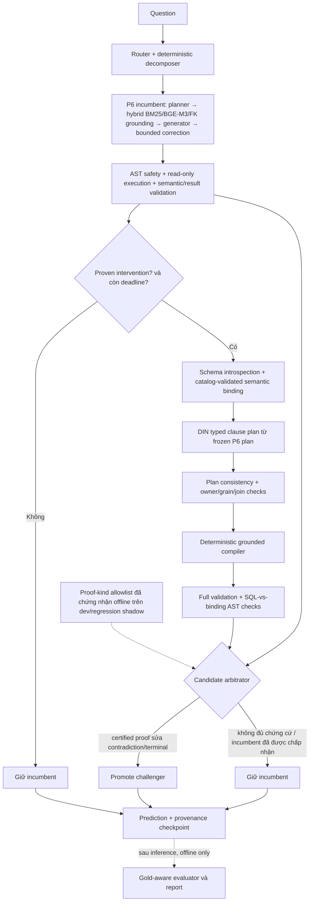

# Paper II so với baseline P6: Olist 58/60 và Spider 120/200

**Cập nhật:** 2026-09-18 (Asia/Bangkok)

**Trạng thái:** Spider-200 R2 đã hoàn tất; R2 vẫn `IN_PROGRESS` và P6 vẫn là default/champion đã được release

**Quyết định:** không promote R2: Spider R2 đạt 120/200, thấp hơn P6 130/200 trên cùng manifest. Giữ Paper II làm research opt-in; không biến hai lỗi Olist đã lộ thành luật riêng để theo đuổi 60/60.

## 1. Kết luận điều hành và ranh giới bằng chứng

Baseline P6 lịch sử đạt **57/60 (95,00%)** trên Olist-60. Kết quả Paper II hiện có là **58/60 (96,67%)**, hơn một case hay 1,67 điểm phần trăm, trong báo cáo `r2-relational-recovery-v2-combined-olist60`. Đây là **adaptive recovery**, không phải 60 inference độc lập trên một source snapshot: lượt v1 giữ 37 success từ run bị ngắt và suy luận 23 case; lượt v2 giữ 54 success từ v1 và suy luận lại sáu failure. SHA-256 của từng prediction được giữ đã được kiểm tra trước merge. Vì vậy 58/60 chứng minh recovery cuối được evaluator chấm đúng 58 case, **không đủ để claim fresh blind improvement hoặc Spider gain**.

So từng case với baseline, Paper II sửa **014, 023, 038** nhưng làm sai **043, 048** vốn đúng ở P6: net **+1**. Cụm từ “giữ nguyên success” chỉ đúng cho **54 success của recovery v1 sang v2**, không đúng nếu hiểu là giữ toàn bộ 57 success của P6. Hai lỗi 043/048 đã được quan sát, nên Olist holdout cũ không còn là nguồn bằng chứng blind cho bất kỳ sửa đổi tiếp theo.

Arbitration log cho thấy 014 `SKIP_CHALLENGER`, còn 023/038 `KEEP_INCUMBENT`; cả ba gain paired so P6 là **output của incumbent trong một run khác**, chưa quy được nguyên nhân cho typed challenger. Ngược lại, 035/039/040 và 045/046/054/059 có `PROMOTE_CHALLENGER` kèm certified proof sửa contradiction của incumbent trong chính run đó. Đây là khác biệt quan trọng giữa *chênh lệch điểm quan sát* và *tác động kiến trúc có evidence*.

Các thành phần hỗ trợ proof đã được triển khai theo operator, owner, grain và SQL AST thay vì case ID/gold SQL/hardprompt. Đó là *thiết kế chống benchmark-specific leakage*, không phải lời bảo đảm rằng mô hình không overfit hoặc sẽ tăng điểm Spider. Phép đo Spider-200 nay đã hoàn tất: cấu hình R2 chạy thực tế **không vượt** P6. Đây là kết quả cross-domain quan sát được, không phải bằng chứng rằng riêng typed challenger gây giảm điểm, vì Spider chạy `candidate_mode=legacy` và không bật certified proof promotion.

## 2. Số liệu đối chiếu

| Chỉ số | P6 baseline lịch sử | R2 recovery v1 | R2 recovery v2 |
|---|---:|---:|---:|
| Phương pháp | frozen full Olist-60 | adaptive, 37 giữ + 23 suy luận | adaptive, 54 giữ + 6 suy luận |
| Result-correct | **57/60 (95,00%)** | 54/60 (90,00%) | **58/60 (96,67%)** |
| First-pass correct | 51/60 | 44/60 | 48/60 |
| Correction recovered / attempted | 6/6 | 10/13 | 10/12 |
| Typed terminal / valid candidate | 60/60 / 60/60 | 60/60 / 60/60 | 60/60 / 60/60 |
| Dev | 28/30 | 30/30 | 30/30 |
| Regression | 14/15 | 13/15 | 14/15 |
| Holdout lịch sử | 15/15 | 11/15 | 14/15 |
| English | 28/30 | 27/30 | 29/30 |
| Vietnamese | 29/30 | 27/30 | 29/30 |
| Easy / medium / hard | 34/37 · 21/21 · 2/2 | 34/37 · 18/21 · 2/2 | 36/37 · 20/21 · 2/2 |
| P50 / P95 latency mỗi prediction | 61,92 / 91,62 s | 66,27 / 91,93 s | 58,77 / 93,47 s |

Latency Olist không phải phép đo speedup có kiểm soát: ba cột khác source revision, phần prediction tái sử dụng, trạng thái model và điều kiện GPU. P50/P95 cũng không gồm cooldown giữa batches hay tổng wall-clock của benchmark. First-pass ở v2 vẫn thấp hơn P6 ba case; tỷ lệ result-correct cao hơn không đồng nghĩa mọi thuộc tính đều cải thiện. Spider được báo riêng ở mục 6, không gộp với Olist.

Đối chiếu đúng cặp trên 60 ID với P6:

```text
P6 57 correct
  +3: 014, 023, 038 được sửa
  -2: 043, 048 bị regression
  = R2 adaptive 58 correct
```

Mốc Paper II cũ `olist-r2e-proof-compiler-v1` dừng 28/31 theo accuracy kill criterion, upper bound 57/60. Mốc đó là một revision trước kiến trúc champion--challenger hiện tại; không được cộng hoặc so latency trực tiếp với report 58/60.

## 3. Kiến trúc Paper II hiện tại

Paper II không thay toàn bộ P6 bằng một specialist. Nó chạy incumbent P6 trước, giữ logical plan/candidate/result, rồi chỉ mở một challenger khi admission có **typed semantic proof** và còn deadline. Challenger dùng schema introspection, semantic catalog được validate theo catalog hash, source grain, typed clause plan và deterministic grounded compiler. Cả hai đi qua chính sách SQL AST, read-only execution và validation; arbitrator quyết định bằng proof obligations và certification, không bằng gold hay model confidence.



| Thành phần | Hợp đồng/giới hạn quan trọng | Code chính |
|---|---|---|
| Reasoning và route | Giữ P6 plan; specialist chỉ vào khi dependency/semantic proof có cơ sở | `layer1_reasoning/adaptive_routing.py`, `planner.py` |
| Grounding | Catalog hash, table/column owner, FK và source grain; Olist business metadata là adapter tùy chọn | `layer2_grounding/service.py`, `semantic_catalog.py` |
| Proof và generation | Typed aggregate, frequency ranking, relational join/comparison/group; deterministic SQL từ contract đã chứng minh | `contracts/semantics.py`, `layer3_generation/easy_compiler.py` |
| Validation và correction | SQLGlot AST kiểm lineage/obligations; read-only SQLite; bounded correction và deadline | `layer4_validation/binding_validator.py`, `executor.py`, `layer5_correction/` |
| Arbitration | Shadow luôn giữ incumbent; enforce chỉ promote certified deterministic proof khi incumbent có contradiction/terminal | `layer6_application/champion_challenger.py` |
| Evaluation | Predictions được ghi trước khi gold-aware evaluator mở expected results; runtime không import evaluator | `agentic_text2sql_eval/`, `scripts/run_r2_olist_recovery.py` |

Certification từ shadow dev/regression của `r2-proof-complete-v4` ghi 23/23 challenger proofs đúng, bảy improvement, zero regression trên **tập shadow được admit**; allowlist gồm `aggregate:avg`, `count_distinct`, `count_rows`, `max`, `sum` và `frequency_ranking`. Đây là điều kiện *cho phép can thiệp*, không phải độ chính xác toàn suite hay giấy bảo đảm với mọi schema. `MIN` chưa nằm trong allowlist.

## 4. Các chỉnh sửa trọng điểm project để đạt điểm 58/60

### 4.1 Giữ incumbent và chỉ promote challenger khi có proof

Revision cũ có thể bỏ một P6 candidate đúng để đổi lấy specialist thất bại. Kiến trúc hiện tại chạy P6 trước, admission có deadline, shadow để quan sát, và enforce chỉ chọn deterministic challenger đã full-validation khi proof kind được chứng nhận và chỉ ra contradiction cụ thể ở incumbent. Specialist exception/timeout/binding incomplete giữ P6 result. Không best-of-N, không thêm model self-judge hay confidence threshold đoán đúng/sai.

### 4.2 Chuẩn hóa semantic ownership và grain xuyên các layer

Resolver xác định population table, metric owner, identity và row grain trước compiler. `COUNT_DISTINCT` phải dùng dimension thuộc entity đúng (`customer_state`, không phải `customer_unique_id` chỉ vì cùng bảng). `per order`, raw payment/review row và derived one-row-per-order view là các grain khác nhau. Validator kiểm AST lineage của view/column theo cùng typed binding, thay vì đòi literal phrase xuất hiện trong SQL cuối. Null/status/ordered predicate chưa biểu diễn được thì fail-closed.

### 4.3 Relational proof và SQL compiler có giới hạn

H11 thêm join cardinality `ONE_TO_ONE`/`MANY_TO_ONE`, alternate metric source đúng grain, column-to-column comparison và grouped aggregate ranking. Compiler chỉ biên dịch join path đã catalog-validated; validator kiểm đủ owner, join, comparison, group, order và limit trước arbitration. Điều này sửa các lỗi R2 nội bộ **035/039/040** (product category không tồn tại ở per-order item totals, thiếu correlation/order-grain comparison, và đếm payment rows thay vì giao hai aggregate tables). Ba case này đã đúng ở baseline P6; chúng là *recovery khỏi regression của R2*, không được tính là ba gain paired so P6.

H12 thêm typed anti-join trên quan hệ one-to-one cho **045/046**: `LEFT JOIN` và `right.order_id IS NULL`, đếm base order rows. Thêm metric AVG `payment_installments` đúng raw payment grain cho **054** và frequency ranking theo `payment_type` raw payment rows cho **059**. Bốn case này sai ở recovery v1 và đúng ở v2; model-free exact-result replay và paraphrase tests cũng pass. Rule mô tả toán tử/owner/grain, không chứa case ID, gold SQL, expected row hay nguyên câu benchmark.

### 4.4 Bảo toàn checkpoint và giảm I/O, không nới laptop guard

Recovery runner audit report source với status/SQL/rows, khóa SHA-256 từng dòng success và cấm ghi đè success seed. V1 giữ 37/37, V2 giữ 54/54 prediction byte-identical; final evaluator chấm đủ 60 ID. Guarded runner stage và xác minh SHA-256 SQLite một lần mỗi invocation, cache catalog snapshot cho child one-case batches và đánh giá cuối trên WSL-native filesystem; đây là tối ưu I/O/latency vận hành, **không đổi câu hỏi, prompt hay logic chấm**. Vẫn batch 1, GPU layer 1, unload models, sampling 0,5 giây và cooldown 60 giây.

### 4.5 Chuyển biến quan sát được và giới hạn

| Nhóm case | Nguyên nhân/giải pháp | Ý nghĩa bằng chứng |
|---|---|---|
| 014, 023, 038 | Output mới lần lượt trả full distribution, distinct đúng dimension và status + non-null; arbitration giữ incumbent | Ba gain paired so P6 **được quan sát**, nhưng không quy nhân quả cho challenger |
| 035, 039, 040 | Relational proof, join/column comparison, cardinality-safe grouped source | Sửa regression phát sinh trong R2, không phải gain so P6 |
| 045, 046, 054, 059 | Anti-join, AVG raw installments, payment-type frequency | Bốn gain từ recovery v1 → v2, không mất 54 success cũ |
| 043, 048 | Temporal month ranking còn thiếu typed projection; raw review `MIN` chưa có proven binding/certification | Hai regression so P6 vẫn tồn tại; **không tuyên bố 60/60** |

Hai case 043/048 đã được xem chi tiết. Viết rule đúng hai câu hỏi đó hoặc ép model bằng hardprompt sẽ làm suy yếu benchmark và không chứng minh transfer. Nếu sau này bổ sung month-bucket hoặc raw-row-grain `MIN`, phải thiết kế bằng schema-derived operator, kiểm thử nhiều schema/paraphrase/adversarial cases và chứng nhận độc lập trước khi promote; Olist 60/60 sau khi xem lỗi chỉ còn là diagnostic.

## 5. Spider transfer: kết quả paired trên 200 case

R2 `spider-r2-hybrid-200-v1` đã có report `complete`, 200 predictions/200 case/20 database và benchmark exit 0. Cùng manifest, cùng thứ tự 200 ID và cùng expected-result hash từng case với P6 `spider-dev-stratified-200-p6-v1`; 20/20 database có cùng generation-model digest, embedding-model digest, index version và catalog hash. Đây là phép đối chiếu **execution accuracy trên laptop-stratified Spider-200**, không phải điểm official hidden Spider test hay full Spider dev 1.034 case.

| Chỉ số Spider-200 | P6 baseline | R2 hybrid/legacy | Chênh lệch R2 − P6 |
|---|---:|---:|---:|
| Result-correct | **130/200 (65,00%)** | **120/200 (60,00%)** | **−10 case; −5,00 điểm %** |
| Regression partition | 63/100 | 59/100 | −4 case |
| Holdout partition | 67/100 | 61/100 | −6 case |
| Easy | 83/107 | 83/107 | 0 |
| Medium | 27/53 | 21/53 | −6 |
| Hard | 16/29 | 12/29 | −4 |
| Extra | 4/11 | 4/11 | 0 |
| Valid candidate | 199/200 | 198/200 | −1 |
| P50 / P95 latency mỗi prediction | 58,51 / 85,29 s | 62,11 / 141,34 s | cao hơn 3,60 / 56,05 s, **không quy nhân quả** |

Ghép theo ID cho thấy **110 cùng đúng, 60 cùng sai, 10 R2 sửa được nhưng 20 P6 đúng thành sai**; ròng −10. Trong 10 gain có 6 holdout và 4 regression; trong 20 loss có 12 holdout và 8 regression. R2 có 77 `EXECUTION_MISMATCH` so với 68 ở P6, cộng một `RESULT_SHAPE_MISMATCH`, một `MODEL_ERROR` và một `WRITE_BLOCKED`; đây là nhãn hậu kiểm, không phải nguyên nhân đã được chứng minh. Bảy case đi qua DIN planning có 1/7 clause-exact; số mẫu nhỏ và run không cô lập được tác động của riêng DIN.

Phép đối chiếu score có chung dữ liệu/model/index/evaluator, nhưng **không phải ablation chỉ thay một module**: P6 dùng 6 GPU layers và correction tối đa 1 lượt; R2 dùng 1 GPU layer, correction tối đa 2 lượt, `planning_mode=hybrid`, `candidate_mode=legacy`, không có certified proof kinds. R2 cũng resume qua nhiều guard-only revisions và các mức clock cap; do vậy không thể quy chênh lệch accuracy/latency cho typed challenger, GPU cap hay một patch riêng. P50/P95 không gồm cooldown 60 giây, model unload hoặc tổng wall-clock. Incident 87,82 W tại checkpoint 174 là peak đã quan sát của quá trình trước khi hạ clock; peak 52,36 W trong continuation cuối **không** được trình bày như peak toàn bộ run.

Kết luận nghiên cứu: Olist adaptive 58/60 vẫn là tín hiệu ứng dụng có giá trị, nhưng **không chứng minh transfer dương sang Spider**; cấu hình Spider R2 hiện đo được còn kém P6. Giữ P6 làm default/champion, R2 research opt-in và gate `IN_PROGRESS`. Muốn phân biệt hiệu ứng thuật toán với nhiễu vận hành cần một ablation source-locked trên cùng runtime/hardware budget, cùng manifest và nhiều seed/run phù hợp laptop guard; không chỉnh rule theo 20 lỗi vừa lộ rồi gọi là blind improvement. Olist aliases, status values và business views chỉ là domain metadata, không được đưa thành hardcode Spider.

## 6. Failure cases Spider, nguyên nhân và weakness của kiến trúc mới

### 6.1 Failure tập trung ở đâu

R2 sai 80/200 case: 77 `EXECUTION_MISMATCH`, một `RESULT_SHAPE_MISMATCH`, một `MODEL_ERROR` và một `WRITE_BLOCKED`. Chênh lệch so P6 không trải đều: easy giữ 83/107 và extra giữ 4/11, còn medium giảm 27 → 21 và hard giảm 16 → 12. Paired analysis cho thấy 110 case cả hai cùng đúng, 60 cả hai cùng sai, 10 gain và 20 regression. Vì vậy vấn đề chính không phải workflow không kết thúc — typed terminal vẫn 200/200 — mà là **chọn sai population, owner, projection hoặc join trong SQL vẫn hợp lệ về cú pháp**.

Các regression nổi bật tập trung vào câu hỏi đa quan hệ:

| Dạng failure | Ví dụ quan sát | Sai lệch chính |
|---|---|---|
| Thiếu output owner | Stadium có nhiều concert nhất; song title và singer name | Context chỉ còn bảng sự kiện; mất bảng chứa tên/capacity/singer |
| Sai population của anti-join | Country không có car maker; student không có friend; TV channel không có cartoon của đạo diễn | Bắt đầu từ bảng quan hệ con thay vì tập population đầy đủ |
| Sai aggregate grain | Bao nhiêu continent nói Chinese | Đếm `CountryCode` ở `countrylanguage` thay vì join sang `country.Continent` |
| Thiếu hoặc sai join path | Battle mất tàu Brig; teacher và course được phân công | Trả thuộc tính/ID của bảng gần nhất thay vì entity được hỏi |
| Nhầm lexical value hoặc direction | `Australian Open tournament`; youngest pet | Copy dư từ câu hỏi vào literal hoặc đảo `ASC`/`DESC` |
| Projection thừa/thiếu | TV channel series; feature type của AirCon | SQL chạy được nhưng output shape/semantic owner không đúng |

### 6.2 Nguyên nhân mạnh nhất: schema context bị thu hẹp quá mức

Chỉ 7/200 case có cùng selected schema context với P6; cả 20 regression đều nhận context khác. Schema linker mới xét từng closure một bảng và khi các tiêu chí trước hòa nhau còn ưu tiên ít bảng/ít token. Điều đó hữu ích với lookup đơn giản nhưng nguy hiểm với Spider medium/hard vì một bảng có lexical score cao có thể thắng trước khi population owner, projection owner và bridge table cùng xuất hiện.

Ví dụ: câu hỏi stadium nhận chỉ `concert`; câu hỏi country không có maker nhận chỉ `car_makers`; câu hỏi battle nhận chỉ `ship`; câu hỏi continent nhận chỉ `countrylanguage`; hai câu song/singer nhận chỉ `song`. Model đôi khi vẫn đoán được bảng ngoài context, nhưng đây là hallucination không grounded và không ổn định. Mười gain cũng đều dùng context khác P6, cho thấy thu hẹp context có cả lợi lẫn hại; bằng chứng hiện tại chỉ kết luận **objective chọn context chưa kiểm soát non-regression**, không kết luận context rộng luôn tốt hơn.

### 6.3 `BASELINE_PRESERVE` chưa phải incumbent bất biến

Trong 192 case mang route `BASELINE_PRESERVE`, R2 đạt 118 correct so với 125 của P6: 10 gain và 17 regression. Chỉ 91/192 logical plan, 6/192 schema context và 91/192 SQL giống artifact P6. Khi plan giống nhau, gain/loss là 6/6; khi plan khác, gain/loss là 4/11. Như vậy `BASELINE_PRESERVE` hiện chỉ giữ **loại route**, vẫn chạy lại decomposer, planner, grounding, generator và correction trên implementation mới. Nó không bảo đảm giữ candidate đúng của champion.

Đây là weakness kiến trúc quan trọng: fallback được gọi là “baseline” nhưng không có tính monotonic. Một thay đổi retrieval, prompt input, corrector hoặc sai số inference đều có thể làm mất success cũ ngay cả khi specialist không được chọn.

### 6.4 DIN-SQL cross-domain đi tiếp khi binding chưa được chứng minh

Bảy case đi qua `DIN_SQL_ENHANCE` chỉ đúng 2/7 so với 5/7 ở P6; không tạo gain và tạo ba regression. DIN plan có clause exact 1/7, column recall 39,29% và join recall 0%. Cả bảy plan đều mang `UNPROVEN_SEMANTIC_BINDING`, nhưng signal này chỉ là advisory nên validation vẫn chấp nhận.

Các lỗi thể hiện đúng weakness đó: query “student không có friend” chỉ dùng `Friend` và bỏ `Highschooler`; query “có friend và được người khác like” dùng `Friend` thay cho `Likes`; query TV channel dùng population `Cartoon` thay cho `TV_Channel`. Validator hiện mạnh về identifier/FK/safety nhưng chưa bắt buộc chứng minh population owner, output owner và hướng anti-join trước khi cho specialist sinh SQL.

### 6.5 Khả năng Olist không chuyển nguyên vẹn sang Spider

Olist 58/60 được hỗ trợ bởi semantic catalog, typed business grain và certified proof arbitration. Spider run lại có `semantic_catalog=null`, `certified_proof_kinds=[]` và `candidate_mode=legacy`. Do đó phần kiểm soát giúp challenger an toàn trên Olist không hoạt động trên Spider, trong khi adaptive routing và schema-linking mới vẫn thay đổi đường suy luận. Đây không phải hardcode answer, nhưng là **domain adaptation chưa đủ generalization**: kiến trúc mới hiểu tốt operator đã được mô hình hóa trên Olist, chưa chứng minh cùng mức ownership/grain trên schema lạ.

### 6.6 Yếu tố nhiễu và giới hạn kết luận nguyên nhân

Run không phải ablation một biến: P6 dùng 6 GPU layers/correction tối đa một lượt, R2 dùng 1 GPU layer/correction tối đa hai lượt và source runtime đã thay đổi ở nhiều layer. Clock cap và offload khác nhau chủ yếu tác động latency, nhưng sai số số học/kernel và việc inference lại có thể làm token greedy khác tại điểm sát nhau. Exact paired McNemar cho 10 gain/20 regression có p khoảng 0,099; point estimate đủ để fail promotion gate nhưng chưa đủ để quy toàn bộ −10 cho riêng DIN, schema linker hay GPU. Những nguyên nhân ở trên được xếp theo mức độ evidence, không phải causal proof tuyệt đối.

## 7. Verification và quản trị artifact

Sau H12, `make check` pass Ruff, format, strict mypy trên 114 source files và **340 non-Ollama tests** (1 deselected); `uv lock --check` và `uv pip check` pass, 83 packages compatible. Model-free replay chấm exact results của các typed proof mới; local-model benchmark chỉ chạy qua guarded wrapper. Core vẫn local/free, không thêm paid SDK hay API key.

Đợt dọn `evals/` chỉ bỏ **tám JSON trung gian trùng dữ liệu**, không bỏ baseline, Paper II progress, certification/provenance, predictions, final combined reports, resource-stop incidents hay Spider artifacts. Hai `*.seed-audit.json` là bản copy của source report sau khi bỏ metadata audit; sáu one-case pilot `*.json` có payload tương đương `*.progress.json` (khác `evaluation_id`/định dạng số) và progress được giữ. File được đưa vào Trash để có thể khôi phục. Không dọn bằng wildcard hoặc xóa hàng loạt cả `evals/reports`.

Tám tên đã dọn, đều dưới `evals/reports/`: `r2-relational-recovery-v1.seed-audit.json`, `r2-relational-recovery-v2.seed-audit.json`, `olist-r2c-din-route-pilot-v1.json`, `olist-r2c-typed-compiler-pilot-v1.json`, `olist-r2h-din-fallback-case030-pilot-v1.json`, `olist-r2h-grain-proof-case030-pilot-v2.json`, `olist-r2h-lineage-case031-pilot-v4.json`, `olist-r2h-typed-frequency-case020-pilot-v3.json`. Payload và `.trashinfo` đã được xác nhận tại `/mnt/d/.Trash-1000/` để phục hồi nếu cần.

## 8. Claim boundary

- **Đã đo:** P6 Olist 57/60; R2 adaptive 58/60; paired +3/−2 trên Olist. Spider-200 P6 130/200, R2 120/200; paired +10/−20, ròng −10.
- **Chưa chứng minh:** R2 fresh blind 58/60, monotonic non-regression so P6 trên mọi case/lần chạy, hoặc hiệu quả dương của riêng typed challenger trên Spider.
- **Không claim:** 60/60, không overfitting tuyệt đối, giảm p95 có kiểm soát, hay khả năng transfer từ Olist business rules sang Spider.
- **Gate:** R2 tiếp tục `IN_PROGRESS`; P6 vẫn default/champion vì Spider paired hiện thấp hơn baseline và fresh Olist blind còn thiếu.

## 9. Solutions và hướng phát triển tiếp theo

### 9.1 P0 — Tạo incumbent P6 thực sự bất biến

- Đóng gói P6 bằng source/config/prompt/index contract đã khóa; lưu và replay plan/context/candidate của incumbent trong cùng invocation thay vì gọi lại một nhánh “tương đương baseline”.
- Chạy R2 như challenger độc lập. Nếu challenger timeout, exception, binding chưa `PROVEN`, thiếu owner hoặc không chứng minh được contradiction của incumbent thì trả nguyên incumbent.
- Dùng `shadow` làm mặc định trên schema chưa có certification; chỉ `enforce` proof kind đã đạt zero-regression gate trên development schemas.

Acceptance criterion đầu tiên không phải tăng điểm mà là: khi challenger không được admit, output incumbent phải byte-identical hoặc semantic-result-identical với frozen P6.

### 9.2 P0 — Sửa objective của schema linker bằng contract tổng quát

- Trích riêng `population_owner`, `projection_owners`, predicate/aggregate owner và số business role từ question/plan trước khi chấm context.
- Không cho singleton closure thắng câu đa entity chỉ vì ít bảng/token; candidate context phải phủ đủ owner bắt buộc và có connected FK/unique join path.
- Tách lexical coverage khỏi relational coverage; phạt thiếu bridge/output table mạnh hơn phạt thêm một bảng hợp lệ.
- Nếu hai context ngang evidence, giữ context đủ owner rồi mới tối ưu token. Không thêm case ID, nguyên câu Spider, gold SQL hoặc tên database vào rule.

Kiểm thử cần dùng nhiều schema tổng hợp, paraphrase và adversarial cases cho lookup, multi-join, anti-join, aggregate grain và projection owner; không chỉ replay 20 regression vừa lộ.

### 9.3 P0 — Fail closed cho DIN plan không có semantic proof

- Trên cross-domain legacy, nâng `UNPROVEN_SEMANTIC_BINDING`, `SEMANTIC_OWNER_MISSING`, `TABLE_OUTSIDE_EVIDENCE` và `COLUMN_OUTSIDE_EVIDENCE` thành điều kiện fallback khi chúng ảnh hưởng population/output/join.
- Bổ sung obligation model-free cho population direction, output shape, aggregate grain, anti-join base set và join connectivity.
- Không cho validator coi “SQL dùng column có thật và chạy được” là đủ; phải kiểm tra column đó thuộc đúng semantic role trong question.

### 9.4 P1 — Xây semantic proof cross-domain từ schema, không từ Olist

- Sinh proof candidates chỉ từ PK/FK, uniqueness, nullability, type, cardinality và lexical ownership của schema hiện tại.
- Chuẩn hóa operator tổng quát: entity lookup, count/count-distinct, grouped aggregate, ranking, existence/anti-join, set intersection và nested comparison.
- Domain metadata chỉ là adapter tùy chọn; khi không có catalog thì hệ thống phải hạ cấp an toàn về incumbent thay vì đoán typed binding.

### 9.5 P1 — Thực hiện ablation kiểm soát trước khi benchmark lại

Chạy qua guarded wrapper, cùng manifest/model digest/index/seed/GPU layers/correction budget và source snapshot:

1. Frozen P6 replay để đo run variance.
2. P6 + schema linker mới, không DIN.
3. P6 + DIN routing ở shadow, giữ output P6.
4. Challenger enforce chỉ với proven cross-domain obligations.

Báo paired gain/loss theo ID, complexity, database, route và owner/join failure; dùng development/regression để sửa, chỉ mở holdout sau source freeze. Promotion yêu cầu không chỉ score tổng cao hơn mà còn giới hạn regression, đặc biệt medium/hard và các case incumbent đã đúng.

### 9.6 P2 — Tối ưu latency sau khi accuracy gate đạt

Tách optimization vận hành khỏi thay đổi reasoning: cache catalog/retrieval an toàn, giảm model reload, early-exit khi incumbent đã certified, và tránh gọi planner/corrector thứ hai khi không có proven intervention. Mọi tối ưu phải được đo với cùng guard profile; không đánh đổi owner/join coverage để giảm token hoặc p95.

Thứ tự triển khai đề xuất là **frozen incumbent → schema ownership coverage → fail-closed DIN → cross-domain proof → controlled ablation → latency**. Hướng này bảo toàn success đã có, cải thiện transfer bằng contract tổng quát và tránh hardprompt, hardcode hay tuning trực tiếp theo gold Spider.
