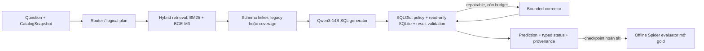

# Báo cáo kỹ thuật Paper II so với P6: kiến trúc, protocol và kết quả Spider-200

**Cập nhật nội dung:** 2026-09-29 (Asia/Bangkok); số liệu benchmark là các run được báo cáo đến 2026-09-27.

**Trạng thái:** Spider-200 `schema-coverage-v2` đã hoàn tất 200/200; gate R2 vẫn `IN_PROGRESS`. P6 tiếp tục là default/champion trong ledger. Báo cáo này là đánh giá tại thời điểm hiện tại, không đánh dấu gate mới là `VERIFIED`.

## 0. Tóm tắt kỹ thuật cho reviewer ngoài nhóm

### 0.1 Phạm vi hệ thống và vị trí của R2

Repository triển khai một runtime Text-to-SQL chạy local trên SQLite/Ollama và một evaluator tách riêng. Đầu vào runtime là câu hỏi, `CatalogSnapshot` của một database và index tương ứng; đầu ra là SQL candidate, trạng thái thực thi/kiểm tra, kết quả và provenance. **P6** là cấu hình release đã qua gate; **Paper II/R2** là nhánh nghiên cứu thay đổi planning, grounding và correction. Báo cáo này đánh giá **Spider-200 cross-domain**, không đánh giá hiệu quả riêng của nhánh semantic proof trên Olist. Đặc tả kiến trúc và trạng thái gate chuẩn nằm ở [master plan](realistic_project_creation_codex.md); bằng chứng release P6 ở [P6 gate](docs/evidence/p6_gate.md).

| Boundary/module trong code | Trách nhiệm liên quan trực tiếp đến phép đo này |
|---|---|
| [`service_factory.py`](src/agentic_text2sql/layer6_application/service_factory.py) và [`query_service.py`](src/agentic_text2sql/layer6_application/query_service.py) | Lắp model, planner, grounding, generator, validator và corrector theo config; điều phối đường chạy một câu hỏi. |
| [`layer1_reasoning/`](src/agentic_text2sql/layer1_reasoning/) | Route và logical plan; R2 hybrid có quyết định adaptive, bao gồm `BASELINE_PRESERVE` và một số case `DIN_SQL_ENHANCE`. |
| [`layer2_grounding/`](src/agentic_text2sql/layer2_grounding/), đặc biệt [`schema_linker.py`](src/agentic_text2sql/layer2_grounding/schema_linker.py) và [`coverage_linker.py`](src/agentic_text2sql/layer2_grounding/coverage_linker.py) | Tìm evidence, chọn bảng/cột/FK và render Schema Context. Đây là intervention duy nhất được chủ đích thay đổi giữa hai run R2 mới. |
| [`layer3_generation/`](src/agentic_text2sql/layer3_generation/) → [`layer4_validation/`](src/agentic_text2sql/layer4_validation/) → [`layer5_correction/`](src/agentic_text2sql/layer5_correction/) | Sinh SQL; parse/policy/read-only execution/kiểm tra; sửa theo lỗi trong giới hạn cấu hình. |
| [`agentic_text2sql_eval/`](src/agentic_text2sql_eval/) | Chấm execution equivalence sau khi inference/checkpoint kết thúc. Runtime không import evaluator hoặc gold benchmark. |

Với Spider trong báo cáo này, `candidate_mode=legacy`, `semantic_catalog=null` và `certified_proof_kinds=[]`. Vì vậy **champion–challenger có typed semantic proof không tham gia phép đo Spider**. Tên route `BASELINE_PRESERVE` trong R2 cũng không đồng nghĩa reuse nguyên SQL P6: đường R2 vẫn có thể lập kế hoạch/sinh SQL lại. Điểm Spider cần được đọc như kết quả của **cấu hình tích hợp R2**, không phải hiệu quả riêng của DIN hay proof.

### 0.2 Ma trận cấu hình và đối chứng

| Cấu hình | Nguồn/đường chạy | Schema Context | Correction | Profile phần cứng trong run | Vai trò bằng chứng |
|---|---|---|---|---|---|
| **P6 lịch sử** | Source commit `1509faa`; `planner_v2` + `generator_v4_cross_domain`; hybrid retrieval top-20 | Context trung bình 3,45 bảng; budget 1.200 token | Tối đa 1 repair/1 LLM call trong correction | Qwen3-14B Q4, 6 GPU layers; guard P6 lịch sử | Incumbent/release benchmark, **130/200**; không phải control phần cứng khớp R2. |
| **R2 `legacy` mới** | Hybrid/adaptive planner-generator; `candidate_mode=legacy` | `schema_context_mode=legacy`; context trung bình 1,35 bảng | Tối đa 2 repair/2 LLM calls trong correction | Cùng model digest với R2 coverage, 1 GPU layer; guard batch 1/unload/cooldown; clock đầu run có đoạn 900 rồi 700 MHz | Control nội bộ cho intervention schema, **120/200**. |
| **R2 `coverage-v2`** | Cùng inference implementation, prompt, model/index digest và manifest với R2 legacy; source guard/launcher có thay đổi sau freeze | `schema_context_mode=coverage`; context trung bình 3,48 bảng | Tối đa 2 repair/2 LLM calls trong correction | 1 GPU layer, hard clock cap 700 MHz, batch 1/unload/cooldown | Treatment nội bộ, **128/200**; ứng viên tích hợp đem so P6. |

`coverage` ưu tiên toàn bộ catalog nếu vừa **6 bảng và 1.200 token**; catalog rộng hơn đi theo bounded FK closure từ owner được truy hồi/nhận diện và giữ các owner/cột bắt buộc, hoặc trả lỗi typed nếu không vừa budget. Đây là thay đổi **schema được đưa vào prompt**, không phải thay model. Trên Spider-200, 179/199 context của `coverage` chứa toàn bộ bảng của database; 20 context còn lại dùng chọn lọc. Xem [evidence module](docs/evidence/schema_context_coverage_2026_09_24.md) và mục 4 để phân biệt ablation model-free với inference Qwen thật.

### 0.3 Kết quả cần đọc trước khi xem phân tích lỗi

| Phép so | Result-correct | Paired gain/loss của bản mới | P50/P95 của bản mới và đối chứng | Kết luận trong phạm vi phép đo |
|---|---|---|---|---|
| R2 `coverage-v2` so R2 `legacy` mới | **128/200 vs 120/200** | **18/10; net +8** | 69,89/156,86 s vs 67,37/163,51 s | Coverage cải thiện điểm R2 trên một run source-locked; có 10 regression. |
| R2 `coverage-v2` so P6 lịch sử | **128/200 vs 130/200** | **4/6; net −2** | 69,89/156,86 s vs 58,51/85,29 s | Chưa có cơ sở thay P6; latency bị confound bởi offload/guard nên không quy cho thuật toán. |

Cả ba kết quả Spider ở đây dùng cùng **200 case/20 database**; hai run R2 mới cùng manifest SHA-256 `35382bd0641a0ae7a4e7ab3bcc7c02efce96fe4df8fb9b754599389eb43c5b4e`, cùng model/index digest, seed 42, temperature 0 và giới hạn suy luận. `Result-correct` là **local execution equivalence** trên database đã pin, không phải official Spider test-suite score. P50/P95 đo latency mỗi prediction, không gồm 60 giây cooldown và toàn bộ wall-clock benchmark. Nhóm holdout 100 câu đã bị mở gold khi chẩn đoán, nên các chỉnh sửa tiếp theo cần schema chưa dùng để thiết kế để kiểm generalization.

**Ranh giới suy luận:** cặp R2 `legacy`/`coverage` gần với ablation một module nhất, nhưng clock profile và tải chạy vẫn khác. Cặp P6/R2 là so sánh outcome trên cùng câu hỏi, **không** phải ablation kiến trúc hoặc latency ở cùng điều kiện. Trên các case R2 coverage sai nhưng có context, **71/71 đã chứa mọi bảng/cột được gold SQL tham chiếu**; do đó trọng tâm tiếp theo là semantic plan, owner, grain, projection, set/anti-join và bảo toàn câu P6 đang đúng, thay vì chỉ tăng schema recall.

**Quyết định:** giữ Qwen3-14B và P6 làm mốc sản phẩm. Cấu hình Spider R2 hiện tại **chưa thành công ở mục tiêu vượt baseline**: `coverage-v2` đạt **128/200** so với P6 lịch sử **130/200**, trong khi P50/P95 quan sát đều cao hơn. Schema Context `coverage` là kết quả nghiên cứu ở cấp module vì đã sửa **120 → 128/200** của nhánh R2 `legacy`; không promote cả kiến trúc R2 hay đổi default chỉ nhờ gain nội bộ này. Ưu tiên kế tiếp là cải thiện **P6** bằng module có ablation kiểm soát, bảo toàn câu đúng và kiểm chứng trên schema chưa dùng để thiết kế.

## 1. Kết luận điều hành và ranh giới bằng chứng

Mốc phải vượt là **P6 lịch sử 130/200 (65,00%)**. Đợt chạy mới nhất `spider-schema-coverage-200-v2` đạt **128/200 (64,00%)** trên cùng manifest Spider-200 laptop-stratified và 20 database: thấp hơn **hai câu**. Ghép theo 200 ID có **124 cùng đúng, 66 cùng sai, bốn câu R2 sửa được và sáu câu P6 đúng thành sai**. Holdout giảm 67 → 65; regression giữ 63; easy giảm ba, medium giảm một, hard và extra tăng mỗi nhóm một. Exact McNemar hai phía cho 4/6 có **p ≈ 0,754**: dữ liệu chưa chứng minh chênh lệch accuracy lặp lại ổn định, nhưng cũng **không có bằng chứng R2 tốt hơn champion**.

**Paired inference:** 124 case cả hai đúng và 66 case cả hai sai; McNemar chỉ xét 10 case discordant (4 R2-only gain, 6 P6-only loss). Exact two-sided `p ≈ 0,754` không chứng minh advantage hoặc equivalence. Quyết định giữ P6 dựa trên outcome quan sát và promotion gate, không diễn giải p-value như xác suất một kiến trúc đúng.

Về tốc độ quan sát, P6 đạt **P50/P95 58,51/85,29 s**, còn `coverage-v2` **69,89/156,86 s**: cao hơn **11,38 s (+19,46%)** ở P50 và **71,57 s (+83,92%)** ở P95. `coverage` chậm hơn trên **177/200** câu ghép ID; trung vị chênh lệch từng cặp là **+9,94 s**. Đây là kết quả vận hành thực tế của hai cấu hình đã chạy, nên **chưa có trade-off accuracy–latency nào biện minh cho việc thay P6 bằng R2**. P6 dùng sáu GPU layers, còn R2 một layer, hard clock cap và unload giữa các case; vì thế chưa được quy phần chậm đó cho riêng thuật toán mới. Cần control P6 dưới cùng guard an toàn trước khi kết luận về hiệu năng nội tại của kiến trúc.

Trong nội bộ R2, `coverage-v2` sửa `spider-schema-legacy-200-v1` **120 → 128/200**. Ghép cặp này có **110 cùng đúng, 62 cùng sai, 18 gain và 10 loss**; exact McNemar hai phía **p ≈ 0,185**. Hai run mới giữ cùng manifest, model/index digest, seed, prompt và giới hạn suy luận; khác biệt cấu hình suy luận là `schema_context_mode`. Kết quả này chứng minh module `coverage` hữu ích hơn schema linker `legacy` trên một run cụ thể, **không chứng minh project đã vượt P6**. Chuỗi điểm cần đọc đúng là **P6 130 → R2 legacy 120 → R2 coverage 128**: bước sau bù tám điểm trong mức hụt mười câu, chưa tạo net gain so baseline. Đây là chênh lệch điểm số, không nói rằng chính tám case P6 từng đúng đã được phục hồi.

Phân tích schema sau chạy cho thấy **71/71 prediction sai có Schema Context của R2 coverage đều chứa toàn bộ bảng và cột được SQL chuẩn tham chiếu**; P6 đã đạt **67/69** ở cùng phép chẩn đoán trên các failure có context. Cả **10 case đổi trạng thái đúng/sai giữa P6 và R2 coverage đều có cùng tập bảng được chọn**. Đây là phép đối chiếu **offline, gold-aware**, chỉ dùng để chẩn đoán. Nó cho thấy sửa thiếu schema của R2 legacy là cần thiết nhưng **không giải thích được vì sao R2 chưa vượt P6**; các điểm phân biệt hiện nghiêng về plan, phép chiếu, điều kiện, grain, set/anti-join hoặc cách dùng cột. Việc có đủ tên bảng/cột không chứng minh model đã hiểu hay dùng chúng đúng.

Mốc Olist vẫn là **P6 57/60** và **Paper II adaptive recovery 58/60**, không có Olist inference mới từ thay đổi Schema Context. Bản 58/60 không phải fresh blind run; xem [báo cáo trước](comparison_new2_to_baseline_vn.md). Spider-200 ở đây là local execution equivalence, **không phải** official hidden Spider test hay full Spider dev 1.034 case.

## 2. Số liệu đối chiếu

| Chỉ số Spider-200 | P6 lịch sử | R2 báo cáo cũ | `legacy` source-locked mới | `coverage-v2` mới |
|---|---:|---:|---:|---:|
| Result-correct | **130/200 (65,00%)** | 120/200 (60,00%) | 120/200 (60,00%) | **128/200 (64,00%)** |
| Holdout / regression | 67/100 · 63/100 | 61/100 · 59/100 | 61/100 · 59/100 | **65/100 · 63/100** |
| Easy | 83/107 | 83/107 | 83/107 | 80/107 |
| Medium | 27/53 | 21/53 | 21/53 | **26/53** |
| Hard | 16/29 | 12/29 | 12/29 | **17/29** |
| Extra | 4/11 | 4/11 | 4/11 | **5/11** |
| Valid candidate / typed terminal | 199/200 · 200/200 | 198/200 · 200/200 | 198/200 · 200/200 | **199/200 · 200/200** |
| P50 / P95 latency mỗi prediction | 58,51 / 85,29 s | 62,11 / 141,34 s | 67,37 / 163,51 s | 69,89 / 156,86 s |

**So trực tiếp với baseline**, `coverage-v2` kém P6 hai câu và có P50/P95 cao hơn. Trên các partition, holdout **−2**, regression **0**; theo độ khó easy **−3**, medium **−1**, hard **+1**, extra **+1**. Nhóm hard/extra tăng là tín hiệu cần nghiên cứu, nhưng nó đi cùng việc mất câu easy và chi phí chạy cao hơn. P6 vẫn là lựa chọn tốt hơn theo **hai chỉ số quan sát được** là tổng accuracy và latency. Điều này chưa chứng minh P6 có thuật toán nhanh hơn vì cấu hình phần cứng/guard khác nhau.

| P6 lịch sử → R2 `coverage-v2` | P6 | R2 coverage | Chênh R2 − P6 |
|---|---:|---:|---:|
| Đúng / 200 | **130** | 128 | **−2** |
| Sai / 200 | **70** | 72 | **+2** |
| Holdout / regression | **67 / 63** | 65 / 63 | −2 / 0 |
| Easy / medium / hard / extra | 83 / 27 / 16 / 4 | 80 / 26 / 17 / 5 | −3 / −1 / +1 / +1 |
| P50 / P95 mỗi prediction | **58,51 / 85,29 s** | 69,89 / 156,86 s | **+11,38 / +71,57 s** |

R2 báo cáo cũ là `spider-r2-hybrid-200-v1`; cột `legacy` là run đối chứng mới. Cùng **120/200** không có nghĩa hai run tạo cùng SQL/cùng tập câu đúng. Cặp `legacy`–`coverage-v2` phù hợp nhất để **cô lập hiệu ứng module Schema Context**. Trong cặp đó, holdout **+4**, regression **+4**; theo độ khó: easy **−3**, medium **+5**, hard **+5**, extra **+1**. Đây là mục tiêu khoa học phụ; **baseline P6** mới là mốc quyết định sản phẩm.

| Paired trên cùng 200 câu | Cả hai đúng | Cả hai sai | Bản mới đúng, đối chứng sai | Bản mới sai, đối chứng đúng | Net |
|---|---:|---:|---:|---:|---:|
| `coverage-v2` so `legacy` mới | 110 | 62 | 18 | 10 | **+8** |
| `coverage-v2` so P6 lịch sử | 124 | 66 | 4 | 6 | **−2** |

P50 của `coverage` cao hơn `legacy` **2,52 s/case**, P95 thấp hơn **6,65 s/case** trong hai run quan sát. Context tăng từ trung bình **54,7 → 180,3 token** trên 199 case có context; số token prompt LLM trung vị tăng **1.178,5 → 1.263,5**. So với P6, context của R2 coverage cũng dài hơn trung bình **180,3 so với 142,9 token**, dù số bảng gần như bằng nhau (**3,48 so với 3,45**). Hai run R2 dùng một GPU layer, nhưng `legacy` có giai đoạn đầu ở clock 900 MHz rồi 700 MHz, còn `coverage-v2` ở 700 MHz; tải, model reload và đường correction cũng biến động. P50/P95 là latency prediction, **không gồm** cooldown 60 giây, unload model hay wall-clock toàn benchmark.

Khác biệt vận hành lớn khi đối chiếu P6: telemetry ghi **model load trung vị khoảng 0,30 s ở P6 và 21,69 s ở R2 coverage**, phù hợp với chính sách unload model giữa các case của run guarded mới. Đây là một phần chi phí thực sự của profile laptop hiện dùng, **không phải** bằng chứng planner/generator R2 tự thân chậm hơn 21 giây. P6 lịch sử dùng sáu GPU layers và guard khác; cũng không được giả định profile cũ an toàn dưới ngưỡng hiện tại. Muốn so tốc độ kiến trúc phải chạy P6 và một P6+module dưới **cùng** một guard/profile an toàn, giữ cả wall-clock gồm cooldown và latency inference trong báo cáo.

## 3. Kiến trúc Paper II và điểm can thiệp trong Spider

[`service_factory.py`](src/agentic_text2sql/layer6_application/service_factory.py) dựng runtime theo `planning_mode`, `candidate_mode`, model/seed và `schema_context_mode`. [`query_service.py`](src/agentic_text2sql/layer6_application/query_service.py) điều phối route → plan → grounding → generation → policy/read-only execution → correction có giới hạn; terminal result và provenance được lưu trước khi evaluator đọc gold. Các đường lỗi như `WRITE_BLOCKED`, parse failure hoặc hết budget vẫn là outcome của benchmark, không bị loại khỏi mẫu số.

Trong nhánh R2 hybrid, planner có thể giữ route `BASELINE_PRESERVE` hoặc chuyển sang `DIN_SQL_ENHANCE`. Trên Spider coverage run, 195 case mang route preserve, bốn case mang route DIN và một case không có route; preserve là **nhãn route**, không phải cam kết tái sử dụng SQL P6. Vì `candidate_mode=legacy` và Spider không có certified semantic proof, nhánh champion–challenger không promote candidate nào ở phép đo này. Điều đó giới hạn cách diễn giải R2: score 128/200 thuộc đường hybrid/legacy candidate tích hợp.

Intervention `coverage` nằm tại [`GroundingService`](src/agentic_text2sql/layer2_grounding/service.py) → [`schema_linker.py`](src/agentic_text2sql/layer2_grounding/schema_linker.py) → [`coverage_linker.py`](src/agentic_text2sql/layer2_grounding/coverage_linker.py). Linker chọn context có giới hạn bảng/token, ưu tiên owner và FK closure khi catalog rộng; context được render vào prompt generator. Validator/corrector không được thay đổi về inference implementation giữa hai run R2 mới. `coverage` có thể làm SQL đổi vì model thấy evidence khác, nhưng paired gain/loss không tự chỉ ra cơ chế của từng case.

Đối chiếu kiến trúc dùng **thực tế trong Spider** cho thấy R2 thêm nhiều đường quyết định, nhưng chưa thu lợi tổng thể:

| Bước | P6 baseline | R2 `coverage-v2` |
|---|---|---|
| Planner/generator | `planner_v2`, `generator_v4_cross_domain` | Adaptive planner/generator, `BASELINE_PRESERVE` vẫn suy luận lại; một số case dùng DIN |
| Grounding | Hybrid top-20, token budget 1.200; context trung bình 3,45 bảng | Hybrid top-20 và mode `coverage`; context trung bình 3,48 bảng, nhiều cột/token hơn |
| Correction | Tối đa một repair và một LLM call | Tối đa hai repair và hai LLM calls |
| Typed challenger | Không có | `candidate_mode=legacy`, không có certified proof promotion trên Spider |
| Hardware đã đo | Qwen3-14B, sáu GPU layers | Cùng model digest, một GPU layer, guarded unload/cooldown và clock cap |

Do đó `coverage-v2` **không phải** “P6 cộng đúng một module Schema Context”. So P6 là phép đánh giá kiến trúc tích hợp; muốn biết module nào tăng điểm trên nền P6 phải gắn nó vào một P6 control được khóa rồi đo lại cùng profile.

Ý tưởng đưa full schema khi vừa context phù hợp giả thuyết trong [The Death of Schema Linking?](https://arxiv.org/abs/2408.07702); cách chọn thông tin theo budget trên schema lớn liên quan đến [CHESS](https://arxiv.org/abs/2405.16755). Đây là cơ sở đặt giả thuyết, **không** phải điểm của các paper được chuyển sang project.

## 4. Các chỉnh sửa trọng điểm project từ báo cáo trước

### 4.1 Sửa lỗi Schema Context bằng module `coverage` opt-in

Code mới ưu tiên phủ đủ schema owner, column và quan hệ FK; khi toàn bộ catalog vừa giới hạn thì cung cấp full schema. Trên 199 prediction có context, `legacy` có **151 context chỉ một bảng**, trung bình **1,35 bảng**; `coverage-v2` có **0 context một bảng**, trung bình **3,48 bảng**. `coverage` đưa toàn bộ bảng của database trong **179/199** context; 20 context còn lại dùng chọn lọc có giới hạn. Câu `WRITE_BLOCKED` xuất hiện ở cả hai run và không có context.

### 4.2 Đo schema recall tách khỏi execution accuracy

Thử nghiệm model-free trước inference dùng cùng retrieval BM25 top-20 và plan surrogate từ câu hỏi; trên mini-100/holdout-100, `coverage` đạt micro table/column/declared-FK recall **1,0** dưới budget, còn `legacy` thấp hơn rõ rệt. Phép đo đó chỉ chứng minh linker có thể giữ đủ items trên tập này. Bằng chứng mạnh hơn là run Qwen thật tăng **+8** nhưng có **10 regression**; recall 1,0 không tự động trở thành execution 1,0. Chi tiết protocol ở [schema_context_coverage_2026_09_24.md](docs/evidence/schema_context_coverage_2026_09_24.md).

### 4.3 Khóa provenance và sửa resume/tmux fail-closed

Một run mang nhãn `spider-schema-coverage-200-v1` thực tế đã chạy **141 prediction ở `legacy`** do tmux không nhận biến môi trường. Run đó được đánh dấu **invalid**, không được ghép vào điểm `coverage`. Launcher sau đó pin mode trong tmux và kiểm tra provenance trước resume; `coverage-v2` bắt đầu lại từ 0, hoàn tất 200/200 với `schema_context_mode=coverage`. Giữa source commit của `legacy` và `coverage-v2`, thay đổi sau freeze chỉ thuộc launcher/evaluator guard và test resume; đường inference/schema selector không đổi. Đây là lý do so cặp mới có giá trị hơn việc cộng dồn checkpoint sai mode.

### 4.4 Tác động quan sát được và chi phí

**Chỉ khi so với R2 legacy**, nhóm medium/hard/extra có net **+11**; easy có net **−3**. Nhiều gain quan sát là câu cần bảng population, bảng output hoặc bridge FK mà context legacy thiếu. Một số loss lại phát sinh khi context đủ rộng nhưng SQL đổi owner, thêm cột đầu ra hoặc đổi grouping/anti-join. So với **P6**, medium/hard/extra chỉ có net **+1** còn easy **−3**; tổng **−2**. Vì vậy hướng tiếp theo là **giữ mức schema coverage của P6, tăng semantic discipline và giảm chi phí**, không đơn thuần tăng token hay số bảng. Tác động tốc độ hiện được đo như ở mục 2; cần thí nghiệm cùng clock cap và ít nhất một lần lặp trước khi kết luận.

## 5. Spider transfer: P6 là đối chứng quyết định

P6 và R2 coverage được ghép trên cùng **200 ID, 20 database và expected-result hash từng case**. P6 đúng 130, R2 coverage đúng 128; **124 cùng đúng, 66 cùng sai, bốn R2-only gain và sáu P6-only loss**. Cả hai có 199/200 valid candidate, 200/200 typed terminal và cùng **68 `EXECUTION_MISMATCH`**. R2 có thêm một `RESULT_SHAPE_MISMATCH` và một `SEMANTIC_MISMATCH`; mỗi run đều có một `UNKNOWN_RUNTIME_ERROR` và một `WRITE_BLOCKED` theo nhãn report. Đây là so sánh outcome hợp lệ trên tập câu này. Chưa phải ablation nguyên nhân vì P6 dùng source commit `1509faa`, sáu GPU layers và tối đa một correction; R2 dùng source mới, một GPU layer, tối đa hai correction cùng hard cap/unload khác.

| Ghép P6 với R2 coverage | Cả hai đúng | Cả hai sai | R2 sửa P6 | R2 làm sai câu P6 đúng | Net R2 |
|---|---:|---:|---:|---:|---:|
| Toàn bộ 200 | **124** | **66** | **4** | **6** | **−2** |
| Holdout 100 | 63 | 31 | 2 | 4 | −2 |
| Regression 100 | 61 | 35 | 2 | 2 | 0 |
| Easy 107 | 79 | 23 | 1 | 4 | −3 |
| Medium 53 | 25 | 25 | 1 | 2 | −1 |
| Hard 29 | 16 | 12 | 1 | 0 | +1 |
| Extra 11 | 4 | 6 | 1 | 0 | +1 |

Phép đếm schema offline cho thấy **P6 vốn không mắc lỗi context bị thu hẹp như R2 legacy**. Trên 199 case có context, P6 chọn trung bình **3,45 bảng** và có **163/199** context chứa toàn bộ bảng của DB; R2 coverage lần lượt **3,48** và **179/199**. P6 có **130/130** câu đúng và **67/69** câu sai với đủ mọi gold-referenced table/column; R2 coverage là **128/128** và **71/71**. Hai mode P6/R2 chọn **cùng tập bảng ở 175/199** case có context, và **cả 10 case gain/loss trực tiếp đều cùng tập bảng**. Vì thế chênh điểm P6–R2 không thể giải thích bằng việc R2 thiếu bảng; thêm bảng cũng chưa tạo ưu thế so P6. Số cột, thứ tự/context text và logical plan vẫn khác; phép đo này không cô lập tác nhân gây từng thay đổi SQL.

Hai run **R2 mới** có cùng manifest SHA-256 `35382bd0641a0ae7a4e7ab3bcc7c02efce96fe4df8fb9b754599389eb43c5b4e`, cùng 200 ID và `expected_result_hash` từng case, cùng 20/20 generation/embedding model digests, index version, catalog hash và active index pointer. Cấu hình chung: Qwen3-14B Q4, hybrid planner/retrieval, legacy candidate, bounded correction tối đa hai lượt, một GPU layer, seed 42. Khác biệt run config ghi trong report là `schema_context_mode=legacy` so với `coverage`; source guard thay đổi nhưng inference implementation không đổi. Đây là **module ablation thực tế** chỉ trong nhánh R2, không phải blind replication nhiều seed hay đối chứng P6 khớp profile.

| Chỉ dấu sau inference | `legacy` mới | `coverage-v2` | Cách đọc |
|---|---:|---:|---|
| Sai tổng cộng | 80/200 | **72/200** | Tám lỗi ít hơn, nhưng có 10 câu đang đúng thành sai |
| `EXECUTION_MISMATCH` | 77 | **68** | Nhãn mismatch kết quả, chưa phải nguyên nhân |
| Lỗi khác | 1 result shape, 1 model, 1 write blocked | 1 unknown runtime, 1 result shape, 1 semantic, 1 write blocked | Không bỏ qua failure terminal |
| Cùng đúng / cùng sai | \- | **110 / 62** | Có 62 câu cả hai mode đều chưa giải được |
| Gain / loss | \- | **18 / 10** | Cần đo non-regression, nhất là easy |

Tách holdout/regression lịch sử **không còn là blind development holdout** cho các câu đã mở gold/SQL trong quá trình chẩn đoán. Số 65/100 holdout ở đây chỉ là partition label của manifest; không thể dùng nó để chứng nhận chỉnh sửa tiếp theo là unseen. P6 130/200 là champion lịch sử nhưng không phải control cùng GPU/source; để quyết định promotion cần P6 control mới trên protocol khớp **và** kiểm tra trên schema hoàn toàn mới. Gain `legacy` → `coverage` là thành công của một ablation nội bộ, còn **P6 → R2 coverage hiện là thất bại của ứng viên kiến trúc tổng thể** theo hai mục tiêu người dùng quan tâm: điểm Spider cao hơn và thời gian chạy thấp hơn.

## 6. Failure cases Spider, nguyên nhân và weakness còn lại

### 6.1 P6 đã giải quyết phần lớn Schema Context trên Spider-200 này

Trên **199 case có context** của mỗi run, phép đối chiếu offline với gold-referenced items cho thấy:

| Tập prediction | Đủ tất cả gold table **và** column | Thiếu ít nhất một gold table | Thiếu ít nhất một gold column |
|---|---:|---:|---:|
| P6 đúng (130) | **130/130** | 0/130 | 0/130 |
| P6 sai nhưng có context (69) | **67/69** | 0/69 | 2/69 |
| `legacy` đúng (120) | 100/120 | 20/120 | 20/120 |
| `legacy` sai nhưng có context (79) | **45/79** | 33/79 | 34/79 |
| `coverage` đúng (128) | **128/128** | 0/128 | 0/128 |
| `coverage` sai nhưng có context (71) | **71/71** | 0/71 | 0/71 |

Các cột thiếu table và thiếu column **chồng lấn**, không cộng lại thành số case. `coverage` cũng có declared-FK micro recall 1,0 trên các context đo được; ba context vẫn thiếu một gold-derived join edge theo phép trích AST (hai đúng, một sai). Một context null là `WRITE_BLOCKED` ở cả P6, `legacy` và `coverage`. Phép chấm này dùng gold **chỉ offline sau inference**, không phải tính năng runtime và không chứng minh model đã chọn đúng đường join. Kết luận quan trọng: thiếu schema là **lỗi do R2 legacy gây ra**, không phải điểm yếu lớn của P6 trên mẫu Spider này. Sửa nó chỉ đưa R2 quay gần mức P6.

### 6.2 Tín hiệu SQL structure trong 71 failure có SQL parse được

Trong 72 câu sai của `coverage-v2`, **71 có SQL tạo ra và parse được bằng SQLGlot**. So AST dự đoán với AST SQL chuẩn cho các tín hiệu sau; một câu có thể xuất hiện ở nhiều hàng và SQL khác cấu trúc vẫn có thể tương đương ngữ nghĩa:

| Tín hiệu khác với SQL chuẩn | Số câu / 71 | Gợi ý kiểm tra tổng quát |
|---|---:|---|
| Tập bảng được dùng | **15** | population, owner của output/filter, bridge table |
| Số JOIN | **15** | join path, join direction, cardinality |
| Hàm aggregate | **18** | metric và grain trước khi `COUNT`/`SUM`/`AVG` |
| Có/không `DISTINCT` | **11** | duplicate semantics và entity identity |
| Số subquery | **9** | anti-join, tồn tại, điều kiện phụ thuộc |
| Số set operation | **9** | giao/hợp/loại tập |
| Có/không `GROUP BY` | **8** | grain của nhóm và khóa grouping |
| Có/không `WHERE` | **8** | ràng buộc population/value |
| `ORDER BY` / `LIMIT` / `HAVING` | **4 / 3 / 2** | ranking, top-k, điều kiện trên nhóm |

Trong **66 câu cả P6 và R2 coverage cùng sai**, 65 câu có SQL parse được ở cả hai. Số tín hiệu AST khác gold cũng tương tự nhau: **aggregate 16 ở P6 / 17 ở R2, số JOIN 16 / 15, tập bảng 15 / 14, `DISTINCT` 12 / 10, số subquery 10 / 9**. Các nhóm này chồng lấn; đây là vùng lỗi chung đáng nghiên cứu nếu muốn **vượt P6**, nhất là metric/grain, quan hệ, tập kết quả và logic set/anti-join. Việc thay toàn bộ schema linker không giải được chúng trong run vừa qua.

Đây là **dấu hiệu để ưu tiên điều tra**, không phải phân loại nguyên nhân loại trừ nhau hay bằng chứng rằng mọi khác biệt AST đều sai. Nhãn `EXECUTION_MISMATCH` chủ yếu nói kết quả trên database local khác expected result; một SQL có thể tình cờ đúng trên một database hoặc bị chấm sai dù tương đương theo dữ liệu khác. Để đánh giá ngữ nghĩa chặt hơn, dùng [official Spider test-suite evaluator](https://github.com/taoyds/test-suite-sql-eval) ở một protocol riêng, không đổi tên local 128/200 thành điểm official. [Nghiên cứu test-suite accuracy](https://arxiv.org/abs/2010.02840) giải thích lý do nhiều database thử nghiệm cho cùng một truy vấn làm phép đo chặt hơn.

### 6.3 Sáu regression so P6 mới là chi phí phải trả để xét promotion

R2 coverage làm sai **sáu câu P6 đã đúng**: **bốn easy, hai medium; bốn holdout, hai regression**. Trong cả sáu, tập bảng được chọn **giống hệt P6**; năm logical plan khác, một plan giống nhưng SQL vẫn đổi. Quan sát output cho thấy hai câu sai cách sắp xếp/chọn cực trị, hai câu trả thêm thuộc tính không được hỏi, một câu chọn lại population/metric ở bảng khác, và một câu bị `RESULT_SHAPE_MISMATCH` dù SQL biểu kiến rất gần P6. Trường hợp shape cần đánh giá riêng bằng bộ chấm chặt hơn trước khi gọi là lỗi ngữ nghĩa. Các nhóm vừa nêu là **mô tả khác biệt quan sát**, không phải nguyên nhân đã chứng minh.

Bốn gain so P6 trải trên bốn mức easy/medium/hard/extra, mỗi mức một câu; gồm sửa set/anti-join, bỏ điều kiện lexical dư, sửa chiều quan hệ loại trừ hoặc chọn đúng thuộc tính đầu ra. Không có dạng nào đủ nhiều để chứng minh một operator mới tổng quát. Sau khi mở các case này, không được viết rule theo câu hỏi, tên database hay SQL chuẩn rồi dùng lại chúng làm blind evidence.

Điểm sản phẩm là **4 gain không bù được 6 loss**. Muốn giảm loss cần true frozen P6 incumbent và chứng cứ semantic cụ thể trước khi dùng challenger; muốn tăng score thật cần giải các câu trong **66 shared failures**, không chỉ chọn lại context. Một module mới chỉ đáng promote khi tăng paired accuracy so **P6 control khớp profile** và giữ latency trong ngân sách sản phẩm.

### 6.4 Mười regression so R2 legacy chỉ là chẩn đoán module

Trong 10 case `legacy` đúng nhưng `coverage` sai, có **năm easy, hai medium, hai hard, một extra**. Quan sát SQL cho thấy các kiểu sai lặp lại: trả thêm một cột dù câu hỏi chỉ yêu cầu hai; chuyển từ mã loại sang mô tả loại; nhóm theo tên thay vì identity; thay anti-join theo tập phủ định bằng điều kiện `<>` trên row con; hoặc chọn nguồn dữ liệu khác khi nhiều bảng cùng có từ khóa. Ví dụ này cho thấy *context đủ* vẫn có thể làm model chọn nhầm phép chiếu, population và grain. Chưa chứng minh chính số bảng thêm vào gây ra từng regression; cần A/B lặp lại với prompt/context order cố định và validator tổng quát.

Trong 18 gain, nhiều câu chuyển từ chỉ dùng bảng gần từ khóa sang trả đúng thuộc tính từ bảng liên quan hoặc đi đúng FK. Một số gain là về lexical value hay shape, không chắc do schema rộng. Cần giữ phân biệt **gain quan sát được** với **cơ chế đã chứng minh**; không viết rule theo ID, tên database hoặc gold SQL của các case này.

### 6.5 `BASELINE_PRESERVE` và DIN vẫn chưa bảo đảm chất lượng Spider

`BASELINE_PRESERVE` là nhãn route, chưa phải output P6 bất biến. Trong `coverage-v2`, 195 case mang route đó, 125 đúng; bốn case qua `DIN_SQL_ENHANCE`, ba đúng; một case không có route. Mẫu DIN quá nhỏ và route có thể đổi khi context đổi, nên không quy +8 cho DIN hay kết luận DIN đã an toàn. `candidate_mode=legacy` cũng có nghĩa typed proof/certified challenger chưa được thử trên Spider. Với 62 case hai mode cùng sai và 71/72 failure không thiếu gold table/column, mở thêm schema có lợi ích biên hạn chế; cần kiểm population/output owner, grain, operator và có thể giữ incumbent khi can thiệp chưa được chứng minh.

### 6.6 Giới hạn chẩn đoán và khả năng đi production

Gold-referenced recall phụ thuộc phép trích schema từ SQL chuẩn, không bao trùm mọi thông tin ngữ nghĩa cần thiết; tên cột đúng chưa đủ để hiểu dữ liệu. Spider-200 chỉ gồm 20 database nhỏ và không đo quyền truy cập, đa dialect, schema drift, tenant isolation, audit, SLA hay câu hỏi mơ hồ của doanh nghiệp. [Spider 2.0](https://arxiv.org/abs/2411.07763) cho thấy workflow doanh nghiệp rộng và dài hơn Spider 1.0. Vì vậy 128/200 là mốc nghiên cứu cross-domain, **không phải giấy chứng nhận production**.

## 7. Verification và quản trị artifact

- Báo cáo `coverage-v2` có `release_status=complete`, 200/200 predictions, 200/200 typed terminal, 20/20 database và `SPIDER_BENCHMARK_EXIT=0`; checkpoint cuối giữ score 128. Run `v1` sai mode có hồ sơ `*.invalid-run.json` và bị loại khỏi phép so sánh.
- Evidence đọc tại worktree `../Agentic_text_to_sql_spider700/`: `evals/reports/spider-schema-legacy-200-v1.json`, `evals/reports/spider-schema-coverage-200-v2.json`, provenance/predictions cùng tên, `docs/evidence/schema_context_coverage_2026_09_24.md`. P6 lịch sử nằm trong **workspace chính** tại `evals/reports/spider-p6-200.json`; Olist ở báo cáo trước. Raw predictions, database, index và traces vẫn là local artifacts, không đưa vào report/commit.
- `coverage-v2` dùng guarded wrapper: batch 1, model unload giữa batches, sampling 0,5 giây, cooldown 60 giây, cap GPU clock 300–700 MHz, một GPU layer. Progress cuối ghi observed peak VRAM **1.801 MiB**, nhiệt độ **57 °C**, công suất **63,89 W**, RAM available thấp nhất **22,15 GiB**, swap **0**. Đây là số monitor ghi nhận, không suy diễn thành bảo đảm phần cứng ở máy khác.
- `make check` được chạy lại trên worktree ngày 2026-09-27: pass Ruff, format, strict mypy trên 115 source files và **362 non-Ollama tests**, một test deselected; warning Starlette từ dependency không làm suite fail. Báo cáo này chỉ thêm tài liệu, không chạy lại local LLM hay đánh dấu gate `VERIFIED`.

## 8. Claim boundary

- **Đã đo:** Olist P6 57/60, Paper II adaptive 58/60. Spider P6 lịch sử **130/200, P50/P95 58,51/85,29 s**; R2 coverage **128/200, 69,89/156,86 s**. Paired R2–P6 **+4/−6**; R2 `legacy`–`coverage` **+18/−10**. `coverage` sửa phần lớn lỗi thiếu schema của R2 legacy nhưng không vượt P6. Trên các outcome quan sát, P6 đang tốt hơn về tổng điểm lẫn latency.
- **Chưa chứng minh:** gain +8 so legacy tái hiện qua nhiều lần chạy/seed, tốc độ thuật toán tốt hơn khi cùng profile, non-regression với P6, tác dụng riêng DIN/typed challenger, hoặc coverage trên catalog doanh nghiệp lớn. Chênh latency hiện bị ảnh hưởng bởi sáu so với một GPU layer và chính sách unload.
- **Không claim:** Spider official leaderboard 64%, full dev performance, 100% ngữ nghĩa SQL, fresh blind Olist improvement, absence of overfitting/leakage tuyệt đối, hoặc sẵn sàng auto-execute production.
- **Gate:** R2 tích hợp hiện **không đạt mục tiêu thay P6**; `coverage` chỉ là module research `IN_PROGRESS`. P6 default/champion cho đến khi một challenger vượt P6 control cùng profile về accuracy, đạt ngân sách latency đã định và qua acceptance trên schema chưa dùng để thiết kế. `realistic_project_creation_codex.md` vẫn là completion ledger chuẩn.

## 9. Khuyến nghị kỹ thuật và thí nghiệm tiếp theo

Thứ tự quyết định từ kết quả hiện có: **P6 là hệ thống để cải thiện; R2 coverage là một giả thuyết module, không phải release candidate**. Một nghiên cứu chỉ tăng điểm từ R2 legacy 120 lên 128 vẫn chưa hoàn thành mục tiêu nếu P6 đạt 130 và chạy nhanh hơn trong kết quả đang có.

### 9.1 P0 — Khóa P6/Qwen3-14B và tạo control an toàn

Khóa source/config/prompt/index của P6, đo một **P6 control mới dưới cùng guarded profile** khi có nguồn lực, rồi chạy từng module như challenger shadow. Profile lịch sử sáu GPU layers không được bê nguyên sang laptop hiện tại nếu vi phạm guard; control và challenger phải cùng một profile đã qua pilot an toàn. `BASELINE_PRESERVE` phải giữ đúng candidate/result incumbent trong cùng invocation khi không có proof can thiệp; test bằng replay deterministic, không dựa vào tên route. Nếu challenger timeout, owner chưa chứng minh hoặc query validation fail, trả incumbent. Điều này bảo vệ các câu easy đang mất và làm paired ablation dễ đọc. Điểm **130/200** vẫn là mốc lịch sử cần vượt, nhưng phép đo mới phải ghép với P6 control cùng điều kiện.

### 9.2 P0 — Tập trung semantic contract thay vì chỉ thêm schema

Ưu tiên các lớp lỗi xuất hiện trong **66 câu P6 và R2 cùng sai**, không tối ưu riêng sáu R2 regression đã lộ. Đưa vào contract có kiểu: `population_owner`, `projection_owners`, metric owner, entity identity, row grain, predicate/value owner, join path, duplicate semantics, output shape và ranking key. Dùng schema PK/FK/uniqueness/nullability để kiểm được các obligation; validator chỉ reject hoặc yêu cầu clarification khi chứng cứ không đủ, tránh đoán từ tên cột. Bắt đầu với lookup/projection, count/group/ranking, anti-join và set logic trên **nhiều schema tổng hợp**, kể cả ví dụ phản chứng; không viết nhánh cho câu Spider đã xem. Cách tách schema items khỏi SQL skeleton/logic phù hợp hướng [RESDSQL](https://arxiv.org/abs/2302.05965); decomposition có giới hạn cho câu phức tạp là giả thuyết từ [DIN-SQL](https://arxiv.org/abs/2304.11015), cần tự kiểm lại trên Qwen3-14B của project.

### 9.3 P1 — Chỉ đưa `coverage` lên P6 nếu nó thêm giá trị

P6 đã có 130/130 câu đúng và 67/69 câu sai với đủ gold-referenced bảng/cột, nên `coverage` không còn là ưu tiên tăng điểm số một trên manifest này. Chỉ thử đưa module vào P6 khi có bằng chứng thiếu schema ở **database rộng hoặc schema mới**; đo P6 vs P6+coverage cùng planner/generator/hardware. Full catalog khi thực sự vừa token/table budget; schema rộng thì ưu tiên owner và FK closure, có thể xếp cột theo role và độ tin cậy. Đo riêng recall, paired accuracy, loss trên incumbent-correct, prompt tokens và P95. Nếu recall tăng nhưng accuracy không tăng hoặc latency quá ngân sách, dừng promotion module này. Không dùng điểm của 10 regression để đặt threshold đúng các case đó; chốt policy từ development/synthetic schemas rồi kiểm ở schema chưa dùng khi thiết kế.

### 9.4 P1 — Correction có mục tiêu và value grounding có quyền

Thay sửa tự do bằng correction theo violation typed: sai output shape, sai owner, join không có đường chứng cứ, group grain bất nhất hoặc điều kiện literal không tồn tại. Chỉ gọi thêm LLM khi validator có signal đáng tin và còn deadline; log nguyên nhân, giới hạn hai lượt như hiện tại. Với dữ liệu doanh nghiệp, thêm value lookup theo quyền/tenant/schema hash để phân biệt tên giá trị và tên cột; không đọc gold benchmark ở runtime. [CHESS](https://arxiv.org/abs/2405.16755) là tham khảo cho tách value retrieval và schema selection; không cần sao chép nguyên kiến trúc nhiều agent nếu chi phí không xứng.

### 9.5 P1 — Thí nghiệm chống overfitting/leakage

Thực hiện tuần tự qua guarded wrapper: (1) P6 control khớp profile; (2) P6 + semantic contract ở shadow, giữ nguyên output; (3) enforce từng proof kind có synthetic multi-schema evidence; (4) thử P6 + `coverage` **riêng** khi có schema thiếu thật; (5) đánh giá trên database/schema mới. Khóa manifest, source commit, model/index digest, seed, prompt, clock cap và evaluator trước mỗi run; báo paired gain/loss **so P6**, complexity, DB, recall, P50/P95, wall-clock có cooldown và monitor peak. Phân tích 72 lỗi R2 hay 70 lỗi P6 hiện tại chỉ để **định nghĩa lớp lỗi tổng quát**; các câu/schema đã xem không còn là blind holdout. Promotion cuối cần unseen database hoặc enterprise acceptance set analyst khóa trước, không chỉ test lại failure rồi chỉnh tiếp.

| Gate quyết định | Điều kiện cần |
|---|---|
| Accuracy | Vượt **P6 control cùng profile** bằng paired result trên schema chưa dùng để thiết kế; nếu biên nhỏ, lặp run để ước lượng variance. Mốc lịch sử 130/200 chỉ là tham chiếu bổ sung trên tập đã lộ. |
| Non-regression | Challenger không thay output P6 khi thiếu proof; báo riêng gain/loss trên câu incumbent đã đúng, đặc biệt easy. |
| Latency và tài nguyên | P95/wall-clock nằm trong SLA/ngân sách đã định. Nếu đánh đổi tốc độ lấy accuracy, phải có gain đáng kể và quyết định sản phẩm rõ ràng; **128/200 cùng P95 156,86 s hiện không đạt**. Giữ nguyên guard laptop. |
| Generalization | Có gain trên database/schema hoặc acceptance set chưa dùng để thiết kế; không claim từ việc sửa đúng các failure đã xem. |

### 9.6 P2 — Tối ưu latency và hoàn thiện sản phẩm

Đo riêng model load, prompt prefill, decode, retrieval, correction và DB execution trên cùng clock cap. Telemetry P6–R2 cho thấy model load khác biệt rất lớn; phải tách chi phí guard/model reload khỏi chi phí logic SQL, không loại bỏ unload/cooldown bắt buộc trên laptop chỉ để làm đẹp số. Dùng catalog/index cache theo schema hash và permission scope; giảm LLM calls bằng early-exit khi incumbent đủ chắc và chỉ chạy correction có signal. Không chạy embedding/generation model đồng thời trên laptop, không nới guard để lấy tốc độ. Production gate còn cần read-only/permission enforcement, tenant isolation, timeout và quota, audit/tracing, schema-versioning, clarification và rollback; đo latency/throughput lại trên hạ tầng triển khai. Ưu tiên trước mắt là **P6 frozen control → semantic contract trên P6 → unseen paired ablation → selective correction → latency/production hardening**.
