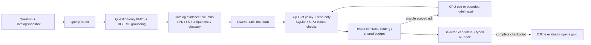

# Báo cáo kỹ thuật A1 so với P6: code hiện tại, kiến trúc và kết quả đầy đủ Spider-200/Olist-60

**Cập nhật nội dung:** 2026-10-08, Asia/Bangkok. Benchmark chạy từ 2026-10-07 và kết thúc rạng sáng 2026-10-08. Báo cáo giữ cấu trúc mục 0–9 của [bản new3](comparison_new3_to_baseline_vn.md), nhưng đối tượng đánh giá là **A1 `obligation-cpu` trong workspace hiện tại**, không phải kiến trúc Paper II/R2 trong worktree lịch sử.

**Trạng thái thực thi:** hoàn tất **Spider 200/200 + Olist 60/60**. Sequence `a1-startupfix450-20261007` có `phase=COMPLETE`, cả hai suite `COMPLETE`, checkpoint đủ ID và reports đã được kiểm tra; worker/server/proxy PID đều `null`, cleanup hoàn tất. **Kết quả chất lượng:** Spider **142/200 (71,00%)**, Olist **41/60 (68,33%)**. Research A1 vẫn `IN_PROGRESS`; P6 tiếp tục là default/champion, chưa promote A1 hoặc đánh dấu một gate nghiên cứu mới `VERIFIED`.

## 0. Tóm tắt kỹ thuật cho reviewer ngoài nhóm

### 0.1 Phạm vi hệ thống và vị trí của A1

Project là hệ thống Text-to-SQL local trên Ollama/SQLite, có catalog/index, sinh SQL, policy đọc-only, executor có giới hạn, correction, trace và evaluator tách khỏi runtime. Runtime nhận câu hỏi và database/catalog đã đăng ký; gold benchmark chỉ được evaluator dùng sau khi prediction được checkpoint. Core không cần paid-provider SDK hoặc API key. [Master plan](realistic_project_creation_codex.md) là đặc tả và completion ledger chuẩn; [P6 gate](docs/evidence/p6_gate.md) là bằng chứng baseline release.

P6 dùng một logical plan do LLM sinh trước grounding/generation. A1 thay đường suy luận này bằng **question-first generation**: câu hỏi + evidence từ schema/catalog/domain đi trực tiếp vào generator; CPU kiểm tra clause, routing và contract quyết định có được sửa hay không. Grounding A1 vẫn gọi retriever với một `LogicalPlan` trung tính kiểu lookup để dùng interface hiện có; đây không phải một semantic plan do LLM tạo, và `result.plan=null` trong các predictions A1.



| Boundary/module hiện tại | Trách nhiệm và đường chạy đã kiểm tra |
|---|---|
| [`settings.py`](src/agentic_text2sql/settings.py), [`service_factory.py`](src/agentic_text2sql/layer6_application/service_factory.py) | Typed settings; pin model/backend; chọn P6 hoặc A1. Default `pipeline_mode=p6`; benchmark này override sang `a1`. |
| [`layer1_reasoning/`](src/agentic_text2sql/layer1_reasoning/) | QueryRouter cho cả hai pipeline; planner/decomposer vẫn tồn tại cho P6. A1 bỏ lượt **LLM planner**. |
| [`layer2_grounding/`](src/agentic_text2sql/layer2_grounding/) | SQLite introspection, catalog hash, immutable FAISS/BM25 index, hybrid retrieval và schema context. |
| [`a1_prompt.py`](src/agentic_text2sql/layer3_generation/a1_prompt.py), [`sql_text_adapter.py`](src/agentic_text2sql/layer3_generation/sql_text_adapter.py) | Evidence question/catalog/domain; kiểm input budget; hỗ trợ JSON hoặc SQL-text. Run thực tế dùng JSON, không dùng SQL specialist. |
| [`layer4_validation/`](src/agentic_text2sql/layer4_validation/) | SQL policy, read-only executor, clause checks, critic routing, independent rank binding và scoped repair contract. |
| [`a1_service.py`](src/agentic_text2sql/layer6_application/a1_service.py), [`budgets.py`](src/agentic_text2sql/workflow/budgets.py) | Điều phối draft/repair/selection; một shared request/deadline budget, gồm provider retries; trace `a1-trace-v3`. |
| [`layer5_correction/`](src/agentic_text2sql/layer5_correction/), CLI/API/UI | Correction truyền thống được giữ cho P6; A1 có đường repair riêng. Factory và result contracts là boundary dùng chung cho các entrypoints. |
| [`agentic_text2sql_eval/`](src/agentic_text2sql_eval/) | Chấm final/draft/candidate pool sau inference, paired analysis và offline diagnostics; không được import vào runtime core. |
| [`resource_guard.py`](src/agentic_text2sql/resource_guard.py), [`tmux_benchmarks.py`](scripts/tmux_benchmarks.py) | Preflight/continuous monitoring, checkpoint, batch 1, unload/cooldown, pause/resume, stop latch, owned native server và truthful completion. |

**Code hiện tại:** branch `research_local_sql_a1_20261003`, Git HEAD `0972e4715f2aa8a64652c3b27d10c80f178bc162`, worktree có thay đổi chưa commit. Vì vậy HEAD không đủ đại diện cho code chạy. Source digest cuối của cả hai checkpoint và source hiện tại đều là:

```text
b9f38c2260dece07a0b9f476ac284689a0b3e2e50a35aa65b367d2c785683193
```

Digest đóng băng `src`, các Python/PowerShell script, prompts và các config/data-contract liên quan. Predictions có các prefix qua migration infrastructure được audit, nên không gọi toàn bộ 260 case là một run không gián đoạn trên một source hash duy nhất; mục 7 mô tả lineage cụ thể.

### 0.2 Ma trận cấu hình và đối chứng

| Cấu hình | Kiến trúc suy luận | Model/compute đã đo | Vai trò |
|---|---|---|---|
| **P6 lịch sử** | Planner LLM → hybrid grounding → generator; tối đa một correction | Qwen3-14B Q4_K_M, 6 GPU layers; profile/guard lịch sử | Champion: Spider **130/200**, Olist **57/60**. Không phải control cùng phần cứng với A1. |
| **R2 coverage-v2 lịch sử** | Hybrid/adaptive planning, coverage schema context; candidate legacy | Cùng model family/digest; 1 GPU layer, hard cap 700 MHz, bounded correction | Mốc ở new3: Spider **128/200**. Không phải code A1 đang chạy. |
| **A1 hiện tại: obligation-cpu** | Question-first draft; CPU checks; obligation routing; scoped repair/selection | Qwen3-14B Q4_K_M, 41 layers, hard cap 300–450 MHz, guarded batch 1 | Full integrated variant: Spider **142/200**, Olist **41/60**. |

Run A1 pin `pipeline_mode=a1`, `critic_mode=repair`, `generation_format=json`, `compute_policy=obligation`, `deterministic_repair=true`, `repairability_routing=true`, `repair_feedback_mode=grounded`, `critic_shadow_sample_rate=0`. Tên `obligation-cpu` mô tả **khả năng được bật**, không chứng minh CPU repair đã hoạt động: trace của full run ghi **0 CPU repairs và 0 critic calls**.

### 0.3 Kết quả cần đọc trước khi xem phân tích lỗi

| Phép so | Result-correct A1 / P6 | Paired gain/loss của A1 | P50/P95 service latency A1 / P6 | Kết luận trong phạm vi phép đo |
|---|---|---|---|---|
| Spider-200 | **142/200 / 130/200** | **19 / 7; net +12** | **12,65/16,95 s / 58,51/85,29 s** | Outcome cross-domain tốt hơn P6 lịch sử trên manifest này; chưa cô lập hiệu ứng từng module hoặc hardware. |
| Olist-60 | **41/60 / 57/60** | **2 / 18; net −16** | **14,01/19,89 s / 61,92/91,62 s** | Application accuracy giảm mạnh; tốc độ quan sát không đủ để promote. |
| Spider A1 / R2 coverage | **142/200 / 128/200** | **20 / 6; net +14** | **12,65/16,95 s / 69,89/156,86 s** | A1 vượt outcome của R2 ở new3; vẫn là bundle comparison qua source/profile khác nhau. |

**Điểm quyết định:** A1 có tín hiệu tích cực trên Spider, nhưng chưa thay được P6 cho project tổng thể vì Olist giảm **26,67 điểm phần trăm**. Workload hoàn tất 260/260 nghĩa là pipeline và evaluator đã đi hết manifest, không đồng nghĩa 260 SQL đều đúng.

## 1. Kết luận điều hành và ranh giới bằng chứng

Trên Spider, A1 tăng **130 → 142/200**, tức **+12 câu, +6,00 pp**; holdout tăng **67 → 74**, regression **63 → 68**. Ghép ID có **123 cùng đúng, 51 cùng sai, 19 gain và 7 loss**. Exact McNemar hai phía trên 26 discordant cases cho **p≈0,02896**. Đây là thống kê thăm dò trên tập case cố định đã được dùng trong lịch sử phát triển; không chứng minh một module riêng tạo gain, không thay thế matched control/multiple runs, và không xử lý hết sự phụ thuộc giữa các câu cùng database.

Trên Olist, A1 giảm **57 → 41/60**, tức **−16 câu, −26,67 pp**. Có **39 cùng đúng, 1 cùng sai, 2 gain và 18 loss**; exact McNemar hai phía **p≈0,000402**. Regression partition giảm **14 → 7/15**, tiếng Việt **29 → 17/30**. Đây là regression ứng dụng lớn, dù thời gian service quan sát thấp hơn.

Gain Spider chủ yếu nằm ở **draft mới**: first-pass **141/200**, selected final **142/200** và candidate-pool oracle **142/200**. Chỉ một operational repair tăng kết quả đúng. Với **0 eligible semantic contracts, 0 CPU edits, 0 critic calls**, run này không cung cấp bằng chứng rằng semantic repair/repairability routing là tác nhân tạo +12 câu so P6.

P50/P95 A1 giảm quan sát khoảng **78,37%/80,13% trên Spider** và **77,38%/78,29% trên Olist** so P6 lịch sử. Tuy nhiên A1 bỏ lượt planner LLM và đồng thời đổi offload **6 → 41 layers**, clock/guard/budget và source. Không gọi các tỷ lệ này là speedup riêng của thuật toán. Latency report chỉ là service; runtime setup và wall time có cooldown được báo riêng ở mục 2.

**Quyết định:** giữ P6 default/champion; A1 là research opt-in có full runtime evidence và Spider outcome đáng nghiên cứu. Ưu tiên sửa các lỗi grounding/intent/output contract đã đo được, sau đó chạy control và ablations cùng profile trên schema chưa dùng để thiết kế. Không tự promote A1 chỉ từ Spider 71% hoặc từ việc tmux đã hiện `SUCCESS FINISH ALL`.

## 2. Số liệu đối chiếu

### 2.1 Spider-200: kết quả đầy đủ

| Chỉ số | P6 lịch sử | R2 legacy mới ở new3 | R2 coverage-v2 ở new3 | A1 hiện tại |
|---|---:|---:|---:|---:|
| Result-correct |130/200 (65,00%)|120/200 (60,00%)|128/200 (64,00%)|**142/200 (71,00%)**|
| Holdout |67/100|61/100|65/100|**74/100**|
| Regression |63/100|59/100|63/100|**68/100**|
| Easy |83/107|83/107|80/107|**87/107 (81,31%)**|
| Medium |27/53|21/53|26/53|**32/53 (60,38%)**|
| Hard |16/29|12/29|17/29|**17/29 (58,62%)**|
| Extra |4/11|4/11|5/11|**6/11 (54,55%)**|
| SQL candidate tồn tại |199/200|198/200|199/200|199/200|
| Typed terminal |200/200|200/200|200/200|200/200|
| P50/P95 service latency |58,51/85,29 s|67,37/163,51 s|69,89/156,86 s|**12,65/16,95 s**|

Hai cột R2 legacy/coverage giữ context của new3; paired analysis mới trực tiếp chấm lại **P6, R2 coverage và A1** bằng `spider-release-v2-outer-order`. Kết quả và mọi correctness label của ba report đều không đổi: **130,128,142**. Không chạy lại inference cho các đối chứng lịch sử.

Field `valid_candidate_count` trong evaluator thực chất đếm `generated_sql != null`; báo cáo gọi rõ là **candidate tồn tại**, không đồng nhất với SQL được validate hoặc result-correct. A1 có **198 `SUCCEEDED`, 1 `VALIDATION_FAILED`, 1 `WRITE_BLOCKED`**; 199 candidate gồm cả SQL bị validator reject.

### 2.2 Olist-60: acceptance đầy đủ

| Chỉ số | P6 lịch sử | A1 hiện tại | Chênh A1 − P6 |
|---|---:|---:|---:|
| Result-correct |**57/60 (95,00%)**|41/60 (68,33%)|**−16; −26,67 pp**|
| Dev |28/30|21/30 (70,00%)|−7|
| Regression |14/15|7/15 (46,67%)|−7|
| Holdout |15/15|13/15 (86,67%)|−2|
| English |28/30|24/30 (80,00%)|−4|
| Vietnamese |29/30|17/30 (56,67%)|−12|
| Easy |34/37|28/37 (75,68%)|−6|
| Medium |21/21|13/21 (61,90%)|−8|
| Hard |2/2|0/2|−2|
| SQL candidate tồn tại |60/60|52/60 (86,67%)|−8|
| Runtime `SUCCEEDED` |60/60|50/60 (83,33%)|−10|
| Typed terminal |60/60|60/60|0|
| First-pass theo report |51/60, legacy proxy|41/60, saved draft scoring|Định nghĩa khác; không phải ablation trực tiếp|
| P50/P95 service latency |61,92/91,62 s|14,01/19,89 s|−47,91/−71,74 s|

Olist A1 dùng `olist-preview-v2`: chấm **preview kết quả đã lưu**, giữ thứ tự cột và áp dụng row-order/tolerance của manifest. Re-score offline P6/A1 bằng cùng phép so giữ nguyên **57/41** và mọi correctness label. Mốc Paper II adaptive **58/60** trong new2/new3 chỉ là lịch sử recovery nhiều revision; không dùng nó như fresh matched control cho A1.

### 2.3 Draft, selection, compute và correction thực tế

| Chỉ số từ A1 trace/evaluator | Spider-200 | Olist-60 |
|---|---:|---:|
| First-pass result-correct |141/200 (70,50%)|41/60 (68,33%)|
| Final selected result-correct |142/200 (71,00%)|41/60 (68,33%)|
| Saved candidate-pool oracle |142/200 (71,00%)|41/60 (68,33%)|
| Draft → selected gain/loss |1/0|0/0|
| Generation HTTP attempts, gồm retries |201|54|
| Mean generation attempts / toàn bộ case |1,005|0,900|
| Embedding API calls |199|60|
| Repair attempted / admitted |2/1|2/0|
| Model repair attempts |2|2|
| CPU repair attempts |0|0|
| Eligible semantic contracts |0|0|
| Critic routed / completed |0/0|0/0|
| Semantic status cuối |200/200 `UNVERIFIED`|60/60 `UNVERIFIED`|

P6 lịch sử ghi **414 generation calls trên Spider**, **126 trên Olist**. A1 giảm topology/calls, nhưng Olist mean0,9 còn phản ánh **8 câu fail trước generation**, không phải tám câu được trả lời miễn phí. Trên 52 câu thực sự gọi generator, Olist dùng54/52≈1,038 attempts/case. Candidate-pool oracle là upper bound của **pool đã tạo**, không phải oracle của toàn bộ model hoặc toàn bộ không gian SQL.

Legacy field `correction.attempted_count=0` trong report Olist A1 không chứng minh không có repair: trace A1 ghi **2 model repairs**, cả hai không admitted. Đường A1 lưu repair trong `assessment`, không điền `CorrectionOutcome` legacy như P6. Bản báo cáo này dùng trace/evaluator candidate diagnostics để tránh đọc sai số0.

### 2.4 Latency: service, setup và wall time là các phép đo khác nhau

| Phạm vi latency A1 | Spider P50/P95 | Olist P50/P95 |
|---|---:|---:|
| `latency_ms.total`: service câu hỏi |12,65/16,95 s|14,01/19,89 s|
| `runtime_setup` |1,26/1,35 s|1,24/1,34 s|
| `runtime_end_to_end`: setup + service |13,90/18,21 s|15,30/21,22 s|
| Guarded batch wall, **gồm cooldown60s** |91,10/95,61 s|92,85/98,99 s|
| Mean guarded batch wall |91,80 s|92,17 s|

Service không bao gồm toàn bộ worker import, DB/index hashing, Olist DB copy, checkpoint, monitor startup và cooldown. Không cộng các P50/P95 của từng stage để suy ra quantile tổng. Telemetry server `llm_load/prefill/decode` và timer client cũng có boundary khác nhau.

Tổng wall của **260 batch thành công duy nhất** từ cả ba segment là **23.889,80s = 6 giờ38 phút09,80s**, trong đó cooldown bắt buộc là **15.600s = 4 giờ20 phút**. Khoảng quan sát từ native sample đầu **15:36:44 ngày07/10** đến sample cuối **00:17:01 ngày08/10**, giờ Bangkok, là khoảng **8 giờ40 phút17,64s**; khoảng này gồm operator gaps, các stop và recovery. Nó không phải thời gian inference liên tục, cũng không phải chỉ thời gian của session cuối.

## 3. Kiến trúc A1 và điểm can thiệp so với P6/R2

| Bước | P6 baseline | A1 trong full run |
|---|---|---|
| Router | Typed intent; chặn write/unsupported | Giữ router; một read question vẫn bị `WRITE_BLOCKED` ở cả hai run |
| Logical planning | `planner_v2` do LLM tạo | Bỏ LLM planner; question-only grounding dùng neutral lookup plan |
| Retrieval | BM25 + BGE-M3, top20, context budget1200 | Giữ hybrid/index; query expansion không còn semantic plan LLM |
| Evidence generator | Prompt từ plan + schema context | Question + catalog columns/PK/FK/uniqueness + glossary Olist |
| SQL output | Structured generator/candidate normalizer | JSON; `a1-question-evidence-v1`; SQL-text adapter chưa đo |
| Validation | SQL policy/read-only execution + plan/domain checks | Policy/executor + CPU clause checks; UNKNOWN không nâng thành semantic proof |
| Repair | Corrector truyền thống có bounded loop | Một bounded repair; operational recovery hoặc semantic edit theo contract |
| Selection | Workflow correction result | Chỉ admit repair đạt điều kiện; giữ draft khi repair không admitted |
| Cost control | Topology/limits lịch sử | Shared cap3 generation attempts, tính cả retries; input2800/output768, ctx4096 |
| Hardware |6 GPU layers trong P6 benchmark |41 layers, hardclock450MHz và strict resource guards |

Evidence A1 gồm schema được chọn, bổ sung PK/FK cần thiết từ catalog; uniqueness metadata có cảnh báo về partial/expression scope. Đây là metadata, chưa phải chứng nhận entity grain. Olist glossary là domain adapter, không biến thành gold answer. Runtime vẫn không dùng case ID/gold SQL làm đầu vào suy luận.

Semantic repair contract hiện chỉ cấp phép cho **ranking edit hẹp**: một source, metric bind độc lập từ question/catalog, top-count/direction rõ, không aggregate/join/subquery/CTE/window/group/distinct/scope ambiguity, count không quá200. Contract cho phép đổi `order`/`limit`, có planned AST; admission đòi đúng planned edit, validation pass, contradiction giảm và không thêm UNKNOWN. Population, projection, grain, set logic và general business semantics chưa được repair contract bao phủ.

`compute_policy=obligation` với production repair và shadow_rate0 giữ compute cho edit hợp lệ; unsupported risks ở UNKNOWN và không gọi critic. Run này không có contract eligible nên không có semantic critic/CPU edit thực tế. Bốn model repairs quan sát đều thuộc **operational errors**, không phải semantic repair đã được chứng minh.

P6 vẫn là default path trong `Settings`; A1 chỉ được chọn bởi frozen settings của benchmark. Module DIN/coverage/typed challenger của Paper II trong worktree lịch sử không tự tham gia run này. Không dùng tên Paper II hoặc số58/60 để mô tả capabilities của A1 hiện tại.

## 4. Các chỉnh sửa trọng điểm project từ báo cáo trước

### 4.1 Chuyển từ integrated R2 sang A1 question-first trên nền P6

Workspace hiện tại phát triển A1 opt-in trên nền `0972e47`, không tiếp tục toàn bộ runtime của worktree R2700. A1 thay dependency vào LLM plan bằng evidence question/catalog; có trace snapshots của draft/candidate pool và budget dùng chung. Đây là một thay đổi bundle, không phải P6 cộng riêng một schema module.

Factory có các variant P6, A1 off/shadow/legacy-repair, obligation-LLM, obligation-CPU và risk-routing controls. Full260case hiện chỉ đo **obligation-cpu**; chưa có kết quả matched ablation cho các variant còn lại. [Kế hoạch A1](docs/research_plan/local_sql_a1_2026_10_03.md) và [novelty/repairability assessment](docs/research_plan/novelty_and_repairability_2026_10_03.md) mô tả giả thuyết và conditions, không phải bằng chứng các paper/module đã được replication.

### 4.2 Thêm evidence, clause checks và scoped repair/selection

Typed `SemanticEvidence`, `ClauseFinding`, `RepairContract`, `CandidateEvaluation` và `A1Trace` tách evidence khỏi hypothesis SQL và label offline. Findings phân biệt `SUPPORTED/CONTRADICTION/UNKNOWN`; model critique không được tự nâng thành deterministic contradiction. CPU edit và model edit phải qua revalidation/admission; operational errors có đường recovery riêng trong shared budget.

Trong full run, draft checks của **199 Spider** và **52 Olist** đều ghi các unknown về ranking, output binding, population/predicate, entity grain và semantic coverage; không có deterministic contradiction được ghi ở draft. Những con số này giải thích vì sao contract eligibility bằng0, nhưng chưa đo precision/recall của detector: không có independently reviewed semantic labels.

### 4.3 Hoàn thiện request/resource budgets và các entrypoints

Generator dùng Qwen3:14b-q4_K_M, temperature0, seed42, `think=false`, JSON format, output cap768; global generation cap3 gồm provider-level format retries. Request timeout120s; case deadline thực tế **180s** do guarded profile override. Plan JSON gốc có field120s, nên cấu hình thực thi phải đọc từ **runtime identity/profile**, không suy ra từ một field trước override.

Run dùng `num_gpu=41`, CPUthreads8, context4096, Ollama internal `num_batch=64`, flash attention và q8_0 KV cache. **Benchmark batch=1** khác internal num_batch64. Embedding BGE-M3 dùng bounded CPU offload0, sequential requests; model residency max1/parallel1, keep_alive0 và unload. Không chạy generation/embedding đồng thời. SQL-specialist/model mới không được pull hoặc benchmark trong báo cáo này.

### 4.4 Khóa provenance, sửa metadata fingerprint và resume

Checkpoint pin source/settings/manifest/DB/index/profile; backend pin model/template/options/version và per-DB provenance. Metadata fingerprint trước đây hash raw parameter text, nên cùng values khác thứ tự dòng gây false stop. Đã chứng minh old hash khớp permutation của cùng values, chuyển fingerprint sang canonical representation và audit migration; actual parameter/model/template changes vẫn bị chặn.

Predictions checkpoint qua temporary file, flush/fsync và atomic replace; prefix phải đúng manifest và không duplicate. Tmux manager pin typed settings/interpreter, phân biệt pause với resource stop, giữ stop latch, kiểm owned process group và full report trước `SUCCESS FINISH ALL`. Những thay đổi này giúp chạy nốt durable prefixes; chúng không phải lý do để cộng điểm accuracy.

### 4.5 Sửa bootstrap monitor và harden cleanup

Đã thay pagefile CIM loop bằng native Windows API, giữ diagnostic stderr/exception detail, duy trì heartbeat trong failure cleanup/cooldown. Startup timeout sau173case dẫn đến cache compiled memory helper theo source hash/DLL checksum, readiness bound15s; model worker chỉ được spawn khi có valid fresh sample. Running freshness vẫn1s, configured sampling0,5s, tất cả hardware limits giữ nguyên.

Profile full GPU dùng hardclock300–450MHz sau pilot800MHz bị power stop81,2W; không lặp pilot800MHz hoặc bỏ watchdog. Monitor/metadata/bootstrap stops được giữ trong artifacts và recovery chỉ thực hiện sau remediation/pilots. Chi tiết lineage và số resource ở mục7.

## 5. Spider transfer và Olist acceptance: P6 là đối chứng quyết định

### 5.1 Paired Spider: tổng, partition và complexity

| Slice Spider | N | P6 đúng | A1 đúng | Cả hai đúng | Cả hai sai | A1 gain | A1 loss | Net |
|---|---:|---:|---:|---:|---:|---:|---:|---:|
| Toàn bộ |200|130|142|123|51|19|7|**+12**|
| Holdout |100|67|74|64|23|10|3|+7|
| Regression |100|63|68|59|28|9|4|+5|
| Easy |107|83|87|80|17|7|3|+4|
| Medium |53|27|32|27|21|5|0|+5|
| Hard |29|16|17|12|8|5|4|+1|
| Extra |11|4|6|4|5|2|0|+2|

Tổng score tăng ở cả bốn complexity slices, nhưng A1 vẫn làm mất **3 easy và4 hard** P6 đã đúng. Historical non-regression target≤1% tổng tập chưa đạt: loss7/200=3,50%. Không đồng nhất net gain dương với bảo toàn mọi incumbent-correct case.

### 5.2 Spider theo toàn bộ20database

| Database | N | P6 đúng | A1 đúng | Gain | Loss | Net |
|---|---:|---:|---:|---:|---:|---:|
| battle_death |10|8|9|1|0|+1|
| car_1 |11|5|6|1|0|+1|
| concert_singer |10|9|9|0|0|0|
| course_teach |10|6|6|0|0|0|
| cre_Doc_Template_Mgt |11|8|9|1|0|+1|
| dog_kennels |10|4|5|2|1|+1|
| employee_hire_evaluation |10|7|8|1|0|+1|
| flight_2 |10|9|10|1|0|+1|
| museum_visit |10|6|7|2|1|+1|
| network_1 |10|5|9|5|1|+4|
| orchestra |10|5|6|1|0|+1|
| pets_1 |10|9|9|0|0|0|
| poker_player |10|8|9|1|0|+1|
| real_estate_properties |4|2|2|0|0|0|
| singer |10|8|7|0|1|−1|
| student_transcripts_tracking |10|4|4|0|0|0|
| tvshow |10|6|8|2|0|+2|
| voter_1 |10|7|7|0|0|0|
| world_1 |14|8|7|0|1|−1|
| wta_1 |10|6|5|1|2|−1|
| **Tổng** |**200**|**130**|**142**|**19**|**7**|**+12**|

Có11database tăng net score,6giữ net score và3giảm. `network_1` đóng góp net+4 nhưng vẫn có một loss; database score bằng nhau cũng không tự chứng minh cùng candidate. Cỡ mẫu mỗi DB nhỏ và manifest là20DB selected, không phải toàn bộ Spider dev.

### 5.3 Paired Olist: application regression

| Slice Olist | N | P6 đúng | A1 đúng | Cả hai đúng | Cả hai sai | Gain | Loss | Net |
|---|---:|---:|---:|---:|---:|---:|---:|---:|
| Toàn bộ |60|57|41|39|1|2|18|**−16**|
| Dev |30|28|21|19|0|2|9|−7|
| Regression |15|14|7|7|1|0|7|−7|
| Holdout |15|15|13|13|0|0|2|−2|
| English |30|28|24|23|1|1|5|−4|
| Vietnamese |30|29|17|16|0|1|13|−12|
| Easy |37|34|28|26|1|2|8|−6|
| Medium |21|21|13|13|0|0|8|−8|
| Hard |2|2|0|0|0|0|2|−2|

Hai gain là `olist_acc_014`, `olist_acc_023`; common failure là `olist_acc_038`.18loss gồm8grounding failures,2validation failures và8executed-but-mismatched cases; loss18/60=30% tổng tập. Olist regression/tiếng Việt cần được xử lý trước bất kỳ promotion nào.

### 5.4 Protocol của phép đối chiếu

Spider dùng cùng200IDs, partition/complexity labels,20database hashes và expected-result hashes. Offline re-score mở gold sau inference, chạy SQL đã lưu trên read-only DB, timeout10s/100.000rows, outer ORDER quyết định row order; column permutation chỉ xét tới width8. P6/R2/A1 labels giữ nguyên dưới cùng evaluator. Olist cùng60reviewedcases/expected-result hashes; re-score preview comparator cũng giữ nguyên labels57/41. Bản copy Olist read-only trên WSL native filesystem được kiểm byte hash để tránh overhead DrvFS, không sửa DB hoặc prediction.

Cặp A1–P6 vẫn khác source/prompt/topology/profile nên đây là **paired outcome comparison**, không phải causal ablation. Spider/Olist từng được mở gold trong các vòng phát triển; các partition tên holdout không còn là một test set hoàn toàn chưa tiếp xúc cho các sửa đổi tiếp theo. Không gộp200Spider và60Olist thành một accuracy chung vì protocol và mục đích khác nhau.

## 6. Failure cases, nguyên nhân quan sát và weakness còn lại

### 6.1 Phân loại terminal và mismatch

| Benchmark | Failures trong denominator | Breakdown |
|---|---:|---|
| Spider |58/200|56`EXECUTION_MISMATCH`,1`UNKNOWN_COLUMN`,1`WRITE_BLOCKED`|
| Olist |19/60|8`GROUNDING_ERROR`,2`VALIDATION_FAILED`/`UNKNOWN_COLUMN`,9`SUCCEEDED` nhưng preview mismatch|

Schema context có ở199Spider và60Olist, trung bình **3,47 bảng/context Spider**, **6,13 Olist**. P6 Spider lịch sử là3,45, R2coverage3,48 theo new3. Đây chỉ là context-size statistic; không chứng minh gold-reference recall của A1 hoặc evidence đã đủ ngữ nghĩa. Đặc biệt Olist có context nhưng evidence builder vẫn có thể fail khi một selected view không có cột grounded.

### 6.2 Tín hiệu AST trong57Spiderfailures có SQL

| Khác biệt cấu trúc so gold, có thể chồng lấn | Số case/57 |
|---|---:|
| Tập bảng dùng trong AST |12|
| Số JOIN |13|
| Tập aggregate function types |8|
| Có/không DISTINCT |10|
| Số subquery |6|
| Số set operation |10|
| Có/không GROUP BY |3|
| Có/không WHERE |5|
| Có/không ORDER BY |4|
| Có/không LIMIT |5|
| Có/không HAVING |2|

Phép đếm này dùng SQLGlot trên saved normalized SQL và gold, gồm case CTE bị validator reject. Các hàng không loại trừ nhau và SQL khác AST vẫn có thể tương đương. Không dùng các số này làm reviewed root-cause labels hoặc detector precision/recall; chúng chỉ ưu tiên điều tra population, relation direction, set logic, aggregation và ranking.

### 6.3 Bảy Spider regression so P6

| Case | DB / complexity | Khác biệt quan sát cần kiểm tra |
|---|---|---|
| `spider_holdout_0976` |dog_kennels / easy|Câu hỏi về treatment gần nhất; draft dùng maximum cost, sai binding giữa thời gian và metric.|
| `spider_regression_0427` |museum_visit / hard|Population đếm lấy từ visit thay vì toàn bộ visitor; anti-join/exclusion không giữ các visitor không có visit.|
| `spider_regression_0898` |network_1 / hard|Chiều quan hệ friend/liked bị bind khác với phép giao tập người có friend và được người khác thích.|
| `spider_regression_1029` |singer / hard|Draft dùng AND của hai điều kiện năm không thể đồng thời, thay vì giao tập citizenship của hai nhóm.|
| `spider_holdout_0795` |world_1 / hard|Validator reject CTE alias`avg_pop`; operational repair không được admitted.|
| `spider_holdout_0489` |wta_1 / easy|Đếm match theo winner/loser hand, thay vì đếm player theo hand; sai population/grain.|
| `spider_regression_0466` |wta_1 / easy|Chọn player/ranking relation thay vì winner/rank-point fields của tournament matches; output/binding khác.|

Với `spider_holdout_0795`, chạy **saved draft** read-only offline cho kết quả local equivalent với gold dù runtime reject`UNKNOWN_COLUMN`. Đây là tín hiệu false rejection ở CTE/derived-scope resolver cần negative/scope fixtures; chưa phải chứng nhận semantic equivalence trên mọi DB. **Benchmark vẫn142/200**, không tự cộng thêm điểm hoặc thay prediction sau khi xem gold.

Case `spider_regression_0699` bị`WRITE_BLOCKED` ở cảP6/A1 do read question có từ “create” trong trường ngày tạo. Đây là false intent block quan sát, vẫn giữ trong denominator200; cần sửa classifier theo intent tổng quát, không bỏ guard write hoặc viết exception theo ID.

### 6.4 Tám Olist grounding failures có thể tái lập model-free

Replay `build_evidence` với saved context/catalog tái lập thông báo **Selected relation has no grounded columns** trên cả8case, trước generator. Sau FK/PK augmentation, các relation dưới đây vẫn không có column được giữ:

| Case | Selected relation không có grounded columns | P6 đúng? |
|---|---|---|
| `olist_acc_021` |products_semantic|Có|
| `olist_acc_027` |customer_order_facts|Có|
| `olist_acc_032` |customer_order_facts|Có|
| `olist_acc_033` |order_payment_totals|Có|
| `olist_acc_041` |order_item_totals|Có|
| `olist_acc_044` |order_payment_totals|Có|
| `olist_acc_049` |order_payment_totals|Có|
| `olist_acc_057` |order_payment_totals|Có|

Đây là lỗi interface giữa selected tables/columns và strict evidence builder, không phải model decode fail hoặc resource stop. View thường không có PK để tự được giữ cột; selected relation có thể được chọn mà không còn cột hợp lệ trong selected_columns. **Không claim sửa8lỗi sẽ đạt49/60**: sau thay evidence, SQL/model outcome có thể đổi; cần run mới và giữ baseline/control.

### 6.5 Các Olist failure còn lại

| Case | Status / nhóm quan sát |
|---|---|
| `olist_acc_003` |SUCCEEDED; câu đếm canceled orders chuyển sang điều kiện order_count của customer facts, sai population/predicate.|
| `olist_acc_010` |SUCCEEDED; lấy average_review_score từ summary view thay vì scalar average của review rows, sai grain/result shape.|
| `olist_acc_013` |SUCCEEDED; aggregate theo bang nhưng trả toàn bộ groups, thiếu top-one selection.|
| `olist_acc_015` |SUCCEEDED; year/count bị đảo vị trí cột so output contract. Đổi chỗ hai cột của saved preview thì khớp P6-correct result.|
| `olist_acc_020` |SUCCEEDED; trả mọi payment type và sort theo tên, thiếu ranking theo count/top-one.|
| `olist_acc_025` |VALIDATION_FAILED;`review_score` được gán vào view không có cột đó; model repair không admitted.|
| `olist_acc_030` |SUCCEEDED; average freight theo item row thay vì per-order aggregate.|
| `olist_acc_035` |VALIDATION_FAILED; category owner gán vào order_items không có column; model repair không admitted.|
| `olist_acc_038` |SUCCEEDED; bỏ filter order_status=delivered; common failure với P6.|
| `olist_acc_039` |SUCCEEDED; aggregate subquery không bind theo order, thay vì so payment/item totals cùng order.|
| `olist_acc_043` |SUCCEEDED; monthly canceled counts nhưng thiếu chọn tháng đứng đầu và tie-break/top-one.|

Mục6.4 và6.5 liệt kê đủ **19Olistfailures**. Với015, mismatch đến từ **column-position contract** của Olist comparator; không gọi mọi executed mismatch là một lỗi ngữ nghĩa cùng loại. Spider cho column permutation, Olist không cho, nên hai accuracy metric không interchangeable.

Các dạng population/grain/output ownership/ranking trên Olist không nằm trong repair contract đơn-source hẹp hiện tại. Bật`deterministic_repair=true` không sửa được chúng khi contract eligibility bằng0. Trace giữ UNVERIFIED thay vì tự claim proof; điều này đúng về epistemic boundary nhưng chưa tạo coverage kiểm nghĩa đủ dùng.

### 6.6 Hiệu quả correction và giới hạn semantic detector

| Repair quan sát | Admitted? | Draft đúng → final đúng |
|---|---|---|
| Spider`spider_holdout_0609` |Có, model operational repair|Sai → đúng|
| Spider`spider_holdout_0795` |Không|Sai theo runtime/evaluator → sai|
| Olist`olist_acc_025` |Không|Sai → sai|
| Olist`olist_acc_035` |Không|Sai → sai|

Không có independent reviewed semantic labels trong offline diagnostics: reviewed=0/unreviewed260, detector precision/recall/FPR **null**, không phải0% hoặc100%. Evaluation labels result-correct/draft-correct có thể đo pool outcomes nhưng không thay thế reviewed error-family labels. Trained critic, calibrated detector, semantic repair generalization và CPU-vs-LLM effectiveness chưa được full run này chứng minh.

## 7. Verification và quản trị artifact

### 7.1 Full completion và lineage của260predictions

| Segment | Prefix/endpoints quan trọng | Stop/remediation |
|---|---|---|
| `a1-fullgpu450-20261007` |Spider18/200,Olist1/60|Monitor failure; native heartbeat stale trong cleanup. Sourceguard/monitor được sửa, giữ evidence.|
| `a1-monitorfix450-20261007` |Cloned18/1; tiếp tục đến173/3|False backend fingerprint do parameter order được canonicalize/audit; sau đó monitor startup timeout trướccase174.|
| `a1-startupfix450-20261007` |Cloned173/3; kết thúc200/60|Cached helper/readiness15s; pilots174/4, full resume; final reports và native cleanup validated.|

Migration chỉ chấp nhận các source changes infrastructure/fingerprint được whitelist; settings/profile/manifest/DB/index/backend/model/template không thay. Prefixes copy byte-identical và được kiểm lại equality; failures không bị bỏ khỏi manifest, completed predictions không được rerun để chọn outcome đẹp. Các source hashes và migration audit nằm trong evidence của từng remediation.

Sequence cuối `phase=COMPLETE`, completed200/60, cả2pilot_passed=true, worker/server/proxy PIDnull; cả2suite COMPLETE và cleanup_pending=false. Log xác nhận:

```text
SUCCESS FINISH ALL: Spider 200/200 + Olist 60/60
NATIVE SERVER CLEANLY STOPPED; job and runners closed
```

Olist report giữ evaluation_id gốc `a1-fullgpu450-20261007-olist` để không đổi frozen selection giữa resume; basename mới`a1-startupfix450-20261007-olist` là artifact lineage, không phải một method khác. Reports mới không làm baseline/R2 reports bị overwrite.

### 7.2 Hardware profile và telemetry toàn chuỗi450MHz

| Chỉ số | Limit của profile | Peak/min ghi nhận trên260successfulcase journals |
|---|---:|---:|
| Available RAM, min Windows/WSL |≥8GiB|**17,9595GiB minimum**|
| Swap/pagefile |<0,25GiB|**0,03954GiB maximum**|
| GPU memory |<14.336MiB|**9.971MiB maximum**|
| GPU temperature |<68°C|**60°C maximum Python;61°C native**|
| GPU power, max average/instant |<70W|**64,71W maximum Python;65,19W native**|
| Graphics clock |≤450MHz|**450MHz maximum**|
| GPU utilization |Observed0–100%|100% maximum|

260successful journals gồm **16.079Pythonobservations**; native journals của ba segment có **51.689samples**, bao gồm cooldown/idle trong các server sessions. Sampling cấu hình0,5s; running sensor freshness1s, monitor/cache failure vẫn fail-closed. Profile batch1/unload/cooldown60s và explicit num_gpu41 được giữ.

Ba unsuccessful Python batches trong chuỗi450MHz được giữ: monitor ValueError tại prefix18, backend fingerprint child failure tại19, Windows monitor startup timeout tại173. Native heartbeat stop của segment đầu cũng được giữ. Các trường hợp này không bị đổi nhãn thành case result failure hoặc giấu khỏi vận hành; checkpoint chưa có case mới thì không tăng denominator/prediction count. Pilot800MHz trước chuỗi này đã chạm81,2W và bị dừng; không đưa số đó vào peak của run450MHz hoặc xóa evidence.

### 7.3 Artifact/provenance để tái lập

| Artifact | Nội dung |
|---|---|
| [`a1-startupfix450-20261007-spider.json`](evals/reports/a1-startupfix450-20261007-spider.json) |Final Spider200 report, slices, errors, candidate quality và provenance.|
| [`a1-startupfix450-20261007-olist.json`](evals/reports/a1-startupfix450-20261007-olist.json) |Final Olist60 report, language/partition/difficulty và preview labels.|
| `evals/predictions/a1-startupfix450-20261007-{spider,olist}.jsonl` |Full saved predictions; `.runtime.json` và`.backend.json` pin source/config/data/model.|
| `data/artifacts/experiments/a1-startupfix450-20261007/` |Frozen plan, sequence state, run/server logs, limits, heartbeat/native samples và startup migration audit.|
| [`spider-p6-200.json`](evals/reports/spider-p6-200.json), [`olist-p6-60.json`](evals/reports/olist-p6-60.json) |P6 historical controls giữ nguyên.|
| `../Agentic_text_to_sql_spider700/evals/reports/spider-schema-coverage-200-v2.json` |R2 coverage outcome tạiworktree lịch sử.|
| `data/artifacts/comparison-new4-20261008/summary.json` |Offline paired, latency, resources, diagnostics và verification summaries cho báo cáo này.|
| `data/artifacts/comparison-new4-20261008/analyze_new4.py` |Saved offline reproduction script; không khởi tạo RuntimeBundle/Ollama hoặc inference.|

Generation model digest:

```text
bdbd181c33f2ed1b31c972991882db3cf4d192569092138a7d29e973cd9debe8
```

Embedding digest:

```text
7907646426070047a77226ac3e684fbbe8410524f7b4a74d02837e43f2146bab
```

Spider manifest SHA256:

```text
35382bd0641a0ae7a4e7ab3bcc7c02efce96fe4df8fb9b754599389eb43c5b4e
```

Các digests/identities lấy từ frozen artifacts và config, không suy từ tên model hoặc basename. Ollama version0.30.10; generation template/options pinned; profile41layers/450MHz. Raw dataset/database/index/traces/predictions/generated diagnostic reports vẫn là ignored local artifacts, không nhúng vào tài liệu hoặc commit chúng.

### 7.4 Source verification và evidence

`make check` chạy lại ngày2026-10-08: **Ruff pass, format281files pass, mypy119sourcefiles pass,260tests passed/1Ollama deselected,80,11s**. Một Starlette/httpx deprecation warning từ dependency không làm suite fail. Không chạy thêm local LLM hoặc benchmark inference để viết báo cáo này.

Offline verification xác nhận source hiện tại khớp sourceSHA của cả2final runtime identities; reports đủ IDs đúng thứ tự, expected-result/data hashes khớp và states cleanup sạch. Re-score savedSQL/preview giữ nguyên toàn bộ labels. Bằng chứng vận hành đọc tại [fullGPU450](docs/evidence/a1_fullgpu450_2026_10_07.md), [monitor/metadata recovery](docs/evidence/a1_monitor_recovery_2026_10_07.md), [startup recovery](docs/evidence/a1_monitor_startup_recovery_2026_10_07.md), và [run plan](docs/monitor_recovery_plan_2026_10_07.md).

## 8. Claim boundary

- **Đã đo:** full260prediction/typed terminals và validated reports/cleanup; Spider142/200 soP6130, paired19/7; Olist41/60 soP657, paired2/18; exact common-evaluator re-score; service/setup/batchwall/resource telemetry; semantic critic/CPU edit thực tế bằng0; một operational repair Spider gain.
- **Có thể kết luận trong run này:** integrated A1 có Spider outcome cao hơn baseline lịch sử và service latency quan sát thấp hơn; application Olist outcome giảm mạnh. Scoped semantic repair chưa có coverage thực tế trên manifest này. Grounding failures và một CTE rejection có reproducible diagnostic evidence.
- **Chưa chứng minh:** gain do bỏ planner riêng, do evidence riêng hoặc routing/CPU edit riêng; matched hardware speedup; calibrated detector; repeated-run stability; SQL specialist performance; unseen-schema generalization; semantic proof từ statusUNVERIFIED.
- **Không claim:** official hidden Spider leaderboard71%, full-dev1034score, Olist100%, production readiness, absence of overfitting tuyệt đối, no-stop guarantee, hoặc một paper novelty đã được verify từ runtime completion.
- **Gate/quyết định:** runtime workload hoàn tất; A1 research vẫn`IN_PROGRESS`. P6 default/champion giữ nguyên. Không đủ điều kiện promote A1 vì Olist regression lớn, Spider loss7case, thiếu matched safe P6 control/ablation và fresh-schema evidence.

## 9. Khuyến nghị kỹ thuật và thí nghiệm tiếp theo

### 9.1 P0 — Sửa interface selected relations/columns trước khi mở benchmark mới

Thiết kế invariant model-free: mỗi selected relation phải có grounded columns hợp lệ, kể cả view không cóPK. Chọn giữa giữ đủ cột có evidence hoặc loại relation không cần thiết **trước** evidence rendering, đồng thời bảo toàn required owner/FK connectivity. Kiểm bằng synthetic/renamed schemas, views, bridges và negative contexts; không hardcode8OlistIDs. Nếu input vượtbudget, trả typed failure rõ; không âm thầm tăng token hoặc bỏ provenance. Chỉ sau invariant checks mới có cơ sở chạy lại Olist với source/config mới.

### 9.2 P0 — Bổ sung output/intent/grain contracts và kiểm resolver

Ưu tiên các lớp lỗi đã quan sát: top-one/tie-break, output column order, per-order vs per-item grain, scalar average, population/filter binding, relation direction và set membership. Tách question goal/owner evidence khỏi draft SQL để tránh self-confirmation; unsupported intent ởUNKNOWN có phép đo rõ. Kiểm CTE/derived-column alias resolver bằng nhiều schemas/scopes và negative unknown columns; kiểm read-intent có field names như ngày tạo mà không làm yếu write policy. Không sửa theo gold/ID rồi gọi lại cùng60/200case là blind gain.

### 9.3 P0 — Tạo matched safe P6 control và ablate từng thay đổi

Control cần cùng approved450MHzprofile,41GPUlayers,model/index/template digests,seed,budgets,unload/cooldown và evaluator. Sau đó đo riêng topology question-first, evidence packing và correction controls. Các variants hiện có chỉ là công cụ cho thiết kế; chưa có full matched scores của chúng. Mỗi model run tiếp theo vẫn phải qua guarded pilot, batch1 và continuous resource monitoring; không nới guard để làm latency đẹp.

### 9.4 P1 — Kiểm coverage và utility của repair trước khi claim novelty

Full run cho contract coverage0 và CPU edits0. Cần một tập independently reviewed errors cùng synthetic/adversarial counterpart để đo contract eligibility, detector precision/recall/FPR, admission false rejection và draft→selected gain/loss. Chạy critic shadow riêng, label review tách khỏi runtime; không lấy execution success làm semantic label. CPU-vs-LLM edit comparison chỉ meaningful khi cùng routing/contract và có đủ eligible cases. Hiện cả selected và pool oracle chỉ bằngdraft hoặc+1Spider, nên tăng số role chưa có bằng chứng cần thiết.

### 9.5 P1 — Fresh schemas, non-regression và promotion gates

Schema/cases hiện tại đã dùng chẩn đoán lịch sử và báo cáo này. Chốt policy/threshold trước một acceptance set chưa dùng để thiết kế; giữ matched P6 outputs làm incumbent, đo paired gains/losses và case-level safety. Một run Spider+6pp không bù được Olist−26,67pp của project nếu use case chính cần thương mại/song ngữ.

| Gate quyết định | Evidence hiện tại | Việc còn thiếu |
|---|---|---|
| Workload completeness |200/200+60/60,statesCOMPLETE,cleanupvalidated|Đã hoàn tất workload này; không cần rerun để chứng minh completion.|
| Accuracy/acceptance |Spider142/200;Olist41/60|Matched control, sửa application regression, fresh acceptance evidence.|
| Non-regression |Spider7loss;Olist18loss|Bảo toàn incumbent bằng contracts/selection tổng quát, chốt tolerance trước test.|
| Mechanism/novelty |Critic0,contracteligible0,CPUedit0|Ablations và independent labels cho coverage/utility của mechanism.|
| Latency/resource |Service thấp hơn lịch sử;batchwall~92s;limits an toàn ởsafe segments|Matched-profile latency/SLA; giữ riêng cooldown/setup/failed-run/operator gaps.|
| Generalization/production |20SpiderDB+1OlistDB đã exposed|Unseen schemas, permission/audit/schema drift/concurrency và deployment acceptance riêng.|

### 9.6 P2 — Tối ưu vận hành sau khi khôi phục accuracy

Đo/cache catalog/index/database identity theo schema/content hash; tối ưu worker import/hash/copy và monitor bootstrap trước khi thay model. Giữ model unload và cooldown60s trên laptop; không bỏ safety để lấy throughput. Product UI nên phân biệt typed workflow completion, SQL executability, semanticUNVERIFIED và offline benchmark accuracy; candidate confidence không phải xác suất trả lời đúng đã calibration.

Thứ tự đề xuất từ full run: **grounding invariant → resolver/output/intent/grain contracts → matched P6 control → fresh paired ablations → repair calibration → latency/production hardening**. Báo cáo này hoàn tất việc ghi nhận code/benchmark hiện tại; không tự thực hiện các thí nghiệm hoặc sửa runtime tiếp theo.
