# Báo cáo kỹ thuật V5 so với P6 và V4: độ tin cậy cơ học, kiến trúc A1 và benchmark đầy đủ Spider-200/Olist-60

**Ngày cập nhật:** 17/10/2026, múi giờ UTC+7. Benchmark CPU chạy qua hai ngày 16–17/10/2026 và hoàn tất khoảng **20:05 ngày 17/10**. Báo cáo giữ cấu trúc mục 0–9 của [báo cáo V4](comparison_new4_to_baseline_vn.md), bổ sung đối chiếu trực tiếp **V5–V4** bên cạnh đối chứng **V5–P6**.

**Định danh phiên bản:** “V5” trong tài liệu này là tên bản báo cáo/nâng cấp hiện tại theo yêu cầu người dùng. Phương pháp thực sự được đo là **A1 `v4-reliability`**, trên branch `v4_incremental_reliability_20261016`, sequence hoàn tất `v4-cpu600-stream-20261016`. Tiền tố `v4-` trong artifact được giữ để bảo toàn provenance. Run này không phải các experiment `v5-intent*` đã dừng, cũng không phải phương án hybrid/V6 hoặc kiến trúc có thêm một lượt LLM trích xuất intent.

**Trạng thái thực thi:** **COMPLETE — Spider 200/200 và Olist 60/60**; cả hai report đã được kiểm tra, hai suite `COMPLETE`, cleanup hoàn tất, worker/server/proxy PID đều `null`. **Chất lượng:** Spider **143/200 (71,50%)**; Olist **50/60 (83,33%)**. `make check` đạt **341 tests passed, 1 Ollama test deselected**. Workload đã hoàn thành; nghiên cứu A1 và quyết định promotion vẫn cần thêm bằng chứng. P6 tiếp tục là default/champion.

## 0. Tóm tắt kỹ thuật cho reviewer ngoài nhóm

### 0.1 Phạm vi hệ thống và thay đổi thực chất của V5

Project là hệ thống Text-to-SQL chạy local với Ollama/SQLite: câu hỏi đi qua router, grounding từ catalog/index, sinh SQL, kiểm policy, thực thi read-only, sửa có giới hạn và lưu trace. Gold SQL và evaluator nằm ngoài runtime suy luận. Core không yêu cầu paid-provider SDK hoặc API key. [Master plan](realistic_project_creation_codex.md) là đặc tả và completion ledger chuẩn; [kế hoạch sửa lỗi thực tế](accurate_real_problem_set_plan.md) ghi giả thuyết, tiêu chí bác bỏ và lịch sử thực thi.

P6 dùng LLM để lập logical plan trước grounding/generation. A1 ở V4 bỏ lượt LLM planner và sinh SQL trực tiếp từ câu hỏi cùng evidence của catalog/domain. **V5 giữ đường question-first này**, bổ sung hai sửa đổi cơ học có phạm vi hẹp:

1. **Phục hồi selected relation thiếu grounded columns:** chỉ lấy cột từ catalog của relation đang được chọn nhưng không có cột hiệu dụng; giữ nguyên context nếu đường cũ đã hoạt động, không thêm bảng mới, không nâng token budget.
2. **Nhận diện named output của CTE/derived table theo lexical scope:** tránh reject nhầm một unqualified reference hợp lệ; giữ các policy đọc-only, normalization và điều kiện LIMIT hiện có.

Thay đổi vận hành quan trọng là chuyển generation sang **CPU-only, `num_gpu=0`, 8 threads**, sau power stop của cấu hình GPU. Đây là lựa chọn thực thi nhằm giảm tải GPU, có chi phí thời gian được đo riêng. **CPU-only generation** và **CPU semantic repair** là hai khái niệm khác nhau: run này dùng CPU để chạy model, nhưng số CPU semantic edits thực tế vẫn bằng **0**.

```mermaid
flowchart LR
    Q[Question + CatalogSnapshot] --> R[Read intent router]
    R --> G[Question-only hybrid grounding]
    G --> C[Recover columns only for empty selected relations]
    C --> E[Question + catalog + domain evidence]
    E --> D[Qwen3-14B CPU: bounded JSON draft]
    D --> V[Scoped SQL policy + read-only execution + clause checks]
    V --> A[Repair contract and shared request budget]
    A -->|eligible bounded repair| P[CPU edit or model repair]
    P --> V
    A --> S[Selected candidate + typed trace + checkpoint]
    S -. inference completed .-> O[Offline gold evaluator and paired analysis]
```



Grounding vẫn nhận một `LogicalPlan` trung tính kiểu lookup để dùng interface hiện có; đó không phải semantic plan do LLM sinh. Các prediction A1 không có LLM plan đầu vào. Cơ chế repair/critic có sẵn trong code không đồng nghĩa đã tạo ích lợi thực tế trên benchmark; mục 2.3 và 6.6 báo số lần hoạt động từ trace.

| Boundary/module | Trách nhiệm trong cấu hình được đo |
| --- | --- |
| [`settings.py`](src/agentic_text2sql/settings.py), [`service_factory.py`](src/agentic_text2sql/layer6_application/service_factory.py) | Typed settings; P6 vẫn là default; benchmark opt-in A1 và hai cờ reliability. |
| [`layer1_reasoning/`](src/agentic_text2sql/layer1_reasoning/) | Router dùng chung; planner của P6 được giữ, A1 bỏ lượt LLM planner. |
| [`layer2_grounding/`](src/agentic_text2sql/layer2_grounding/) | Catalog, BM25/BGE-M3, immutable index, selected schema và join evidence. |
| [`a1_prompt.py`](src/agentic_text2sql/layer3_generation/a1_prompt.py) | Bổ sung catalog completion cho relation rỗng; giữ prompt cũ khi context đã đủ; kiểm schema/input budgets. |
| [`policy.py`](src/agentic_text2sql/layer4_validation/policy.py) | Thêm ngoại lệ derived output theo scope; không bỏ write guard hoặc sửa SQL semantics để tăng điểm. |
| [`a1_service.py`](src/agentic_text2sql/layer6_application/a1_service.py), [`budgets.py`](src/agentic_text2sql/workflow/budgets.py) | Điều phối draft, validation, repair, selection và shared deadline/request budget. |
| [`hardware.py`](src/agentic_text2sql/hardware.py), [`resource_guard.py`](src/agentic_text2sql/resource_guard.py) | Profile CPU, GPU offload tường minh, batch 1, unload/cooldown và fail-closed monitoring. |
| [`gpu_monitor.py`](src/agentic_text2sql/gpu_monitor.py), [`windows_monitor.py`](src/agentic_text2sql/windows_monitor.py) | Persistent sensor streams, freshness và quan sát RAM/swap/GPU trên cả Windows/WSL. |
| [`agentic_text2sql_eval/`](src/agentic_text2sql_eval/) | Chấm saved predictions và candidate pool sau inference; không tham gia suy luận runtime. |
| [`tmux_benchmarks.py`](scripts/tmux_benchmarks.py), [`benchmark_monitor.py`](scripts/benchmark_monitor.py) | Checkpoint, guarded sequence, trạng thái thật, pause/recovery và xác nhận report/cleanup trước completion. |

### 0.2 Ma trận phiên bản và cấu hình đối chứng

| Phiên bản | Đường suy luận | Cấu hình generation đã đo | Vai trò |
| --- | --- | --- | --- |
| **P6 lịch sử** | LLM planner → grounding → generator; bounded correction | Qwen3-14B Q4_K_M, 6 GPU layers | Baseline/champion; Spider 130/200, Olist 57/60. |
| **V4 — báo cáo new4** | A1 question-first, `obligation-cpu`, scoped repair | Cùng model digest; 41 GPU layers, hard cap 450 MHz, batch nội bộ 64 | Mốc ngay trước nâng cấp; Spider 142/200, Olist 41/60. Tên variant có “cpu” không có nghĩa generation chạy CPU-only. |
| **V5 — báo cáo này** | A1 `v4-reliability`: đường V4 + context recovery + derived-output resolver | Cùng model digest; **0 GPU layers, CPU 8 threads, batch nội bộ 64**, cap GPU 600 MHz vẫn được giám sát | Candidate hiện tại; Spider 143/200, Olist 50/60. |

Cả V4 và V5 dùng `pipeline_mode=a1`, `critic_mode=repair`, `generation_format=json`, `compute_policy=obligation`, `deterministic_repair=true`, `repairability_routing=true`, `repair_feedback_mode=grounded`, shadow rate 0. V5 bật thêm `recover_empty_relations=true` và `resolve_derived_columns=true`.

Model generation, embedding, template fingerprint, catalog hash, index version và retrieval configuration của từng database khớp V4. Tuy nhiên **offload, FA/KV settings, timeout/deadline và source khác nhau**; do đó đây là paired outcome comparison với lịch sử, chưa phải matched hardware control hay causal ablation.

### 0.3 Kết quả cần đọc trước

| Phép so | Result-correct V5 / đối chứng | Gain / loss; net | P50/P95 service V5 / đối chứng | Diễn giải |
| --- | --- | --- | --- | --- |
| Spider: V5 / P6 | **143/200 / 130/200** | **18 / 5; +13** | 70,76/96,74 s / 58,51/85,29 s | Outcome cao hơn trên manifest đã chọn; latency CPU quan sát cao hơn P6 lịch sử. |
| Spider: V5 / V4 | **143/200 / 142/200** | **5 / 4; +1** | 70,76/96,74 s / 12,65/16,95 s | Phục hồi một false rejection, nhưng vẫn có bốn prior-correct losses; chưa có bằng chứng vượt trội tổng thể V4. |
| Olist: V5 / P6 | **50/60 / 57/60** | **2 / 9; −7** | 103,18/124,75 s / 61,92/91,62 s | Khoảng cách application accuracy còn 11,67 pp; chưa thay được P6. |
| Olist: V5 / V4 | **50/60 / 41/60** | **9 / 0; +9** | 103,18/124,75 s / 14,01/19,89 s | Cả tám lỗi grounding cũ được phục hồi thành kết quả đúng; thêm một gain ngoài nhóm phục hồi. |

Trong báo cáo, **pp** là điểm phần trăm; **gain/loss** được ghép theo cùng case ID. `SUCCEEDED` chỉ cho biết workflow đã thực thi SQL hợp lệ trong boundary hiện tại, không chứng minh câu trả lời đúng ngữ nghĩa. Hoàn thành 260 case không có nghĩa 260 câu SQL đều đúng.

## 1. Kết luận điều hành và ranh giới bằng chứng

**V5 đã khắc phục được nút nghẽn reliability quan trọng của V4 trên Olist.** Điểm tăng **41 → 50/60**, tương đương **+9 câu, +15,00 pp**. Có **41 câu cùng đúng, 10 câu cùng sai, 9 gain và 0 loss** so với V4. Tám case từng `GROUNDING_ERROR` đều đi đến generation và được evaluator chấm đúng trong run mới. Gain thứ chín là một câu ranking có prompt cũ giữ nguyên, nên không quy toàn bộ +9 cho context completion.

**Spider cải thiện nhẹ về tổng nhưng chưa đạt non-regression đầy đủ.** V5 tăng **142 → 143/200 (+0,50 pp)**; có **138 cùng đúng, 53 cùng sai, 5 gain và 4 loss**. CTE từng bị reject nhầm đã được chấp nhận và cho kết quả đúng; bốn gain còn lại đi cùng bốn losses trên các prompt không thay đổi. Exact McNemar hai phía cho V5–V4 là **p=1,00000 trên Spider** và **p=0,00390625 trên Olist**. Đây là thống kê thăm dò trên tập cố định đã được dùng chẩn đoán, không phải chứng nhận generalization hoặc tác động riêng của một patch.

So với P6, V5 đạt **Spider +13 câu (+6,50 pp)** nhưng **Olist −7 câu (−11,67 pp)**. Paired gain/loss lần lượt **18/5** và **2/9**; exact McNemar lần lượt **p≈0,01062** và **p≈0,06543**. P lớn hơn 0,05 trên Olist không chứng minh hai hệ thống tương đương; mức thiếu hụt 7/60 vẫn là kết quả quan sát có ý nghĩa vận hành. Các phép kiểm không hiệu chỉnh multiple comparisons hoặc sự phụ thuộc giữa các câu trong cùng database.

**Chi phí CPU phải được nhìn như một trade-off.** Median service tăng khoảng **5,59 × trên Spider** và **7,37 × trên Olist** so V4 GPU. So P6 lịch sử, median lần lượt khoảng **1,21 ×** và **1,67 ×**. Run hoàn tất dưới giới hạn tài nguyên đã đặt, nhưng không chứng minh CPU làm model thông minh hơn, không phải latency speedup và chưa là thử nghiệm matched để đo riêng overhead của hai patch.

**Quyết định:** giữ P6 default/champion; ghi nhận V5 là candidate A1 đã hoàn thành benchmark, có evidence rõ về phục hồi grounding và false rejection. Chưa promote do application accuracy còn dưới P6, Spider còn prior-correct losses, chưa có matched control/ablation và chưa có acceptance trên schema chưa dùng để thiết kế.

## 2. Số liệu đối chiếu

### 2.1 Spider-200: kết quả đầy đủ

| Chỉ số | P6 lịch sử | V4 (new4) | V5 hiện tại |
| --- | ---: | ---: | ---: |
| Result-correct | 130/200 (65,00%) | 142/200 (71,00%) | 143/200 (71,50%) |
| Holdout | 67/100 (67,00%) | 74/100 (74,00%) | 76/100 (76,00%) |
| Regression | 63/100 (63,00%) | 68/100 (68,00%) | 67/100 (67,00%) |
| Easy | 83/107 (77,57%) | 87/107 (81,31%) | 88/107 (82,24%) |
| Medium | 27/53 (50,94%) | 32/53 (60,38%) | 31/53 (58,49%) |
| Hard | 16/29 (55,17%) | 17/29 (58,62%) | 18/29 (62,07%) |
| Extra | 4/11 (36,36%) | 6/11 (54,55%) | 6/11 (54,55%) |
| SQL candidate tồn tại | 199/200 | 199/200 | 199/200 |
| Runtime SUCCEEDED | 198/200 | 198/200 | 199/200 |
| Typed terminal | 200/200 | 200/200 | 200/200 |
| P50/P95 service latency | 58,51/85,29 s | 12,65/16,95 s | 70,76/96,74 s |

Spider gồm **200 case trên 20 database**, chia 100 regression và 100 holdout theo manifest laptop-stratified. “Holdout” là nhãn partition lịch sử; sau các vòng chẩn đoán hiện tại, không coi đây là tập hoàn toàn chưa tiếp xúc. Difficulty/complexity là nhãn của evaluator trong repository, không tự đồng nhất với mọi cách phân hạng của official Spider.

Field `valid_candidate_count` thực chất đếm SQL candidate khác `null`. V5 có **199 SQL candidate và 199 `SUCCEEDED`**, nhưng chỉ **143 result-correct**. V4 có 199 candidate nhưng 198 `SUCCEEDED`, do một SQL bị validation reject. Case `WRITE_BLOCKED` vẫn nằm trong denominator của cả hai phiên bản.

### 2.2 Olist-60: acceptance đầy đủ

| Chỉ số | P6 lịch sử | V4 (new4) | V5 hiện tại |
| --- | ---: | ---: | ---: |
| Result-correct | 57/60 (95,00%) | 41/60 (68,33%) | 50/60 (83,33%) |
| Dev | 28/30 (93,33%) | 21/30 (70,00%) | 24/30 (80,00%) |
| Regression | 14/15 (93,33%) | 7/15 (46,67%) | 11/15 (73,33%) |
| Holdout | 15/15 (100,00%) | 13/15 (86,67%) | 15/15 (100,00%) |
| English | 28/30 (93,33%) | 24/30 (80,00%) | 27/30 (90,00%) |
| Vietnamese | 29/30 (96,67%) | 17/30 (56,67%) | 23/30 (76,67%) |
| Easy | 34/37 (91,89%) | 28/37 (75,68%) | 32/37 (86,49%) |
| Medium | 21/21 (100,00%) | 13/21 (61,90%) | 18/21 (85,71%) |
| Hard | 2/2 (100,00%) | 0/2 (0,00%) | 0/2 (0,00%) |
| SQL candidate tồn tại | 60/60 | 52/60 | 60/60 |
| Runtime SUCCEEDED | 60/60 | 50/60 | 58/60 |
| Typed terminal | 60/60 | 60/60 | 60/60 |
| P50/P95 service latency | 61,92/91,62 s | 14,01/19,89 s | 103,18/124,75 s |

V5 có **60/60 candidate** và không còn `GROUNDING_ERROR`, nhưng hai candidate vẫn bị `UNKNOWN_COLUMN` và tám SQL thực thi được vẫn sai kết quả. Vì vậy không thể suy từ candidate rate 100% hoặc holdout 15/15 thành application accuracy 100%.

Olist dùng `olist-preview-v2`: so sánh **preview đã lưu**, giữ vị trí cột, áp dụng yêu cầu row order và tolerance của từng case. Spider dùng execution equivalence với protocol khác. Hai accuracy không được gộp thành một con số “chung” cho project.

### 2.3 Draft, selection và compute thực tế

| Chỉ số V5 | Spider-200 | Olist-60 |
| --- | ---: | ---: |
| First-pass result-correct | 142/200 (71,00%) | 50/60 (83,33%) |
| Final selected result-correct | 143/200 (71,50%) | 50/60 (83,33%) |
| Saved candidate-pool oracle | 143/200 (71,50%) | 50/60 (83,33%) |
| Draft → selected gain/loss | 1 / 0 | 0 / 0 |
| Generation HTTP attempts, gồm retries | 200 | 62 |
| Mean generation attempts / toàn bộ case | 1,000 | 1,033 |
| Embedding API calls | 199 | 60 |
| Repair attempted / admitted | 1 / 1 | 2 / 0 |
| Model repair attempts | 1 | 2 |
| CPU repair attempts | 0 | 0 |
| Eligible semantic contracts | 0 | 0 |
| Critic routed / completed | 0 / 0 | 0 / 0 |
| Semantic status cuối | 200 `UNVERIFIED` | 60 `UNVERIFIED` |

So V4, generation attempts là **201 → 200 trên Spider** và **54 → 62 trên Olist**. Olist tăng tám lượt vì tám case trước đây fail trước generation nay đã được xử lý, không phải do thêm mandatory reasoning stage. P6 predictions lịch sử ghi 414 generation calls trên Spider và 126 trên Olist; A1 có topology ít lượt hơn nhưng CPU-only khiến service vẫn chậm hơn P6 lịch sử.

`correction.attempted_count=0` trong Olist report là field legacy của đường P6, không phản ánh đủ repair của A1. Trace A1 ghi **hai model repairs**, đều không được admitted. Candidate-pool oracle chỉ là upper bound của các candidate **đã sinh và lưu**, không phải upper bound của model hoặc toàn bộ không gian SQL.

### 2.4 Latency: phân biệt service, setup và wall time

| Boundary V5 | Spider P50/P95 | Olist P50/P95 |
| --- | ---: | ---: |
| Service total | 70,76/96,74 s | 103,18/124,75 s |
| Runtime setup | 1,35/1,60 s | 1,55/1,72 s |
| Runtime end-to-end | 71,71/97,37 s | 104,77/126,39 s |
| Generation client timer | 68,16/92,48 s | 101,35/119,12 s |
| Grounding client timer | 1,69/2,96 s | 1,64/1,70 s |
| LLM load telemetry | 6,25/9,25 s | 6,01/8,17 s |
| LLM prefill telemetry | 49,57/69,35 s | 89,50/103,11 s |
| LLM decode telemetry | 16,92/33,78 s | 15,61/33,47 s |
| Guarded batch wall, gồm cooldown 60 s | 141,62/165,55 s | 180,64/203,36 s |
| Mean guarded batch wall | 143,68 s | 185,99 s |

Median telemetry `llm_prompt_eval` là **49,57 s trên Spider** và **89,50 s trên Olist**; `llm_eval` lần lượt **16,92 s** và **15,61 s**. Những số này cho thấy prefill là một thành phần chi phí đáng kể của cấu hình CPU hiện tại. Timer phía server và phía client có boundary khác nhau; không cộng P50/P95 của các stage để suy ra quantile tổng.

Tổng `latency_ms.total` của 260 prediction khoảng **21.025,11 s = 5 giờ 50 phút 25 giây**. Tổng wall của **260 guarded batch thành công duy nhất** là **39.896,40 s = 11 giờ 04 phút 56 giây**, bao gồm **15.600 s = 4 giờ 20 phút cooldown bắt buộc**. Wall còn chịu chi phí startup/import, hashing, database setup/copy, checkpoint và orchestration; không coi phần chênh này là riêng thời gian sửa SQL.

Khoảng từ native sample đầu **20:06:25 ngày 16/10** đến sample cuối **20:05:34 ngày 17/10** dài khoảng **23 giờ 59 phút 09 giây**. Khoảng này gồm pause qua đêm, recovery và operator gaps; không phải 24 giờ inference liên tục. Tổng guarded batch cũng không bao gồm toàn bộ thời gian chờ của người vận hành hoặc mọi teardown ngoài boundary của batch.

## 3. Kiến trúc A1 và điểm can thiệp so với P6/V4

| Bước | P6 baseline | V5 được đo |
| --- | --- | --- |
| Router | Typed intent; chặn write/unsupported | Giữ router. False block trên câu hỏi đọc có metadata “create dates” chưa được sửa trong variant này. |
| Logical planning | LLM `planner_v2` | A1 bỏ lượt LLM planner; không thêm lượt LLM intent trước draft. |
| Retrieval | BM25 + BGE-M3, top-k và schema budget | Giữ hybrid top 20, budget 1200; metadata/index từng DB khớp V4. |
| Context/evidence | Plan + schema | Question + catalog/domain; chỉ hoàn thiện relation rỗng bằng cột catalog của chính relation đó. |
| Generation | Structured SQL generator | JSON, Qwen3-14B Q4_K_M, `a1-question-evidence-v1`, CPU-only. |
| Validation | SQL safety policy + read-only execution | Giữ boundary; thêm derived-output scope resolution có điều kiện. |
| Repair | Corrector truyền thống giới hạn | Operational repair hoặc semantic edit theo contract, cùng shared request budget. |
| Selection | Kết quả correction workflow | Revalidation/admission; giữ draft nếu repair không đủ điều kiện. |
| Trace/evaluation | Runtime trace và evaluator tách biệt | `a1-trace-v3`; saved draft/candidates cho offline diagnostics; semantic uncertainty không biến thành proof. |
| Vận hành | Guard lịch sử | Profile CPU, batch 1, unload/cooldown 60 s, dual monitoring và checkpoint lineage. |

Semantic repair contract vẫn chỉ bao phủ ranking edit hẹp: một source rõ, metric bind độc lập từ question/catalog, top-count/direction rõ, không aggregate/join/subquery/CTE/window/group/distinct hoặc ambiguity vượt phạm vi. Admission đòi đúng planned edit, validation pass, giảm contradiction và không thêm UNKNOWN. Population, grain, output owner, set logic và general business semantics chưa có contract bao phủ tổng quát.

Trong run này, **contract eligibility bằng 0**, nên không có semantic critic hay CPU edit thực tế. Ba model repair attempts đều là operational recovery. Việc giữ trạng thái `UNVERIFIED` là minh bạch về giới hạn kiểm nghĩa; nó chưa phải năng lực phát hiện hoặc sửa đầy đủ các semantic errors còn lại.

Domain glossary Olist là evidence nghiệp vụ của ứng dụng; không phải gold benchmark. Uniqueness, PK/FK và catalog columns giúp grounding nhưng không tự chứng nhận grain/population phù hợp với mọi câu hỏi. Không thêm rule theo case ID hoặc câu gold vào đường runtime để tạo các điểm số trong báo cáo.

## 4. Các chỉnh sửa trọng điểm từ V4 đến V5

### 4.1 Phục hồi relation thiếu cột mà không thay prompt đang hoạt động

`complete_empty_relation_context` kiểm catalog/context identity, selected relations và effective columns theo quy tắc V4, gồm selected columns, PK và các FK cần thiết giữa selected relations. Nếu mỗi relation đã có cột, hàm trả nguyên context. Nếu một relation thực sự rỗng, chỉ các cột có thật trong catalog của relation đó được thêm vào; evidence ghi `kind=catalog_completion` để phân biệt completion với relevance score của retriever.

Completion không thêm bảng, không đoán tên cột, không kéo full database schema và không bỏ relation để né exception. Context sau render phải trong schema budget 1200; final prompt vẫn phải qua input cap 2800. Catalog rỗng, unknown identity hoặc overflow trả typed failure, không âm thầm cắt dữ liệu hoặc nâng budget.

Replay saved V4 xác nhận **251 prompt đang hoạt động byte-identical**, tám Olist prompt được phục hồi và một case không có context do bị router chặn. Đối chiếu saved draft prompt hash của full run V5 cũng xác nhận **199 Spider + 52 Olist prompt cũ giữ nguyên**, không có existing prompt đổi hash; chỉ tám case trước generation mới có draft prompt.

| Prompt V5, estimated tokens | N có draft | P50 | P95 | Max | Input cap |
| --- | ---: | ---: | ---: | ---: | ---: |
| Spider | 199 | 728 | 965 | 1192 | 2800 |
| Olist | 60 | 1478 | 1601 | 1724 | 2800 |

Estimated tokens của packer không đồng nhất với token count của tokenizer phía Ollama. Selected table sets của **199 Spider context và 60 Olist context** đều khớp V4; đây là bằng chứng giữ interface lựa chọn bảng, không phải phép đo gold-schema recall hoặc semantic completeness.

### 4.2 Sửa false UNKNOWN_COLUMN bằng lexical scope

Resolver chỉ mở ngoại lệ cho named output của một CTE/derived source nhìn thấy trong chính SELECT scope của reference, khi resolve được duy nhất một source phù hợp. Không lấy tập alias toàn cục để hợp thức hóa cột của sibling CTE hoặc scope khác. Wildcard/ambiguous output và correlated resolution vượt phạm vi không được xem là đã giải quyết tổng quát.

Explicit CTE output lists vẫn bị abstain ở nhánh ngoại lệ vì renderer SQLite đã pin có thể làm mất binding của danh sách đó. Những giới hạn này được giữ để tránh một sửa chữa false rejection biến thành false allowance rộng hơn.

Replay kiểm **255 policy evaluations**: **249 old-allowed decisions và normalized SQL giữ nguyên**; hai evaluations mới được allow là draft/repair của **cùng một CTE case**, không phải hai gain độc lập. Saved CTE thực thi read-only trả **539 hàng**, equivalent với frozen gold. Nested aggregate prior-correct `spider_holdout_0098` vẫn trả **230 hàng đầy đủ** trong audit, tránh lặp lỗi biến preview cap 200 thành semantic LIMIT200.

### 4.3 Giữ prompt, model và request budget; đổi cấu hình thực thi có ghi nhận

| Tham số thực thi | V4 lịch sử | V5 CPU hiện tại |
| --- | --- | --- |
| Generation model | Qwen3-14B Q4_K_M | Cùng model/digest |
| Generation format / sampling | JSON; temperature 0, seed 42, think=false | Giữ nguyên |
| Context / input / output | 4096 / 2800 / 768 | Giữ nguyên |
| Maximum generation HTTP attempts | 3, tính cả retries | Giữ nguyên |
| GPU offload `num_gpu` | 41 | **0, tường minh** |
| CPU `num_thread` | 8 | 8 |
| Ollama internal `num_batch` | 64 | 64 |
| Flash attention / KV cache | On / q8_0 | **Off / f16** |
| Case deadline thực tế | 180 s | **900 s** |
| Request timeout thực tế | 120 s | **300 s** |
| Benchmark batch / cooldown | 1 / ≥60 s | Giữ nguyên |
| Model residency | max_loaded 1, parallel 1, keep_alive 0 | Giữ nguyên; unload giữa batch |
| Graphics clock watchdog | ≤450 MHz | ≤600 MHz; generation vẫn CPU-only |

900 s là bounded ceiling cho case CPU, không phải thời gian chạy bắt buộc hoặc tăng token/reasoning budget. Settings chỉ cho deadline trên 180 s khi `num_gpu=0`; profile GPU cũ giữ giới hạn riêng. Frozen plan có thể chứa giá trị trước profile override; số thực thi trong bảng lấy từ **runtime identity, profile và backend provenance**, không suy từ một field plan đơn lẻ.

Embedding BGE-M3 có GPU offload bounded bằng 0; generation và embedding chạy tuần tự, không nạp đồng thời hai model. CPU execution giảm nhu cầu VRAM của model nhưng vẫn cần RAM host; telemetry ở mục 7 cho thấy headroom RAM từng gần ngưỡng 8 GiB, nên không gọi CPU là miễn phí về tài nguyên.

### 4.4 Tách software reliability khỏi hardware remediation

Candidate full-GPU `v4-smallfix600b16-20261016` đã dừng ở Spider 30 + Olist 1 vì **73,39 W >70 W**. Checkpoint và latch của nó được giữ nguyên. Candidate CPU dùng **experiment mới**, không nối kết quả GPU sang CPU và không tăng power stop để hoàn tất workload.

CPU parent `v4-cpu600-stable-20261016` sau đó dừng tại Spider 44 + Olist 1 vì **WSL nvidia-smi startup timeout 0,5 s**, trước khi có sample hoặc prediction mới. Đây là sensor failure; không có evidence của resource threshold breach trong incident đó. Phục hồi dùng audited infrastructure continuation, không xóa latch cũ.

### 4.5 Persistent sensors, đồng hồ đo elapsed và completion trung thực

Thay việc tạo nvidia-smi process mỗi lần poll bằng persistent GPU streams trên Windows/WSL; giữ giới hạn startup riêng và kiểm freshness khi đang chạy. Parser xử lý EOF/nonzero exit, malformed/nonfinite/negative values, stale stream và intermediate peaks; guard không tiếp tục bằng một mẫu cached-safe khi sensor đã lỗi.

Elapsed-time bounds dùng monotonic clock, ưu tiên `CLOCK_MONOTONIC_RAW` ở WSL; Windows dùng Stopwatch cho heartbeat. Cách này tránh dùng độ lệch wall clock giữa hai hệ điều hành làm căn cứ freshness. Sampling được cấu hình 0,5 s, GPU stream đọc khoảng 200 ms, running freshness bound 1 s. Mọi sensor/resource failure vẫn fail-closed và giữ evidence.

Dashboard tmux chạy độc lập với worker, đọc state/latches để phân biệt RUNNING, PAUSING, COMPLETE hoặc RESOURCE_STOP. Viewer còn sống không được xem là proof workload còn chạy. `SUCCESS FINISH ALL` chỉ xuất hiện sau kiểm đủ manifest IDs, final reports và owned cleanup.

## 5. Spider transfer và Olist acceptance: phân tích ghép cặp

### 5.1 Spider so với P6: tổng, partition và complexity

| Slice | N | P6 đúng | V5 đúng | Cùng đúng | Cùng sai | Gain | Loss | Net |
| --- | ---: | ---: | ---: | ---: | ---: | ---: | ---: | ---: |
| Toàn bộ | 200 | 130 | 143 | 125 | 52 | 18 | 5 | +13 |
| Holdout | 100 | 67 | 76 | 65 | 22 | 11 | 2 | +9 |
| Regression | 100 | 63 | 67 | 60 | 30 | 7 | 3 | +4 |
| Easy | 107 | 83 | 88 | 81 | 17 | 7 | 2 | +5 |
| Medium | 53 | 27 | 31 | 26 | 21 | 5 | 1 | +4 |
| Hard | 29 | 16 | 18 | 14 | 9 | 4 | 2 | +2 |
| Extra | 11 | 4 | 6 | 4 | 5 | 2 | 0 | +2 |

So P6, V5 có net gain ở cả hai partition và bốn complexity slices. Tuy vậy **5/200 case (2,50%)** P6 đã đúng bị mất ở V5; net gain dương không chứng minh bảo toàn incumbent. Mục 6.3 liệt kê đủ năm case này.

### 5.2 Spider theo toàn bộ 20 database

| Database | N | P6 đúng | V4 đúng | V5 đúng | Gain/P6 | Loss/P6 | Net/P6 |
| --- | ---: | ---: | ---: | ---: | ---: | ---: | ---: |
| battle_death | 10 | 8 | 9 | 9 | 1 | 0 | +1 |
| car_1 | 11 | 5 | 6 | 6 | 1 | 0 | +1 |
| concert_singer | 10 | 9 | 9 | 9 | 0 | 0 | 0 |
| course_teach | 10 | 6 | 6 | 6 | 0 | 0 | 0 |
| cre_Doc_Template_Mgt | 11 | 8 | 9 | 10 | 2 | 0 | +2 |
| dog_kennels | 10 | 4 | 5 | 5 | 2 | 1 | +1 |
| employee_hire_evaluation | 10 | 7 | 8 | 8 | 1 | 0 | +1 |
| flight_2 | 10 | 9 | 10 | 9 | 0 | 0 | 0 |
| museum_visit | 10 | 6 | 7 | 8 | 2 | 0 | +2 |
| network_1 | 10 | 5 | 9 | 8 | 4 | 1 | +3 |
| orchestra | 10 | 5 | 6 | 6 | 1 | 0 | +1 |
| pets_1 | 10 | 9 | 9 | 9 | 0 | 0 | 0 |
| poker_player | 10 | 8 | 9 | 8 | 1 | 1 | 0 |
| real_estate_properties | 4 | 2 | 2 | 2 | 0 | 0 | 0 |
| singer | 10 | 8 | 7 | 7 | 0 | 1 | −1 |
| student_transcripts_tracking | 10 | 4 | 4 | 4 | 0 | 0 | 0 |
| tvshow | 10 | 6 | 8 | 7 | 1 | 0 | +1 |
| voter_1 | 10 | 7 | 7 | 7 | 0 | 0 | 0 |
| world_1 | 14 | 8 | 7 | 8 | 0 | 0 | 0 |
| wta_1 | 10 | 6 | 5 | 7 | 2 | 1 | +1 |
| Tổng | 200 | 130 | 142 | 143 | 18 | 5 | +13 |

So P6, **10 database tăng net score, 9 giữ net score và 1 giảm** (`singer`). Một database giữ tổng điểm vẫn có thể thay case đúng/sai: `poker_player` có một gain và một loss. Mỗi database chỉ có 4–14 case trong manifest này; không suy kết quả thành chất lượng trên toàn bộ schema hoặc toàn bộ Spider dev.

### 5.3 Spider so với V4: một gain ròng, chín outcome thay đổi

| Slice | N | V4 đúng | V5 đúng | Gain | Loss | Net |
| --- | ---: | ---: | ---: | ---: | ---: | ---: |
| Toàn bộ | 200 | 142 | 143 | 5 | 4 | +1 |
| Holdout | 100 | 74 | 76 | 4 | 2 | +2 |
| Regression | 100 | 68 | 67 | 1 | 2 | −1 |
| Easy | 107 | 87 | 88 | 1 | 0 | +1 |
| Medium | 53 | 32 | 31 | 2 | 3 | −1 |
| Hard | 29 | 17 | 18 | 2 | 1 | +1 |
| Extra | 11 | 6 | 6 | 0 | 0 | 0 |

| Gain so V4 | Thay đổi quan sát |
| --- | --- |
| `spider_holdout_0334` | Projection bỏ cột COUNT không được yêu cầu, giữ template type. |
| `spider_regression_0427` | Dùng toàn bộ visitor population và loại nhóm có visit sau 2010, thay vì chỉ đếm từ visit. |
| `spider_holdout_0795` | CTE named output không còn bị false UNKNOWN_COLUMN; runtime/evaluator đều pass. |
| `spider_holdout_0459` | Projection chỉ giữ first_name/country_code, bỏ cột tours bổ sung. |
| `spider_holdout_0489` | Đếm players theo hand, thay vì đếm winner/loser rows của matches. |

False rejection ở 0795 có mechanical replay và fresh full-run evidence. Bốn gain khác không phải đường context completion; toàn bộ 199 Spider draft prompt hash giữ nguyên. Đồng thời V5 mất bốn câu tại 0241/0887/0677/0623. **Seed 42 và prompt giống nhau không bảo đảm output giống nhau qua CPU/GPU và cấu hình backend khác nhau**; chưa có matched control để tách các nguyên nhân gây outcome flips.

So trực tiếp saved final SQL fields, 172/200 Spider giống V4, gồm một field `null` của case bị block; tức **171/199 SQL không-null giống hệt**. Con số này chỉ mô tả output stability của lần chạy, không phải semantic-equivalence rate.

### 5.4 Olist so với P6: application gap còn lại

| Slice | N | P6 đúng | V5 đúng | Cùng đúng | Cùng sai | Gain | Loss | Net |
| --- | ---: | ---: | ---: | ---: | ---: | ---: | ---: | ---: |
| Toàn bộ | 60 | 57 | 50 | 48 | 1 | 2 | 9 | −7 |
| Dev | 30 | 28 | 24 | 22 | 0 | 2 | 6 | −4 |
| Regression | 15 | 14 | 11 | 11 | 1 | 0 | 3 | −3 |
| Holdout | 15 | 15 | 15 | 15 | 0 | 0 | 0 | 0 |
| English | 30 | 28 | 27 | 26 | 1 | 1 | 2 | −1 |
| Vietnamese | 30 | 29 | 23 | 22 | 0 | 1 | 7 | −6 |
| Easy | 37 | 34 | 32 | 30 | 1 | 2 | 4 | −2 |
| Medium | 21 | 21 | 18 | 18 | 0 | 0 | 3 | −3 |
| Hard | 2 | 2 | 0 | 0 | 0 | 0 | 2 | −2 |

Olist holdout khôi phục **15/15**, bằng P6. Tuy nhiên dev và regression còn thiếu tổng 7 câu; tiếng Việt **23/30** vẫn thấp hơn P6 **29/30**. Cả hai hard cases vẫn sai. Hai gain so P6 là `olist_acc_014`, `olist_acc_023`; common failure của P6 và V5 là `olist_acc_038`.

### 5.5 Olist so với V4: utility của context recovery

| Slice | N | V4 đúng | V5 đúng | Gain | Loss | Net |
| --- | ---: | ---: | ---: | ---: | ---: | ---: |
| Toàn bộ | 60 | 41 | 50 | 9 | 0 | +9 |
| Dev | 30 | 21 | 24 | 3 | 0 | +3 |
| Regression | 15 | 7 | 11 | 4 | 0 | +4 |
| Holdout | 15 | 13 | 15 | 2 | 0 | +2 |
| English | 30 | 24 | 27 | 3 | 0 | +3 |
| Vietnamese | 30 | 17 | 23 | 6 | 0 | +6 |
| Easy | 37 | 28 | 32 | 4 | 0 | +4 |
| Medium | 21 | 13 | 18 | 5 | 0 | +5 |
| Hard | 2 | 0 | 0 | 0 | 0 | 0 |

| Case gain | Trạng thái V4 → V5 | Phần được phục hồi/quan sát |
| --- | --- | --- |
| `olist_acc_021` | GROUNDING_ERROR → đúng | Đếm sản phẩm thiếu category. |
| `olist_acc_027` | GROUNDING_ERROR → đúng | Maximum payment value. |
| `olist_acc_032` | GROUNDING_ERROR → đúng | Đếm review score 1. |
| `olist_acc_033` | GROUNDING_ERROR → đúng | Average delay cho late-delivered population. |
| `olist_acc_041` | GROUNDING_ERROR → đúng | Top 3 customer states theo số đơn. |
| `olist_acc_044` | GROUNDING_ERROR → đúng | Tỷ lệ canceled orders. |
| `olist_acc_049` | GROUNDING_ERROR → đúng | Maximum review score. |
| `olist_acc_057` | GROUNDING_ERROR → đúng | Average delivery days với null handling. |
| `olist_acc_020` | Executed mismatch → đúng | Ranking payment type theo count, tie-break và LIMIT 1; prompt cũ giữ nguyên. |

Cả tám case đầu có `catalog_completion` trong context V5 và đều result-correct. Đây là utility đo được trên đường lỗi mục tiêu; không biến completion thành một semantic repair tổng quát. Case 020 không có context completion, nên chỉ ghi nhận là output gain của integrated run. **46/60 final SQL giống hệt V4**; tám case có SQL lần đầu và sáu case còn lại đổi SQL, không phải mọi thay đổi cú pháp đều đổi correctness label.

### 5.6 Protocol đối chiếu và tính công bằng

Offline re-score thực hiện cho **P6, V4 và V5**, dùng cùng evaluator hiện tại, cùng case IDs và expected-result hashes. Kết quả giữ nguyên **130/142/143 Spider** và **57/41/50 Olist**, không có label nào đổi. Không chạy lại model để chọn output đẹp hơn.

Spider saved SQL được chạy trên read-only SQLite, timeout 10 s và cap 100.000 hàng; outer ORDER BY quyết định row-order comparison, unordered results được so theo multiset và column permutations chỉ xét tới width 8. Đây là local `spider-release-v2-outer-order`, không phải official hidden-test leaderboard hoặc full-dev 1034 score.

Olist re-score dùng saved preview với `olist-preview-v2`, không thay bằng full-result metric mà vẫn gọi cùng tên. Gold được execute sau khi inference hoàn tất; bản copy DB trên native filesystem được kiểm byte hash và mở read-only để tránh overhead DrvFS, không sửa database gốc. Column order của Olist được giữ, khác Spider normalization.

Model/template/index/catalog metadata khớp V4 giúp kiểm provenance nhưng chưa làm phép so thành ablation: hardware execution và timeout/deadline vẫn khác. Các case đã được xem trong phát triển; điểm trên partition “holdout” hiện chỉ là regression/development evidence, chưa chứng minh unseen-schema generalization.

## 6. Failure cases, nguyên nhân quan sát và weakness còn lại

### 6.1 Terminal status và correctness là hai trục khác nhau

| Benchmark V5 | Typed status | Failures theo evaluator |
| --- | --- | --- |
| Spider | 199 SUCCEEDED; 1 WRITE_BLOCKED | **57/200**: 56 EXECUTION_MISMATCH và 1 WRITE_BLOCKED. |
| Olist | 58 SUCCEEDED; 2 VALIDATION_FAILED | **10/60**: 8 executed preview mismatches và 2 UNKNOWN_COLUMN. |

So V4, Spider loại được false validation rejection; Olist loại được tám grounding failures. Nhưng phần semantic mismatch vẫn đáng kể. Schema context có ở 199 Spider và 60 Olist; số bảng/context trung bình lần lượt là **3,47** và **6,13**, chỉ là kích thước context, không chứng minh đã retrieve đủ gold-relevant evidence.

### 6.2 Tín hiệu AST trong 56 Spider failures có SQL

| Khác biệt cấu trúc so gold, có thể chồng lấn | Số case/56 |
| --- | ---: |
| Tập bảng trong AST | 10 |
| Số JOIN | 13 |
| Tập aggregate function types | 8 |
| Có/không DISTINCT | 8 |
| Số subquery | 5 |
| Số set operation | 9 |
| Có/không GROUP BY | 3 |
| Có/không WHERE | 5 |
| Có/không ORDER BY | 3 |
| Có/không LIMIT | 4 |
| Có/không HAVING | 2 |

Các đếm dùng SQLGlot trên saved SQL và gold, có thể chồng lấn. Khác AST không tự chứng minh nguyên nhân sai; SQL khác cấu trúc vẫn có thể equivalent. Đây là diagnostics để ưu tiên review, không phải reviewed root-cause labels hoặc detector precision/recall.

### 6.3 Spider regressions phải giữ trong báo cáo

| Case V4 đúng → V5 sai | DB | Khác biệt quan sát |
| --- | --- | --- |
| `spider_regression_0241` | flight_2 | Trả airline ID kèm COUNT từ flights, thay vì tên airline được hỏi; thiếu owner join/projection phù hợp. |
| `spider_holdout_0887` | network_1 | Trả thêm friend_count ngoài tên người; output shape khác yêu cầu. |
| `spider_holdout_0677` | poker_player | Trả thêm COUNT ngoài nationality; output shape khác yêu cầu. |
| `spider_regression_0623` | tvshow | Trả thêm channel ID ngoài series_name. |

Bốn loss này tương đương **2,00% toàn bộ Spider manifest** hoặc **4/142=2,82% các câu V4 đã đúng**. Prompt giữ nguyên không bảo đảm non-regression của output. Các khác biệt projection cần được giải quyết bằng output contract tổng quát và verification, không bằng rule theo ID.

| Case P6 đúng → V5 sai | DB | Failure còn lại |
| --- | --- | --- |
| `spider_holdout_0976` | dog_kennels | Bind “most recent treatment” vào cost thay vì thời gian. |
| `spider_regression_0898` | network_1 | Chiều quan hệ friend/liked và set membership khác yêu cầu. |
| `spider_holdout_0677` | poker_player | Projection thêm aggregate không được yêu cầu. |
| `spider_regression_1029` | singer | Logic AND của điều kiện năm thay cho giao tập citizenship giữa các nhóm. |
| `spider_regression_0466` | wta_1 | Owner/binding giữa player/ranking và winner/rank-points của matches sai mục tiêu. |

Một case có thể xuất hiện ở cả hai bảng vì dùng hai đối chứng khác nhau; không cộng chúng thành chín failure độc lập. False block ở `spider_regression_0699` vẫn được giữ trong denominator; variant hiện tại chưa sửa read-intent nhận nhầm metadata “create dates”.

### 6.4 Toàn bộ 10 Olist failures còn lại

| Case | Trạng thái | Khác biệt quan sát so yêu cầu | P6 đúng? |
| --- | --- | --- | --- |
| `olist_acc_003` | SUCCEEDED | Hỏi canceled orders nhưng SQL lọc theo customer facts/order_count, không dùng canceled status; trả 0. | Có |
| `olist_acc_010` | SUCCEEDED | Trả review-score summary theo nhiều dòng, thiếu scalar AVG trên toàn bộ review population. | Có |
| `olist_acc_013` | SUCCEEDED | Hỏi bang có nhiều đơn nhất nhưng group theo customer_unique_id, thiếu output state/top-one đúng. | Có |
| `olist_acc_015` | SUCCEEDED | Trả COUNT rồi year; manifest yêu cầu year rồi COUNT. Đây là column-position mismatch. | Có |
| `olist_acc_025` | VALIDATION_FAILED | `review_score` được gán vào `order_review_summary` không có cột đó; repair không admitted. | Có |
| `olist_acc_030` | SUCCEEDED | AVG freight theo order-item row, thay vì AVG tổng freight đã aggregate theo order. | Có |
| `olist_acc_035` | VALIDATION_FAILED | Category owner gán vào order_items; thiếu đường qua products và fallback category đúng; repair không admitted. | Có |
| `olist_acc_038` | SUCCEEDED | Chỉ kiểm delivery timestamp khác null, thiếu filter order_status=delivered. | Không |
| `olist_acc_039` | SUCCEEDED | Aggregate subquery không ghép payment/item totals theo cùng order; sai per-order comparison. | Có |
| `olist_acc_043` | SUCCEEDED | Trả canceled counts của mọi tháng theo thời gian, thiếu top-one theo count và tie-break. | Có |

Cả 10 case cũng là failures của V4; V5 không tạo thêm Olist prior-correct loss trong lần chạy này. Tuy nhiên hai hard cases 025/035 vẫn bị reject, còn tám executed mismatches cho thấy policy/execution chưa kiểm chứng được ý nghĩa câu hỏi.

Không gọi mọi mismatch là cùng một semantic error: 015 là output column order theo comparator; 030 là grain/weighting; 038 là population predicate; 039 là correlated ownership; 043 là ranking contract. Phân loại này giúp thiết kế test/counterexample đúng cơ chế, thay vì sửa regex riêng từng câu.

### 6.5 Những điều chưa được khắc phục bằng hai patch hiện tại

Context completion phục hồi khả năng cung cấp evidence, không tự xác định đúng canceled population, entity identity, grain hoặc metric owner. Scope resolver sửa một loại false UNKNOWN_COLUMN, không phải bộ SQLite name-resolution đầy đủ và không thay executor thành semantic verifier.

Vì vậy các vấn đề scalar-vs-multirow, projection width/order, top-one/ties, average item-vs-order, relation direction và set membership vẫn nằm ngoài coverage đã chứng minh. Chính sách chỉ sửa khi có contract/admission hợp lệ bảo vệ một số incumbent, nhưng run hiện tại chưa có eligible semantic contract nào để đo utility trên các lỗi này.

### 6.6 Correction và giới hạn đo semantic detector

| Repair V5 quan sát | Admitted? | Saved draft → selected |
| --- | --- | --- |
| Spider `spider_holdout_0609` | Có; model operational repair | Sai → đúng |
| Olist `olist_acc_025` | Không | Sai → sai |
| Olist `olist_acc_035` | Không | Sai → sai |

First-pass executable tăng thành final executable **198 →199 trên Spider**, Olist giữ **58 →58**. Final selected đúng bằng saved pool oracle ở cả hai benchmark; trong pool hiện có chưa thấy một candidate đúng bị selection bỏ mất. Điều này không chứng minh selector tối ưu ở các pool khác.

Offline semantic diagnostics chưa có independently reviewed error labels: **reviewed 0/unreviewed 260**, precision/recall/false-positive-rate là **null**, không phải 0% hoặc 100%. Draft findings về entity grain, output binding, population/predicate, ranking và semantic coverage vẫn `UNKNOWN` ở 199 Spider và 60 Olist draft. Result-correct labels của evaluator không thay thế bộ nhãn độc lập cần cho calibration của detector.

## 7. Verification và quản trị artifact

### 7.1 Full completion và lineage của 260 predictions

| Segment | Prediction contribution | Trạng thái/giải thích |
| --- | --- | --- |
| `v4-cpu600-stable-20261016` | 44 Spider + 1 Olist = 45 | Parent CPU; dừng trước case Spider 45 vì nvidia-smi startup timeout 0,5 s. Latch, logs và predictions giữ nguyên. |
| `v4-cpu600-stream-20261016` | Kế thừa nguyên byte 45 prediction; tạo mới 156 Spider +59 Olist =215 | Infrastructure-only migration với persistent sensors; kết thúc 200/60, validated reports/cleanup. |

Migration audit giữ **23 parent files** theo SHA256; current prefix vẫn byte-identical với parent 44+1. Chỉ **7 monitor/orchestration infrastructure files** đổi trong migration; model, SQL pipeline, prompts, profile, data/index và Git HEAD giữ lineage. Không copy kết quả từ GPU experiment đã power stop vào CPU checkpoint.

Continuation được calibration rồi chạy tới 96 Spider +2 Olist và pause sạch theo yêu cầu người dùng. Sau reboot và xác nhận Administrator cap 300–600 MHz, Spider recovery pilot hoàn tất tại 97; phần còn lại chạy đến 200, sau đó Olist recovery pilot riêng hoàn tất tại 3 rồi chạy tới 60. Recovery giữ nguyên checkpoint/source và không bypass latch của parent.

Final sequence và hai suite đều `COMPLETE`; `recovery_required=false`, `cleanup_pending=false` ở hai suite, owned worker/server/proxy PID đều `null`. Controller cũng `COMPLETE`; không có resource/cleanup latch mới trong continuation. Log xác nhận:

```text
SUCCESS FINISH ALL: Spider 200/200 + Olist 60/60
Reason: Both reports and cleanup validated
NATIVE SERVER CLEANLY STOPPED; job and runners closed
```

Olist final report giữ `evaluation_id=v4-cpu600-stable-20261016-olist` từ parent để không đổi frozen selection. Basename `v4-cpu600-stream-20261016-olist` là lineage của artifact, không phải một phương pháp khác. Không rename experiment hoặc sửa identity để làm tên artifact khớp số phiên bản báo cáo.

### 7.2 Tài nguyên: tách successful CPU chain khỏi các stop lịch sử

| Chỉ số | Limit của profile CPU | Python guard:260 successful batches | Windows native:hai CPU segments |
| --- | ---: | ---: | ---: |
| Available RAM tối thiểu | ≥8 GiB | **8,5470 GiB** | **8,5407 GiB** |
| Swap/pagefile tối đa | <0,25 GiB | **0,09067 GiB** | **0,09067 GiB** |
| GPU memory tối đa | <14.336 MiB | **1.187 MiB** | **1.300 MiB** |
| GPU temperature tối đa | <68°C | **52°C** | **53°C** |
| GPU power, max average/instant | <70 W | **33,96 W** | **29,28 W** |
| Graphics clock tối đa | ≤600 MHz | **600 MHz** | **600 MHz** |
| GPU utilization | Quan sát 0–100% | 31% | 79% |

Python journals ghi **55.481 observations** trên 260 successful batches. Native journals có **88.745 samples**:14.527 ở CPU parent và 74.218 ở continuation, gồm thời gian server sống qua cooldown/idle. Hai kênh lấy mẫu độc lập và không có cùng boundary; maxima không nhất thiết bằng nhau. Cột native RAM/pagefile là host Windows; Python guard kết hợp kiểm host/WSL.

GPU memory/utilization còn lại có thể gồm hoạt động hệ thống/desktop; không được suy chúng thành bằng chứng Qwen đang offload lên GPU. Backend provenance pin `num_gpu=0`; pilot API đã xác nhận model `size_vram=0`. Headroom RAM thấp nhất chỉ khoảng 0,54 GiB trên ngưỡng, nên run hoàn tất này không bảo đảm mọi workload/app đồng thời về sau đều an toàn.

**Một unsuccessful CPU batch** của parent được giữ: sensor startup timeout với `samples=0`, không tạo prediction mới. Nó không bị bỏ khỏi lịch sử vận hành, nhưng cũng không làm denominator benchmark tăng lên 261. Continuation sau migration có **215 successful batches, không có resource/sensor/cleanup stop mới**. Power stops của các GPU/hybrid experiment khác được giữ riêng, không trộn vào peak CPU hoặc mô tả chuỗi CPU là một run chưa từng gặp incident.

### 7.3 Artifact và cấu hình để tái lập

| Artifact | Nội dung |
| --- | --- |
| [`v4-cpu600-stream-20261016-spider.json`](evals/reports/v4-cpu600-stream-20261016-spider.json) | Final Spider 200 report:143 đúng, slices, failures, candidate quality và provenance. |
| [`v4-cpu600-stream-20261016-olist.json`](evals/reports/v4-cpu600-stream-20261016-olist.json) | Final Olist 60 report:50 đúng, language/partition/difficulty và saved-preview labels. |
| `evals/predictions/v4-cpu600-stream-20261016-{spider,olist}.jsonl` | Full predictions, typed trace; `.runtime.json`/`.backend.json` khóa source/config/data/model. |
| `data/artifacts/experiments/v4-cpu600-stream-20261016/` | Sequence plan/state, run/server logs, native samples và `continuation.json`. |
| [`spider-p6-200.json`](evals/reports/spider-p6-200.json), [`olist-p6-60.json`](evals/reports/olist-p6-60.json) | P6 historical controls, giữ nguyên. |
| [`a1-startupfix450-20261007-spider.json`](evals/reports/a1-startupfix450-20261007-spider.json), [`a1-startupfix450-20261007-olist.json`](evals/reports/a1-startupfix450-20261007-olist.json) | V4 controls tương ứng báo cáo new4. |
| `data/artifacts/comparison-new5-20261017/summary.json` | Common-evaluator re-score, paired slices, latency, failures, resources và identity checks. |
| `data/artifacts/comparison-new5-20261017/supplement.json` | Prompt hash/token audit, baseline call counts, final states và input hashes. |
| `data/artifacts/comparison-new5-20261017/offline-replay.json` | Mechanical replay:251 prompt giữ nguyên,8 phục hồi, policy/large-result preservation. |
| `data/artifacts/comparison-new5-20261017/make-check.log` | Kết quả static checks và tests của source hiện tại. |

Git HEAD khi chạy và lúc audit:

```text
663879ab034dce1c604784a45504a03753926282
```

Worktree có thay đổi chưa commit, vì vậy HEAD không đủ mô tả code thực thi. Hai source identities của lineage:

```text
CPU parent, inherited 45 predictions:
b5e80887c0636c911119cc2feaf81f30cf881c52ea1109223205d6e886e60eab

CPU continuation, new 215 predictions; khớp source hiện tại:
76a2c89a21778e0d0bed0812c9b5343bf366ec85b59e1b7020d60e76b761990a
```

Generation model digest, embedding digest và Spider manifest SHA256:

```text
Qwen3-14B Q4_K_M:
bdbd181c33f2ed1b31c972991882db3cf4d192569092138a7d29e973cd9debe8

BGE-M3:
7907646426070047a77226ac3e684fbbe8410524f7b4a74d02837e43f2146bab

Spider-200 manifest:
35382bd0641a0ae7a4e7ab3bcc7c02efce96fe4df8fb9b754599389eb43c5b4e
```

Ollama version **0.30.10**; generation template/options và per-database metadata được pin trong backend artifact. Audit xác nhận database/index payload hashes hiện tại khớp frozen identities, manifest/expected-result hashes khớp và parent evidence chưa đổi. Dataset, DB, index, traces, predictions và generated diagnostics tiếp tục là ignored local artifacts; không nhúng raw data hoặc secrets vào báo cáo.

### 7.4 Kiểm chứng offline và cách tái lập

`make check` ngày 17/10/2026: **Ruff pass; format 318 files pass; mypy 121 source files pass; 341 tests passed,1 Ollama test deselected; test time 103,71 s**. Một dependency deprecation warning Starlette/httpx không làm suite fail. Không chạy thêm local model, inference benchmark hoặc đổi runtime để viết báo cáo này.

Các lệnh sau chỉ đọc saved artifacts và chấm offline; script đầu không tạo `RuntimeBundle`, không gọi Ollama hoặc sinh lại prediction:

```bash
cd '/mnt/d/desktop_informations/vnpt ai/agentic_text_to_sql'
uv run --frozen --extra ui --group dev python data/artifacts/comparison-new5-20261017/analyze_new5.py
uv run --frozen --extra ui --group dev python -m scripts.audit_v4_reliability --output data/artifacts/comparison-new5-20261017/offline-replay.json
python3 data/artifacts/comparison-new5-20261017/audit_supplement.py
# Chạy lại quality checks khi cần, giữ log trong artifact bundle:
make check > data/artifacts/comparison-new5-20261017/make-check.log 2>&1
```

Analyzer kiểm đủ IDs/clean states, common-evaluator labels, source digest, data/index identities, prefix equality và hashes của 23 parent files. Mechanical replay kiểm 255 policy evaluations, full-result preservation và 25 input hashes gồm baseline files/stop evidence hiện có. Supplement kiểm 251 existing draft prompt hashes và final completion. Các script/JSON này nằm trong ignored artifacts; để tái lập ở máy khác cần chuyển cùng artifact bundle và dữ liệu hợp lệ, không chỉ checkout tài liệu Markdown.

## 8. Claim boundary

- **Đã đo:** đủ 200 Spider + 60 Olist, reports/cleanup validated; Spider 143/200, Olist 50/60; paired V5–P6 là 18/5 và 2/9; paired V5–V4 là 5/4 và 9/0; re-score ba phiên bản không đổi label; generation/repair counts, latency và resource telemetry có artifact tái lập.
- **Cơ chế có evidence trực tiếp:** tám selected-relation failures được context completion phục hồi và cả tám trả kết quả đúng; CTE false rejection có replay và fresh-run recovery; 251 existing draft prompts giữ nguyên; old-allowed policy SQL giữ nguyên trong replay.
- **Giới hạn quy kết:** không quy gain 020 hoặc các Spider output flips vào hai patch; không quy chênh CPU/GPU thành chất lượng thuật toán; chưa có matched V4/P6 control cùng profile hoặc component ablation. Một run có seed cố định không thay repeated-run stability evidence.
- **Chưa chứng minh:** semantic detector calibrated, trained critic, CPU semantic repair utility, intent extraction độc lập, unseen-schema generalization, official Spider score, production readiness hoặc không còn khả năng safety stop. Review labels cho detector vẫn thiếu.
- **Quyết định release:** benchmark execution hoàn tất; research/promotion chưa hoàn tất. Không promote A1 chỉ vì tổng score tăng so V4 hoặc vì tmux hiển thị SUCCESS. P6 giữ default/champion do Olist và các evidence gates còn thiếu.

## 9. Khuyến nghị kỹ thuật và thí nghiệm tiếp theo

### 9.1 P0 — Chốt non-regression trước khi thêm cơ chế suy luận

Giữ V5 artifacts làm evidence, review đủ bốn V4-correct Spider losses và năm P6-correct Spider losses. Output contract cần phân biệt cột được yêu cầu với metric chỉ dùng để sort/filter, đúng owner của identifier và tên hiển thị. Kiểm bằng synthetic/renamed schemas, thêm counterexamples cho trường hợp người dùng thực sự yêu cầu cả metric; không cấm aggregate projection theo heuristic rộng.

Giữ hai fixes đã có trong phạm vi đo được: unchanged prompt path và scoped resolver với negative cases. Một bộ context completion hoạt động không phải lý do mở full schema vô điều kiện hoặc nới validator để giảm reject count.

### 9.2 P0 — Xử lý 10 Olist failures theo output/population/grain

Ưu tiên evidence độc lập từ câu hỏi/catalog cho scalar-vs-multirow, output column order, top-one/tie-break, canceled/delivered population và per-order aggregation. 025/035 cần owner-aware binding; 030 cần phân biệt average item với average order; 039 cần phép so giữa aggregates cùng order, tránh uncorrelated scalar subquery. 038 phải được giữ như common failure của cả P6/V5, không chỉ tối ưu những câu baseline đã đúng.

Mỗi lớp cần positive/negative fixtures với duplicates, nulls, one-to-many joins và alternate question semantics. Với khả năng chưa được chứng minh, giữ UNKNOWN; không thêm một extra LLM call bắt buộc cho mọi câu hoặc dùng reviewer gold để điều khiển runtime.

### 9.3 P0 — Matched control cho chất lượng và chi phí CPU

Nếu tiến hành model run tiếp theo, cần control V4/P6 cùng model/index/template digests, profile CPU/offload, seed, context/token/request budgets, evaluator và unload/cooldown. Đo riêng context-only, scope-only và combined variant; ghi cả draft, final, pool oracle và mọi prior-correct loss. Full runs trong báo cáo này không cung cấp causal isolation cho các thành phần đó.

Các ngưỡng latency đã chốt trong plan là matched median≤1,20 × và P95≤1,25 × control. So sánh lịch sử GPU–CPU hiện tại không đủ điều kiện xác nhận đạt ngưỡng này; không đổi ngưỡng sau khi xem kết quả. Mọi inference mới vẫn theo authorization và guarded profile, không tự chạy thêm để hoàn thiện tài liệu.

### 9.4 P1 — Đo utility của repair trên tập có review độc lập

Contract eligibility 0, critic 0 và CPU edits 0 nghĩa là chưa có full-run evidence về hiệu quả semantic repair mechanism. Cần bộ reviewed error families tách khỏi runtime, đo precision/recall/FPR, admission false rejection và draft→selected gain/loss. Operational recovery 0609 có một gain thật, nhưng không đại diện cho semantic repair trên population/grain/ranking tổng quát.

Giữ candidate-pool oracle như diagnostic của pool đã lưu. Nếu pool chưa có câu đúng, thêm selector phức tạp hơn chưa xử lý nguyên nhân thiếu candidate; nếu có correct candidate bị loại, mới cần phân tích admission/selection trên chính boundary đó.

### 9.5 P1 — Fresh acceptance và promotion gates

| Gate quyết định | Evidence hiện tại | Trạng thái/điều kiện còn thiếu |
| --- | --- | --- |
| Workload completion | 200/200 + 60/60; reports/states/cleanup validated | **Hoàn tất run này**; không cần inference lại để chứng minh completion. |
| Mechanical engineering | 251 prompt giữ nguyên; 8 context recovery; scoped policy/full-result replay; 341 tests | Có evidence offline và run hiện tại; không suy thành bộ semantic resolver đầy đủ. |
| Cải thiện tổng so V4 | 143>142 Spider; 50>41 Olist | Đạt điều kiện điểm tổng mô tả; Spider 5 gain/4 loss và p=1 không chứng minh superiority. |
| Application so champion | 50/60 so P6 57/60 | Chưa đạt parity; tiếng Việt/hard cases và remaining business semantics cần xử lý. |
| Non-regression | Olist 0 loss so V4; Spider 4 loss so V4 | Phải điều tra losses; net gain không thay thế incumbent preservation. |
| Matched latency | CPU service median 70,76/103,18 s | Chưa có matched control để xác nhận các ngưỡng đã chốt. |
| Safety/recovery | CPU continuation 215 batches sạch; parent sensor incident được bảo toàn | Đã hoàn tất dưới guard sau remediation; không claim toàn lineage chưa từng có incident hoặc mọi run sau đều an toàn. |
| Mechanism/generalization | Context/scope có utility mục tiêu; semantic contract 0 | Thiếu ablation, detector review labels và fresh schemas/paraphrases chưa dùng thiết kế. |

Trước acceptance mới, khóa policy/threshold và test protocol; giữ tập mới ngoài quá trình sửa lỗi. Không gọi lại cùng 260 case đã phân tích là một blind test. Research/promotion tiếp tục `IN_PROGRESS`; tài liệu này không thay default pipeline hoặc tự mở một model run mới.

### 9.6 P2 — Tối ưu vận hành sau khi bảo toàn chất lượng

Telemetry CPU cho thấy prefill và model reload có chi phí lớn; wall còn bao gồm worker import, DB/index hashing/copy và cooldown. Tối ưu catalog/index identity caching theo content hash hoặc orchestration chỉ được ghi nhận khi giữ provenance/guard và được đo trên cùng profile. Không bỏ unload/cooldown để làm throughput đẹp, không đề xuất lại GPU profile đã breach mà thiếu remediation/authorization mới.

Trong UI/reporting, tiếp tục phân biệt **workflow completion**, **SQL executability**, **semantic UNVERIFIED** và **offline result correctness**. Kết quả hiện tại chứng minh một bước tiến reliability có ích trên Olist và một CTE false rejection đã được sửa; bước tiếp theo là bảo toàn các câu đã đúng và thu hẹp application gap với P6 bằng cơ chế có kiểm chứng.
