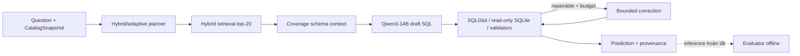

# Research 3 archive — Spider-200 128/200

**Archive branch:** `research_3_128`. **Packaged:** 2026-10-01, Asia/Bangkok.

**Purpose:** giữ độc lập snapshot nghiên cứu Schema Context coverage đạt 128/200 để so sánh với P6 và các vòng nghiên cứu trước. Đây là tên vòng lưu trữ của project; không đổi tên phương pháp Paper II/R2 thành một publication thứ ba.

## Snapshot và kết quả

**Inference source commit:** `389b8154054243ff00ac67e420f5d042b15f34fd`. Đây là commit ghi trong report `spider-schema-coverage-200-v2`, được tạo từ worktree Spider. Workspace chính ở `1f39654` thiếu hai guard/launcher commits sau đó; branch này lấy đúng `389b815` làm parent.

Code/runtime/prompts/tests/scripts/configs được giữ nguyên từ source đó. Commit đóng gói phía sau chỉ thêm/cập nhật documentation, slides và aggregate evidence; không thay generation hoặc gán kết quả lịch sử cho kiến trúc mới trong `codex_answer.md`.

| Chỉ số | Giá trị lịch sử |
|---|---:|
| Result-correct | **128/200 (64%)** |
| Database | 20 |
| Valid candidate / typed terminal | 199/200 · 200/200 |
| Easy / medium / hard / extra | 80/107 · 26/53 · 17/29 · 5/11 |
| Holdout / regression partition | 65/100 · 63/100 |
| P50 / P95 prediction | 69,89 / 156,86 giây |
| So P6 130/200 | 4 gain · 6 loss · net −2 |
| So R2 legacy 120/200 | 18 gain · 10 loss · net +8 |

Đây là local execution equivalence của Spider-dev subset, không official test-suite/full dev/hidden test score. Holdout đã bị exposed khi chẩn đoán. P6 dùng hardware/correction profile khác, nên latency không là matched architecture ablation. R2/coverage vẫn `IN_PROGRESS`; P6 không bị thay champion/default.

## Kiến trúc thực sự có trong snapshot



Cấu hình run: Qwen3-14B Q4, `num_gpu=1`, seed 42, temperature 0, `num_ctx=4096`, output cap 768, planning `hybrid`, retrieval `hybrid`, schema context `coverage`, candidate mode `legacy`, không semantic catalog/certified proof promotion; tối đa hai repairs. Schema budget 1.200 tokens/sáu bảng khi full catalog vừa, rộng hơn thì bounded selection/FK closure.

Code chứa champion–challenger và typed semantics từ R2, nhưng chúng **không chứng minh đóng góp vào phép đo Spider này**. Kiến trúc ít calls/SQL-specialist/critic mới trong `codex_answer.md` là proposal, chưa implementation của branch.

## Tài liệu và evidence

- [Báo cáo chính 128/200](comparison_new3_to_baseline_vn.md): architecture, control/treatment, paired analysis, failure và limitations.
- [Báo cáo trước](comparison_new2_to_baseline_vn.md): R2/Olist/history.
- [Aggregate JSON](docs/evidence/research_3_128_summary.json): source/report/model/manifest hashes, configs, metrics và observed resources; không chứa per-case predictions/gold.
- [Schema coverage evidence](docs/evidence/schema_context_coverage_2026_09_24.md): construction và ablation model-free; trạng thái ngày 24/9, đọc cùng final run ở báo cáo chính.
- [Canonical ledger](realistic_project_creation_codex.md): §25 đã sync aggregate evidence; giữ `IN_PROGRESS`.
- [Giáo án và kiến trúc tiếp theo](codex_answer.md): small-model literature, clause critics, A4500-specific tuning và kế hoạch ablation.
- [Quyết định nền phát triển](docs/research_plan/next_development_base.md): chọn P6 baseline làm nền logic cho nhánh phát triển riêng.
- [Slides Spider-200](<docs/slides/Báo cáo Kỹ thuật Spider-200 R2 vs P6.pdf>), [slides tiến độ](<docs/slides/Báo cáo Tiến độ Paper II so với Baseline P6.pdf>).

Report JSON gốc SHA-256 `18f7074b3f0ea8b86ee6dce6c2c30ab6d258bdb2d4d17580a229b29b1a60076c`; manifest hash `35382bd0641a0ae7a4e7ab3bcc7c02efce96fe4df8fb9b754599389eb43c5b4e`. Hash xác định artifact local đã đọc, không tái tạo được predictions khi thiếu data/model/index tương ứng. Gold, raw datasets, generated DB/index/trace/predictions, logs và weights giữ local/ignored; chat mentor và session scratch files không xuất bản.

## Ranh giới tái lập và hardware

Default `schema_context_mode` trong code vẫn `legacy` vì coverage là opt-in. Checkout branch này chưa tự bật cấu hình 128/200. Run tương lai phải pin model/index/catalog/DB/manifest/config và source mới; score có thể khác. Không resume checkpoint lịch sử từ commit documentation mới hoặc ghép prediction khác source.

Các tests semantic/Olist của snapshot cần canonical Olist database local; một số test mang tên unit vẫn đọc `data/processed/olist.sqlite`. Worktree mới thiếu fixture đó sẽ fail, chưa thể gọi suite là self-contained. Trong lượt archive, fixture Olist và Spider có sẵn được liên kết local/ignored chỉ để checks; không commit dữ liệu hoặc đổi tests để che dependency.

Read-only/non-LLM verification:

```bash
make check
```

Inference phải qua `scripts/launch_r2_spider_tmux.py` và guarded wrappers. Launcher yêu cầu `--schema-context-mode coverage`, evaluation ID mới, `--models-dir` hợp lệ và verified hard-cap confirmation; không chạy `scripts/run_benchmark.py` trực tiếp. Trước run: stale jobs vắng, idle safe, hard cap active và một guarded case pilot mới; chỉ tiếp tục checkpoint khi pilot pass.

Profile lịch sử coverage: một GPU layer, clock cap 300–700 MHz, batch 1, sampling 0,5 giây, unload/cooldown 60 giây, VRAM <4 GiB, nhiệt <65°C, power <70W, available RAM ≥14 GiB, swap <0,25 GiB. Observed peaks: 1.801 MiB VRAM, 57°C, 63,89 W; minimum available RAM 22,15 GiB, swap 0. Chưa calibrate profile này cho model mới; 16 GB vật lý không cho phép tăng guard limits.

Lượt archive không chạy model, đổi hard cap, tạo dataset/index hay retrain. Quy trình hiện hành là [AGENTS.md](AGENTS.md); commands/profile cũ trong docs chỉ là provenance nếu xung đột policy.

## Kiểm tra trước publication

**`make check` pass trên worktree archive:** Ruff, format 268 files, strict mypy 115 source files; **362 tests passed, 1 Ollama test deselected**, một Starlette/httpx deprecation warning. Dùng environment tách riêng và fixture Olist/Spider local đã có, không gọi model. Lượt checks đầu trên worktree chưa liên kết fixture bị fail do thiếu Olist; sau khi liên kết ignored data, full suite pass mà không thay code/tests.

Đã kiểm tra runtime/source directories không khác commit inference `389b815`; links của tài liệu đóng gói tồn tại; staged paths chỉ gồm tài liệu/slides/aggregate JSON, không raw data, generated DB/index, traces/predictions, logs hoặc secrets. Đóng gói không đánh dấu gate `VERIFIED`.
